# 1. Quick Start

## 1.1 UNO Q Quick Overview

**What is Arduino UNO Q?**

**Arduino UNO Q** is the most powerful UNO-form-factor development board in the Arduino family. It uses a **dual-processor architecture** and integrates two chips on one UNO-size board:

| Chip | Role | Capability |
|------|------|------------|
| **Qualcomm Dragonwing™ QRB2210** | Main processor, MPU | Runs full Debian Linux and handles high-load tasks such as AI, vision, and networking |
| **STM32U585** | Microcontroller, MCU | Runs Arduino sketches and handles real-time control, sensor reading, and pin operations |

> In simple terms: UNO Q combines a **mini Linux computer** with a **real-time control microcontroller**. The two processors communicate seamlessly through the built-in RPC bridge, Arduino Bridge or Router Bridge.

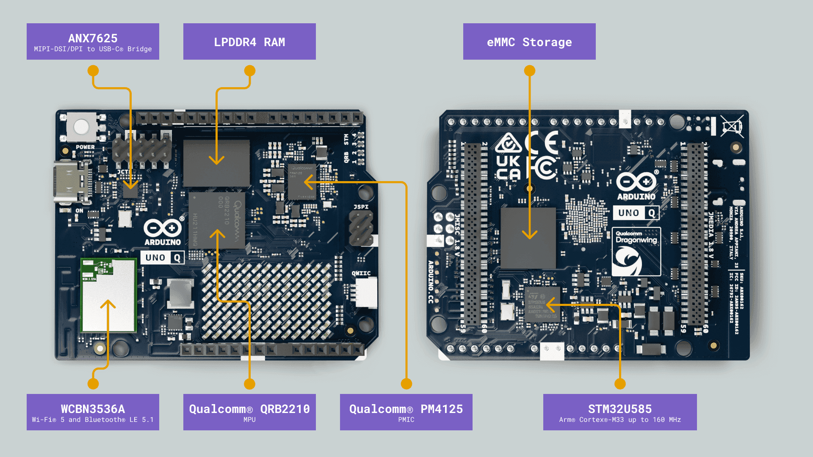

**Core specifications**

**Main processor: Qualcomm QRB2210**

| Specification | Parameter |
|---------------|-----------|
| CPU architecture | Quad-core Arm® Cortex®-A53 |
| Clock speed | 2.0 GHz |
| GPU | Adreno™ 3D graphics accelerator |
| ISP | Dual image signal processors, 13MP + 13MP or 25MP at 30fps |
| Operating system | Debian Linux |
| Memory | On-board LPDDR4 |

**Microcontroller: STM32U585**

| Specification | Parameter |
|---------------|:---------:|
| CPU architecture | Arm® Cortex®-M33 |
| Clock speed | Up to 160 MHz |
| Flash | 2 MB |
| SRAM | 786 KB |
| Floating-point unit | Hardware FPU |
| Operating system | Zephyr RTOS |

**On-board resources**

| Resource | Description |
|----------|-------------|
| **LED matrix** | 8×13 pixel LED matrix |
| **RGB LED** | LED1 and LED2, LED3 and LED4 |
| **Wireless connection** | WiFi® + Bluetooth® through the WCBN3536A module |
| **USB port** | USB-C® for power and data transfer |
| **GPIO pins** | Compatible with the standard Arduino UNO R3 and R4 pin layout |
| **Expansion interface** | Compatible with UNO Shields expansion boards |

## 1.2 Unboxing and Accessory Check

Open the package and check the accessories against the table below:

| Accessory | Quantity | Image |
|-----------|:--------:|-------|
| **Arduino UNO Q development board** | 1 pc | 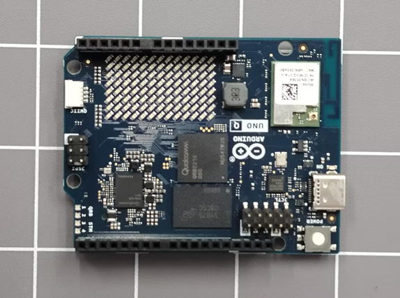 |
| **Black USB-C data cable** | 1 pc | 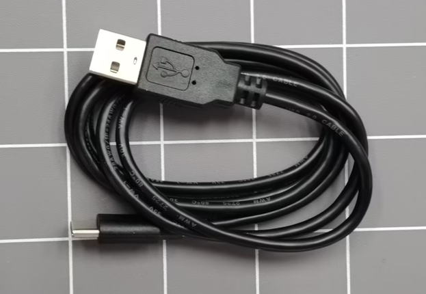 |
| **Quick Start Card** | 1 pc | 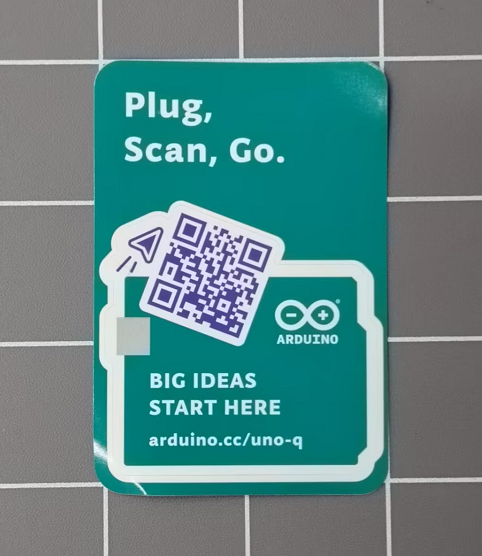 |
| **Product manual** | 1 copy | 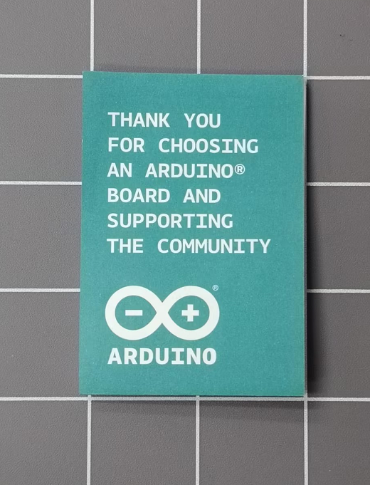 |

**Check points**

After receiving the development board, perform the following visual inspections:

- **Appearance integrity**: Check that the PCB is not damaged or scratched, the components are soldered securely, and there are no obvious signs of poor soldering or short circuits.
- **Port condition**: Check that the USB-C port is intact and the pin headers and sockets are straight without bending.
- **Indicator test**: Connect the development board to a computer with the USB-C cable. Check whether the power indicator, PWR, lights up normally to confirm the power circuit status.

**Notes**

- Use a data cable instead of a charging-only cable. A charging-only cable lacks the data channel required for program upload.
- The development board is sensitive to electrostatic discharge. Touch a grounded object before handling the board to release static electricity and avoid chip damage.
- If the indicator does not light up after power-on or the computer cannot recognize the serial device, check the cable and USB port first to avoid misjudging the board as faulty.
- Scan the QR code on the Quick Start Card to open the official [Arduino UNO Q product page](https://www.arduino.cc/en/uno-q) and obtain the full feature description and development resources.

If any accessory is missing or the board has obvious damage, contact after-sales support for replacement.

## 1.3 Power-On and Safe Wiring

**Connect the development board to the computer**

1. Take out the **USB-C data cable**.
2. Insert one end into the USB-C port on **Arduino UNO Q**.
3. Insert the other end into a USB port on the computer.

After power-on, wait for the system to start. After startup succeeds, a heartbeat display appears.

<table>
<tr>
<td>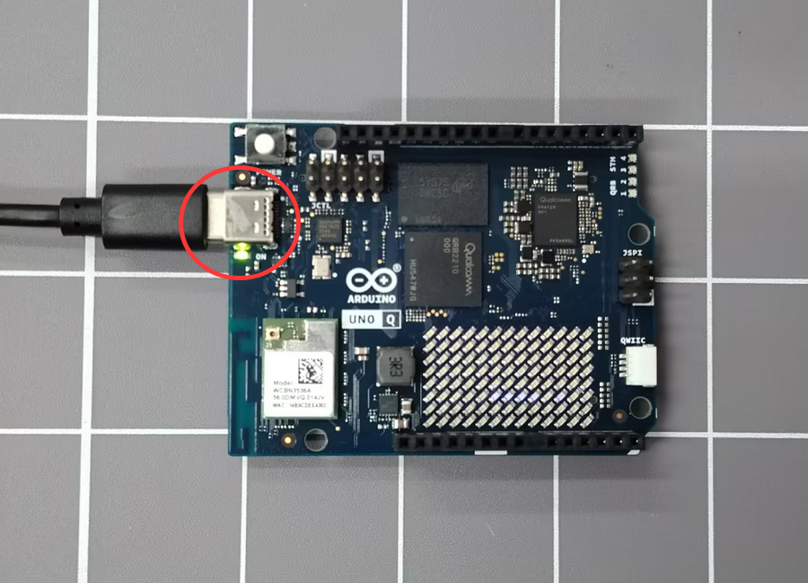<br><center>Connection</center></td>
<td>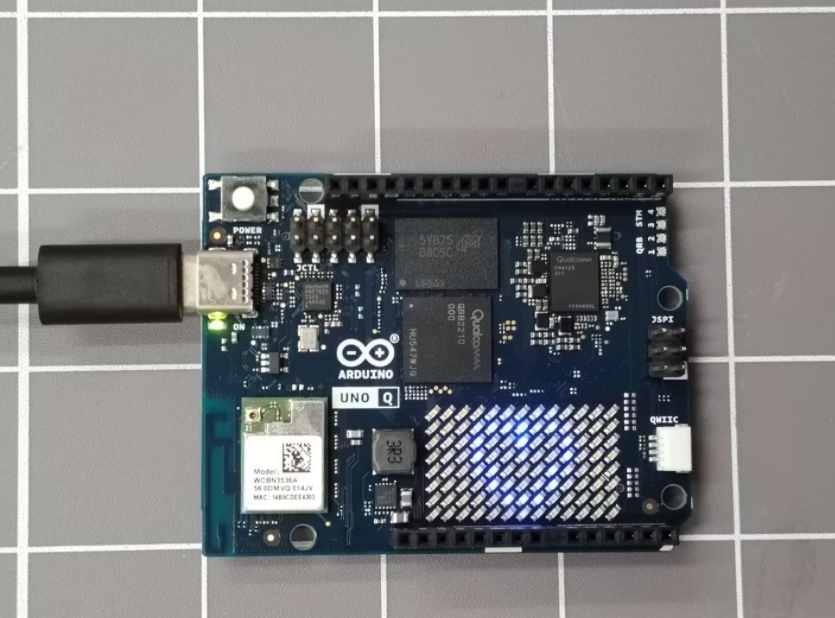<br><center>Startup successful</center></td>
</tr>
</table>

> [!Note]
> **If the development board is not recognized:**
>
> - **Replace the USB-C data cable. Some cables support charging only and do not support data transfer.**
> - **Unplug and reconnect the USB-C cable.**
> - **Check Device Manager for any device with an exclamation mark.**

---

## 1.4 Install Arduino App Lab

**Arduino App Lab** is a **hybrid development environment** designed for UNO Q. It integrates Python and Arduino in one project and allows the two chips to work together through **Router Bridge**.

Open [**2. Software & Programs\01 Arduino App Lab Installation Package**](https://drive.google.com/drive/folders/1BMDHwfAsRf4oxnnkh64XW4drAokY8JoR?usp=sharing) in the same directory as this document. Select the installer for the computer system, then double-click the installer. After installation is complete, the interface appears as shown below:

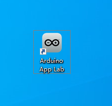

> If a driver installation prompt appears during installation, **accept all driver installation requests**. Otherwise, the development board cannot be recognized.

<p id="p1-5"></p>

## 1.5 Connect, Configure, and Update

**Before startup, connect Arduino UNO Q to the computer with a data cable.**

1. Open **Arduino App Lab** and wait for it to connect to the Arduino UNO Q development board.

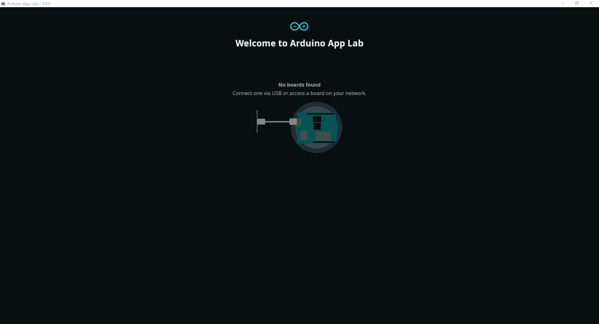

2. Connect to the Arduino UNO Q development board.

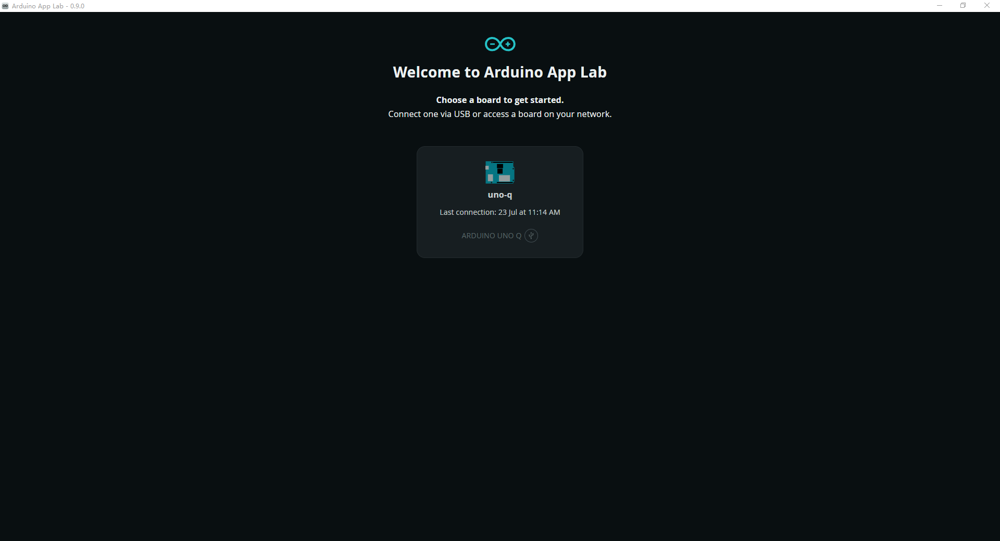

3. Configure the Arduino UNO Q development board.

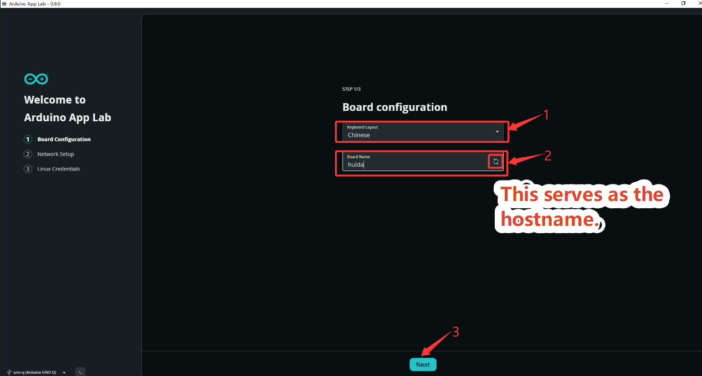

4. Configure networking for the Arduino UNO Q development board. This step can be skipped, but completing it first makes later use more convenient.

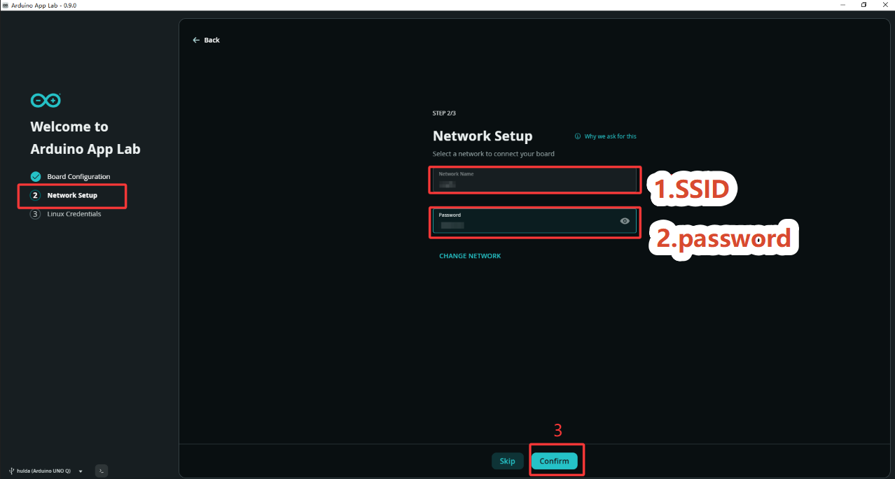

5. Set the Linux login password for the Arduino UNO Q development board.

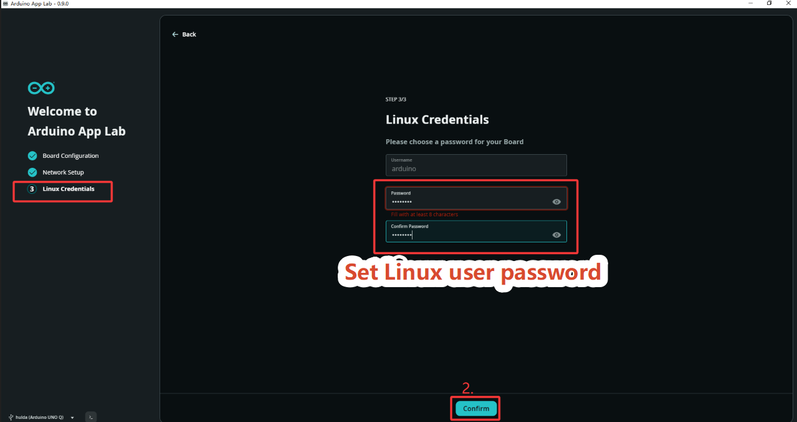

6. Wait for loading after configuration is complete.

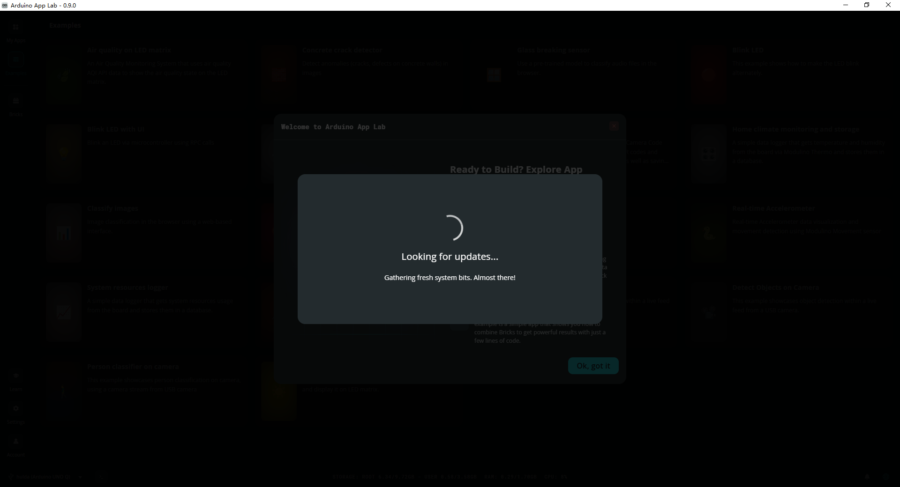

7. The system detects available updates. Components in the update list can be updated. These updates are not mandatory, and skipping them does not affect current use. To use the latest version of Arduino App Lab, click **Install updates**.

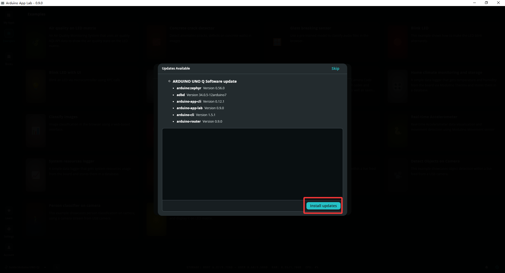

8. Wait for the update to complete.

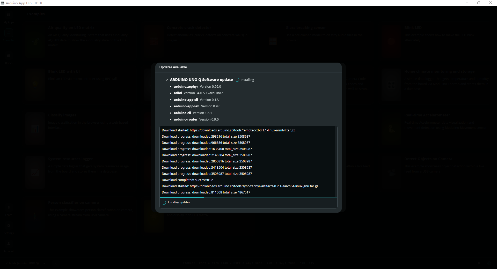

9. After the update is complete, click **Restart APP Lab**.

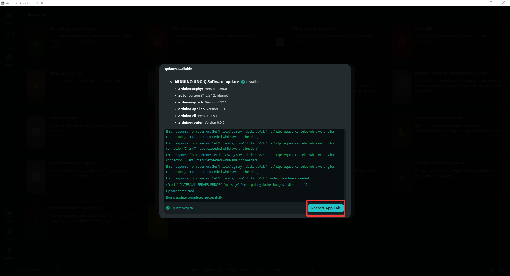

10. Start using App Lab.

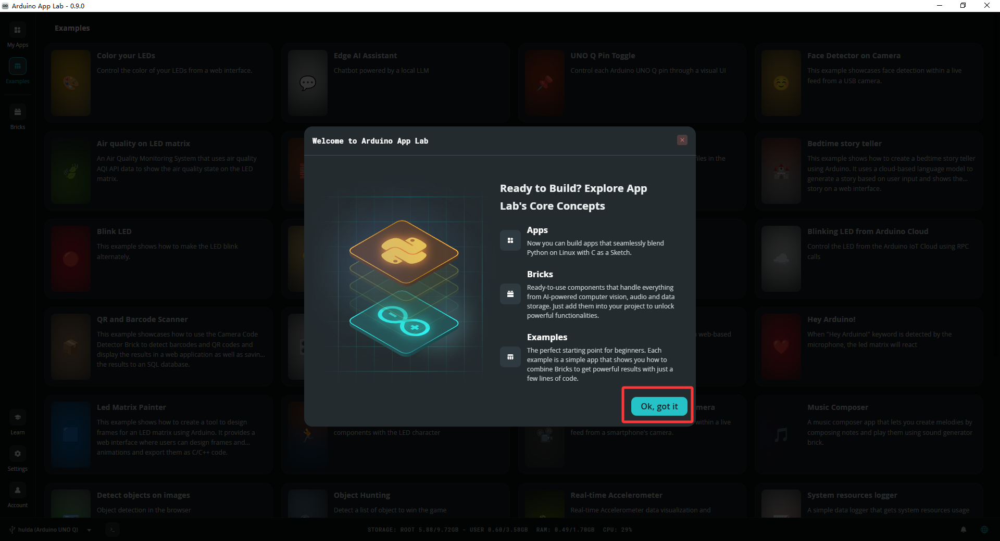

11. App Lab home screen with official examples.

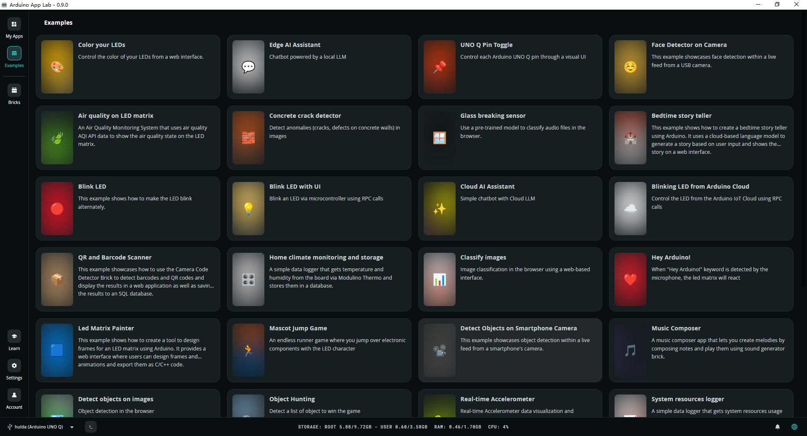

---

## 1.6 Select an Operating Mode

Arduino UNO Q supports three operating modes based on **where App Lab runs** and **how the board connects**:

|  Mode | Where App Lab runs | Connection method | Recommended use |
|--------------|--------------------|-------------------|----------|
| **PC Hosted Mode** | Computer | Direct USB-C connection | Daily development and debugging |
|  **SBC Mode** (Single-board computer mode) | UNO Q | Docking station, display, keyboard, and mouse | Standalone demonstrations and teaching |
|  **Network Mode** | Computer | WiFi LAN | Remote development and maintenance |


### 1.6.1 PC Hosted Mode

**PC Hosted Mode** is the most common development mode. App Lab is installed and runs on the computer. UNO Q connects to the computer through a USB-C data cable, which supplies power and transfers data through one cable.

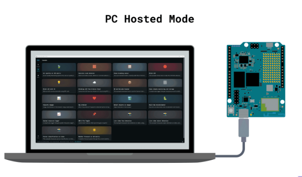

**Workflow:**

1. Connect UNO Q to a USB port on the computer with a USB-C data cable.
2. The on-board power indicator, PWR, lights up and UNO Q starts.
3. Open **Arduino App Lab** on the computer and wait for the development board to be recognized automatically.
4. After the development board appears in the device list, click it to connect and start development.

**Key features:**

| Feature | Description |
|---------|-------------|
| **Plug and play** | USB-C provides both power, 5V/3A, and a data channel |
| **Real-time debugging** | View Console logs, build output, and running status in App Lab |
| **Sufficient performance** | Code compilation and execution depend on the computer performance for a smooth experience |
| **Firmware update** | Flash a complete Linux system image through USB |

---

### 1.6.2 SBC Mode

**SBC Mode** uses UNO Q as an **independent mini Linux computer**. App Lab is preinstalled in the Debian system on UNO Q. Connect a display, keyboard, and mouse, then complete all development work directly on the board.

**Additional hardware required:**

UNO Q has only one USB-C port. Use a **USB-C multifunction docking station** to output video and connect peripherals at the same time.

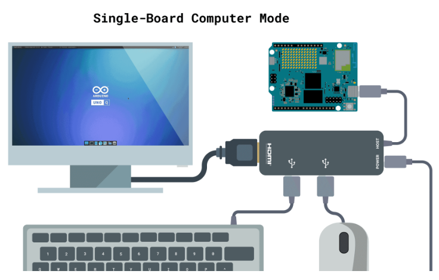

**Docking station requirements:**

| Function | Required | Description |
|----------|----------|-------------|
| **HDMI or DisplayPort** | Required | UNO Q outputs video through USB-C DisplayPort Alt Mode. The docking station converts the signal to HDMI or DP |
| **USB-C PD power input** | Required | Power UNO Q through the docking station, 5V/3A |
| **USB-A port** | Required | Connect the keyboard and mouse |
| Ethernet port | Optional | Wired network connection, which is more stable than WiFi |

**Startup process:**

1. Connect the docking station, display, keyboard, mouse, and power supply as shown above.
2. After power-on, UNO Q starts Debian Linux automatically and the desktop environment appears on the display.
3. Enter the Linux login password to log in. The password is set during first-time configuration in [section 1.5](#p1-5).
4. Double-click the **Arduino App Lab** icon on the desktop to start development.

**SBC Mode features:**

| Feature | Description |
|---------|-------------|
| **Fully independent** | No external computer is required. UNO Q itself is a Linux host |
| **App Lab runs on the board** | All compilation and execution are completed on the QRB2210 processor |
| **Suitable for demonstrations and teaching** | A board and a portable display are enough for a complete demonstration |
| **4GB version recommended** | The desktop experience on the 2GB version may lag |

---

### 1.6.3 Network Mode

**Network Mode** allows remote access to UNO Q through a **WiFi LAN**. App Lab still runs on the computer, but it discovers and connects to the board through the network. The experience is similar to direct USB connection, with no need to plug or unplug cables before development. The prerequisite is that the computer and UNO Q are on the **same LAN**. If Arduino UNO Q has already been configured for SBC Mode, it can still be accessed remotely through Arduino App Lab on the computer and Network Mode. Both modes can be used at the same time.

UNO Q uses the **mDNS** protocol, also known as Multicast DNS, to broadcast its presence on the LAN. App Lab scans automatically and displays available Network devices.

**First-time configuration: Connect UNO Q to WiFi**

1. Connect the development board through USB first, using PC Hosted Mode, and open App Lab.
2. Open **Settings** > **Wi-Fi Networks**.
3. Select the wireless network and enter the password.
4. UNO Q saves the network and connects automatically after later power-on.

**Connect with Network Mode:**

1. Open Arduino App Lab on the computer. Make sure the computer and UNO Q are on the **same LAN**, then wait for the system to scan for UNO Q on the LAN.

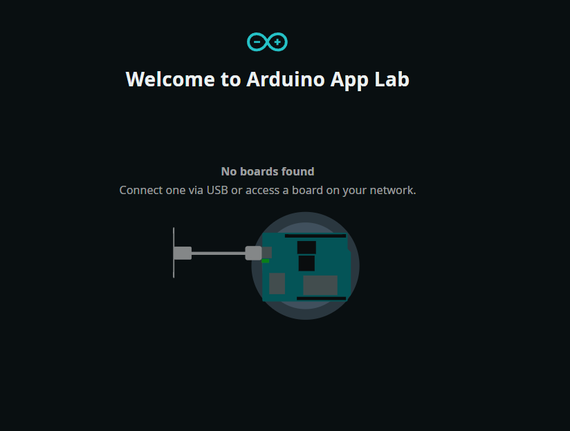

2. App Lab detects UNO Q.

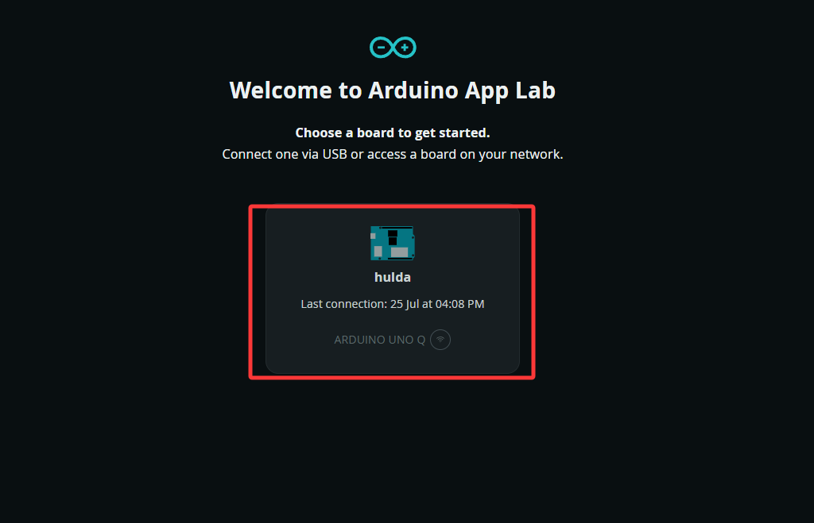

3. Click the development board and enter the Linux login password.

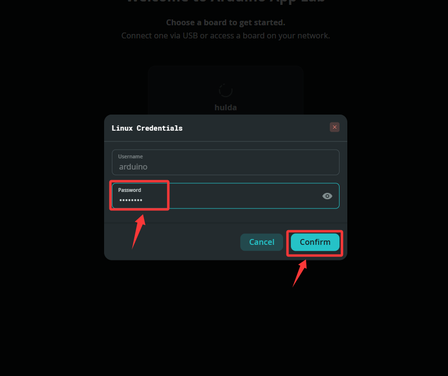

4. After connection succeeds, create projects, write code, and click **Run** just as with a direct USB connection.

> [!Note]
> **Troubleshooting:** If the development board cannot be found in Network Mode:
>
> - **Windows:** When App Lab starts for the first time, Windows Defender may display a network access request for `mdns-discovery.exe`. Click **Allow**.
> - **Network environment:** Enterprise networks, guest WiFi, VPNs, or strict firewalls may block mDNS discovery. Accessing the development board via its IP address is a good indication that Network Mode is available

## 1.7 Run an Official Example

This section uses the classic **Blink** example, with a direct USB-C connection, to demonstrate how to create and run an App Lab project.

**Create a new project**

1. In App Lab, click **Create new app** or the **+** button.

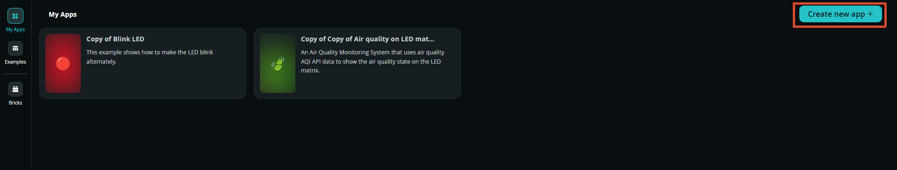

2. Enter the project name: `MyBlink`.

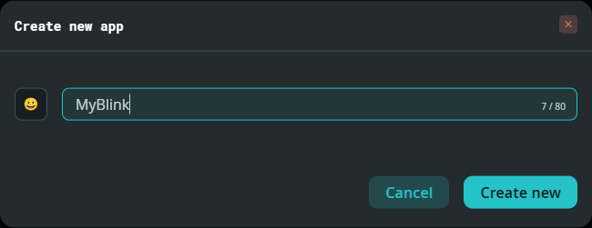

3. Click **Create new**.

App Lab automatically generates two files: `main.py` and `sketch.ino`.

**Project file overview**

After the project is created, the following project structure appears:

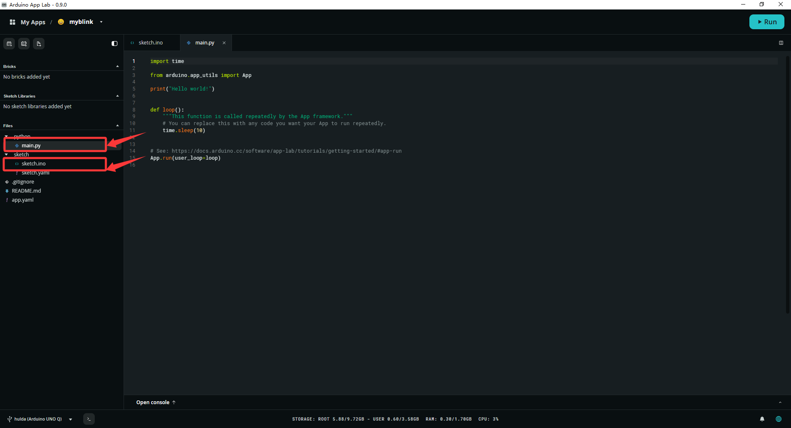

**Write Python code in main.py**

Double-click `main.py`, delete the default content, and enter the following code:

```python
from arduino.app_utils import *

if __name__ == "__main__":
    App.run()
```

> The only function of `App.run()` is to start the Router Bridge, enabling communication between the Python side and the Arduino side. For a purely MCU-based Blink example, the Python side only needs to start the runtime.

**Write Arduino code in sketch.ino**

Double-click `sketch.ino` and enter the following code:

```cpp
#include "Arduino_RouterBridge.h"

void setup() {
    // Initialize the built-in LED pin
    pinMode(LED_BUILTIN, OUTPUT);

    // Start Router Bridge and connect to the Python side
    Bridge.begin();
}

void loop() {
    digitalWrite(LED_BUILTIN, HIGH);  // Turn on
    delay(1000);                       // Wait 1 second
    digitalWrite(LED_BUILTIN, LOW);   // Turn off
    delay(1000);                       // Wait 1 second
}
```

**Run the program**

After confirming that both files have been saved:

1. Make sure UNO Q is connected to the computer through USB-C.
2. Confirm that the development board has been recognized in App Lab.
3. Click **Run** on the toolbar.

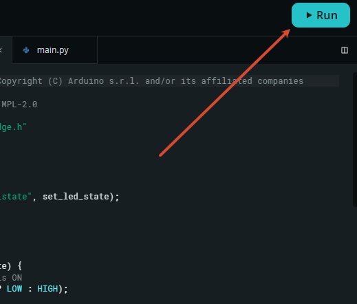

App Lab then performs the following steps in sequence:

1. Compile and deploy `sketch.ino` to the STM32 MCU.
2. Start `main.py` on the QRB2210 Linux side.
3. Establish the Router Bridge communication link.

After deployment succeeds, the **LED3 red channel on UNO Q starts blinking at 1 second intervals**. The complete project workflow from creation to execution is now finished.

## 1.8 Copy and Modify an Example

<p id="p1-8-1"></p>

### 1.8.1 Program Download

Based on the official Blink example, modify the code to produce different effects. Starting from this section, case code is provided directly. Import and use the case code from the product materials. Before that, quickly learn how to import a project and download the program.

1. Connect the **Arduino UNO Q** development board to the PC with a **Type-C** data cable, as shown below:


2. Open **Arduino App Lab**. After the device starts successfully, click the **Arduino UNO Q** development board icon to connect.


3. Click the **My Apps** icon in the upper-left corner to import the project.


4. Use the **mcu_telemetry** project as an example. Drag the corresponding project zip package into the window.


5. After the import success prompt appears, click the corresponding project icon to enter the project.


6. In the project, click the **Run** button in the upper-right corner to run the current project.


7. To run the program automatically after the development board powers on, configure it as shown below.


### 1.8.2 Modify Blink Timing 1

**Program Download**

Find the [**2. Software & Programs\02 Source Code\1. Quick Start\1.MyBlink_speed01.zip**](https://drive.google.com/drive/folders/1asduVNKJuP9URf5f1c5UPn9TGHINRxK8?usp=sharing) source package in the same directory as this document and import it. Refer to [1.8.1 Program Download](#p1-8-1) for the detailed download procedure.

**Project Outcome**

After the program is uploaded to Arduino UNO Q, the on-board LED blinks quickly. The effect is more obvious than the original 1 second interval. Specifically, the LED turns on and off rapidly at 0.2 second intervals, blinking about 2.5 times per second for a fast flashing effect.

**Program Analysis**

The header file imports the RouterBridge library to connect MCU and Linux communication:

```cpp
#include "Arduino_RouterBridge.h"
```

In `setup`, configure the LED pin and start Bridge:

```cpp
pinMode(LED_BUILTIN, OUTPUT);
Bridge.begin();
```

In `loop`, the four lines of code form one blink cycle. The 200 ms delay determines the blink speed:

```cpp
digitalWrite(LED_BUILTIN, HIGH);  // Turn on
delay(200);
digitalWrite(LED_BUILTIN, LOW);   // Turn off
delay(200);
```

### 1.8.3 Modify Blink Timing 2

**Program Download**

Find the [**2. Software & Programs\02 Source Code\1.Quick Start\2.MyBlink_speed02.zip**](https://drive.google.com/drive/folders/1asduVNKJuP9URf5f1c5UPn9TGHINRxK8?usp=sharing) source package in the same directory as this document and import it. Refer to [1.8.1 Program Download](#p1-8-1) for the detailed download procedure.

**Project Outcome**

The LED repeatedly plays the SOS distress signal: three short blinks, three long blinks, and three short blinks. After the full sequence, it pauses for 1 second and repeats.

**Program Analysis**

The S signal uses a `for` loop to create three quick blinks. Each on and off duration is 200 ms:

```cpp
for (int i = 0; i < 3; i++) {
    digitalWrite(LED_BUILTIN, HIGH);
    delay(200);
    digitalWrite(LED_BUILTIN, LOW);
    delay(200);
}
```

The O signal also loops three times, but the on duration is extended to 600 ms to create long blinks:

```cpp
for (int i = 0; i < 3; i++) {
    digitalWrite(LED_BUILTIN, HIGH);
    delay(600);
    digitalWrite(LED_BUILTIN, LOW);
    delay(200);
}
```

Use `delay(300)` to separate letters. Use `delay(1000)` after the full sequence before the next loop.

## 1.9 View the App Page and Console Logs

**App Lab home screen navigation**

After App Lab starts, the left sidebar contains the following function areas:

| Navigation item | Description |
|-----------------|-------------|
| **My Apps** | View, edit, and manage created or copied apps |
| **Examples** | Browse built-in and ready-made Arduino projects |
| **Bricks** | Explore modular code blocks, such as web servers or AI models |
| **Learn** | Access offline documents and tutorials |
| **Settings** | Manage preferences, including Wi-Fi networks, Linux password, and keyboard layout |
| **Account** | View Arduino account settings |

**App Lab home screen:**

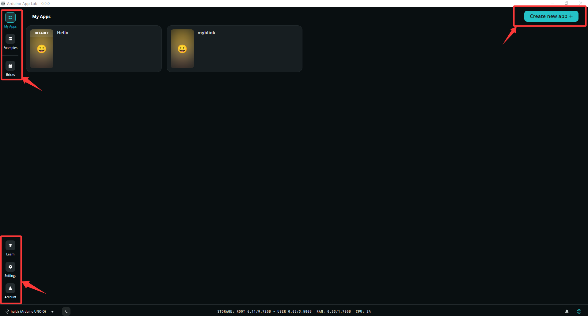

**View Console logs and output**

The output panel at the bottom of App Lab displays program logs, build information, and error messages. When a program has a problem, **check the Console output first** to locate the issue quickly.

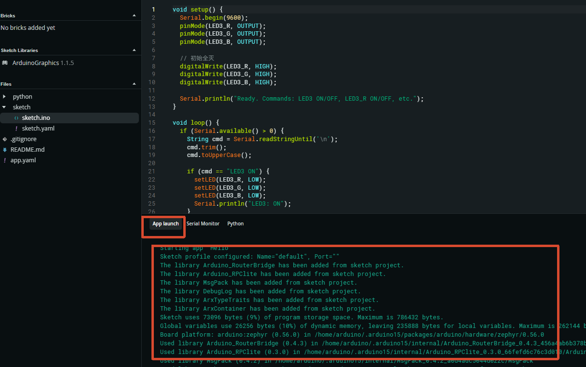

## 1.10 FAQs

**Q1: Nothing happens after clicking Run, and the LED does not light up**

> **Check:**
>
> 1. Check whether the USB-C cable is securely connected. Try using another cable, such as a charging cable or a data cable.
> 2. Confirm that the pin has been initialized with `pinMode(pin, OUTPUT)`.
> 3. Check whether the output panel at the bottom of App Lab shows any error messages.

**Q2: Bridge.call() reports "function not found"**

> **Cause:** The Python side does not expose the function with `Bridge.provide()`, or the function names are inconsistent.
>
> **Solution:** Make sure `Bridge.provide("xxx", xxx)` on the Python side and `Bridge.call("xxx")` on the Arduino side use exactly the same name.

**Q3: Compilation reports "Arduino_RouterBridge.h not found"**

> **Cause:** App Lab did not load the Router Bridge library correctly.
>
> **Solution:** Make sure **Arduino UNO Q** is selected as the target device when creating the project. App Lab automatically adds the required library dependencies.

**Q4: How do changes on the Python side take effect?**

> Click **Run** to redeploy code on both sides. If only `main.py` is modified, App Lab may support `hot reload` without reflashing the MCU, but a complete **Run** is recommended each time.

**Q5: Can Arduino IDE replace App Lab for development?**

> Yes. However, App Lab hybrid development capability, Python + Bridge, will not be available. For pure MCU programming, Arduino IDE is simpler. See the [Arduino IDE development guide](https://docs.arduino.cc/software/ide/).

**Q6: Can App Lab projects be shared with Arduino IDE?**

> The `.ino` file can be shared, but `main.py` is specific to App Lab. To open the project in Arduino IDE, import only `sketch.ino`, and remove `#include "Arduino_RouterBridge.h"` and `Bridge.begin()`.
