# 2. Arduino UNO Q Hardware Basics

This chapter covers basic hardware use for **Arduino UNO Q**, including on-board LED matrix display, digital input and output, PWM lighting effects, and serial communication. These are the core hardware control capabilities of UNO Q and the foundation for MCU-side programs in later chapters. All experiments in this chapter are completed in Arduino App Lab and can run without external modules.

<p id="p2-1"></p>

## 2.1 Program Download (Must Read)

1. Connect the **Arduino UNO Q** development board to the PC with a **Type-C** data cable, as shown below:


2. Open **Arduino App Lab**. After the device starts successfully, click the **Arduino UNO Q** development board icon to connect.

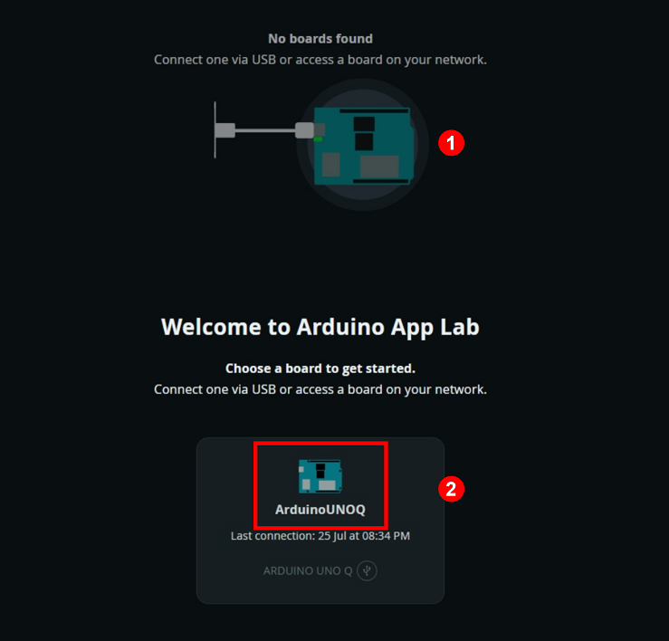

3. Click the **My Apps** icon in the upper-left corner to import the project.


4. Drag the corresponding project zip package into the window.

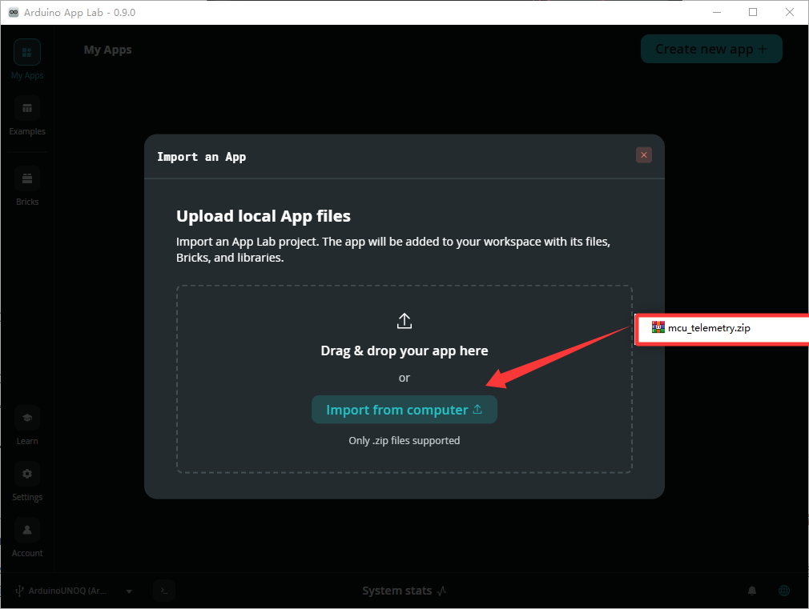

5. After the import success prompt appears, click the corresponding project icon to enter the project.

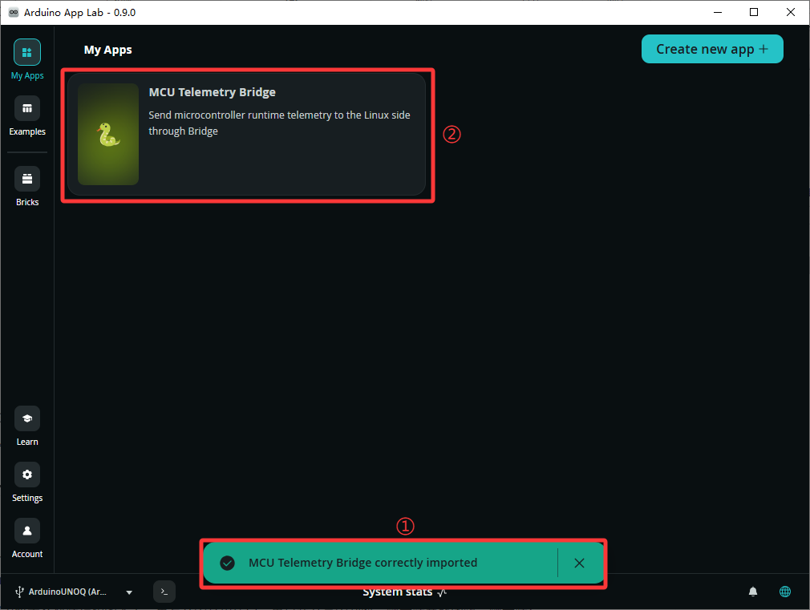

6. In the project, click the **Run** button in the upper-right corner to run the current project.

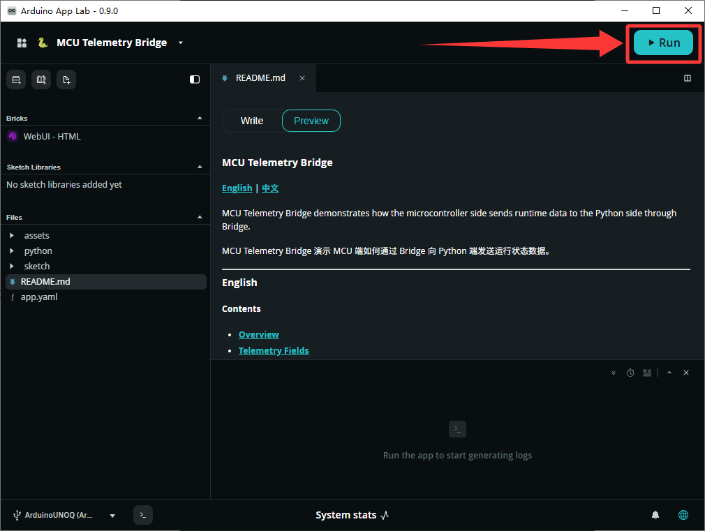

7. To run the program automatically after the development board powers on, configure it as shown below.

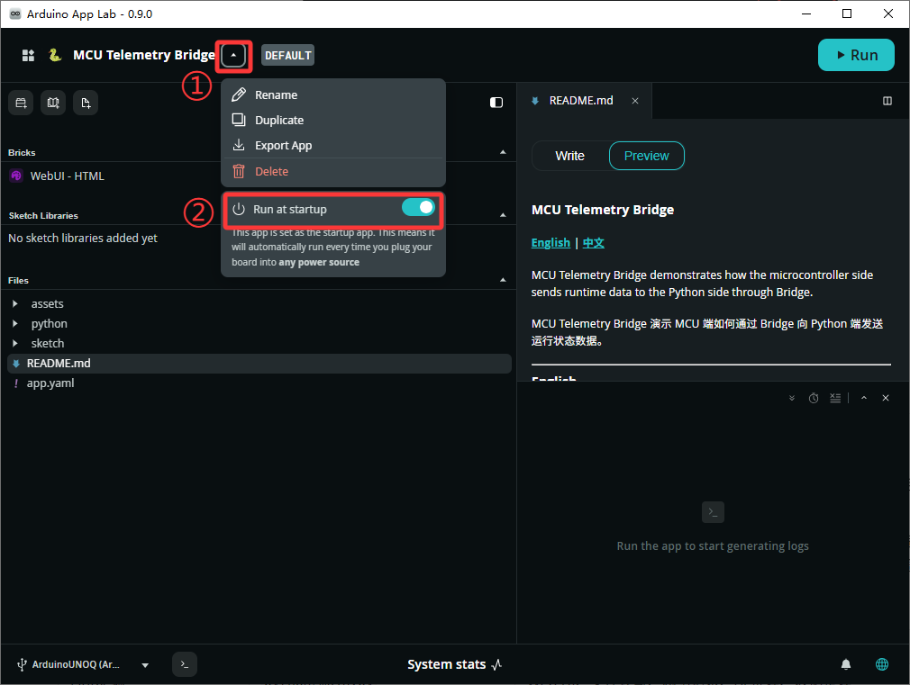

## 2.2 On-Board LED Matrix

### 2.2.1 Experiment Overview

Arduino UNO Q has an **8×13 blue LED matrix** managed directly by the STM32 microcontroller, with 104 LED pixels in total. A program can control each pixel on or off to display text, icons, and simple animations. This experiment includes two exercises. First, scroll English text on the matrix. Then, alternate between two heart patterns to create a pulsing animation.

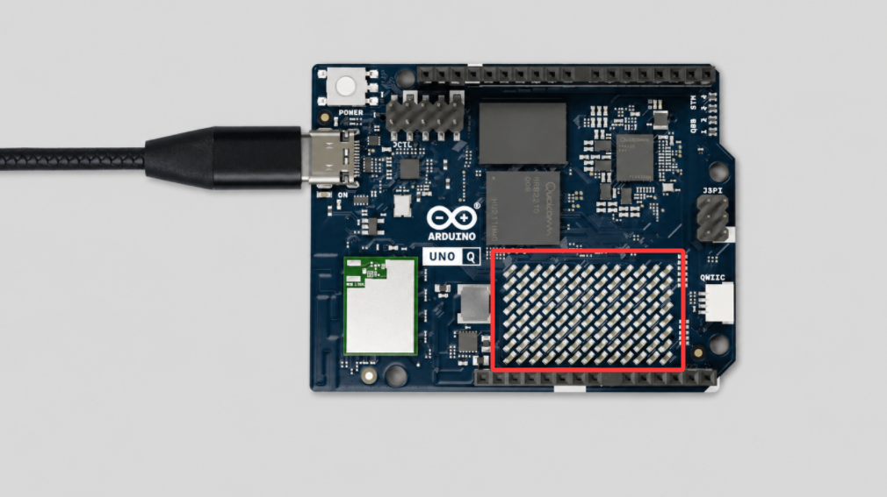

### 2.2.2 Program Download

Text display: Find the [**2. Software & Programs\02 Source Code\2. Arduino UNO Q Hardware Basics\2.1 led_matrix_text.zip**](https://drive.google.com/drive/folders/1S7CEFenebQMZ755vOiYnDN7UNDqkiGMA?usp=sharing) source package in the same directory as this document and import it. Refer to [2.1 Program Download (Must Read)](#p2-1) for the detailed download procedure.

Heart animation: Find the [**2. Software & Programs\02 Source Code\2. Arduino UNO Q Hardware Basics\2.2 led_matrix_heart.zip**](https://drive.google.com/drive/folders/1S7CEFenebQMZ755vOiYnDN7UNDqkiGMA?usp=sharing) source package in the same directory as this document and import it. Refer to [2.1 Program Download (Must Read)](#p2-1) for the detailed download procedure.

### 2.2.3 Project Outcome

**Text display**: The matrix scrolls the configured English text from right to left. After the text reaches the left side, it pauses for 1 second and then starts again. The text content and scroll speed can be adjusted in the program.

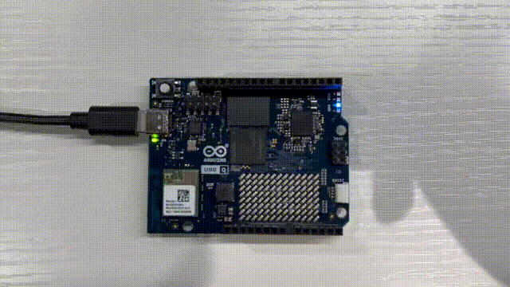

**Heart animation**: A small heart and a large heart display alternately at 300 ms intervals, forming a looping pulsing animation.

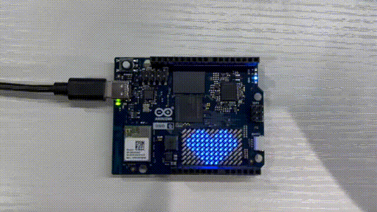

### 2.2.4 Program Analysis

* **Text display: sketch.ino file**

Import the LED matrix libraries and create a matrix object:

```cpp
#include <ArduinoGraphics.h>
#include <Arduino_LED_Matrix.h>

Arduino_LED_Matrix matrix;
```

Initialize the matrix, set the font, and set the scroll speed in `setup`:

```cpp
matrix.begin();
matrix.textFont(Font_5x7);
matrix.textScrollSpeed(100);
```

`textScrollSpeed(100)` controls the scroll speed. A smaller value makes the text scroll faster.

Implement scrolling text display in `loop`:

```cpp
matrix.beginText(0, 0, 127, 0, 0);
matrix.print("      HELLO       ");
matrix.endText(SCROLL_LEFT);
delay(1000);
```

| Code | Function |
|---|---|
| `matrix.beginText(0, 0, 127, 0, 0)` | Sets the text color. R=127 indicates half-brightness blue |
| `matrix.print(...)` | Sets the text to display. Spaces at the beginning and end provide margins |
| `matrix.endText(SCROLL_LEFT)` | Scrolls the text to the left |
| `delay(1000)` | Pauses for 1 second after scrolling ends |

* **Heart animation: sketch.ino file**

Define two pattern arrays with 8 rows × 13 columns. `1` means on, and `0` means off:

```cpp
uint8_t smallHeart[8][13] = {
  {0, 0, 0, 0, 0, 0, 0, 0, 0, 0, 0, 0, 0},
  {0, 0, 0, 0, 1, 0, 0, 0, 1, 0, 0, 0, 0},
  // ... 8 rows in total
};

uint8_t bigHeart[8][13] = {
  {0, 0, 0, 1, 1, 0, 0, 0, 1, 1, 0, 0, 0},
  // ... 8 rows in total
};
```

Render the two patterns alternately in `loop`:

```cpp
matrix.renderBitmap(smallHeart, 8, 13);
delay(300);
matrix.renderBitmap(bigHeart, 8, 13);
delay(300);
```

| Code | Function |
|---|---|
| `matrix.renderBitmap(smallHeart, 8, 13)` | Displays the small heart pattern |
| `matrix.renderBitmap(bigHeart, 8, 13)` | Displays the large heart pattern |
| `delay(300)` | Keeps each pattern displayed for 300 ms. A smaller value makes the animation faster |

## 2.3 Pins and Digital Input/Output

### 2.3.1 Experiment Overview

UNO Q has 47 digital pins controlled by the STM32 microcontroller, and 22 of them are brought out through UNO-style headers. Digital pins can work as outputs to control LEDs or as inputs to read external logic levels. This experiment includes two exercises. Use the on-board RGB LED to practice digital output. Use pin A1 with a Dupont wire to practice digital input.

The on-board RGB LED turns on at a low logic level:

| Output level | LED status |
|---|---|
| `LOW` | On |
| `HIGH` | Off |

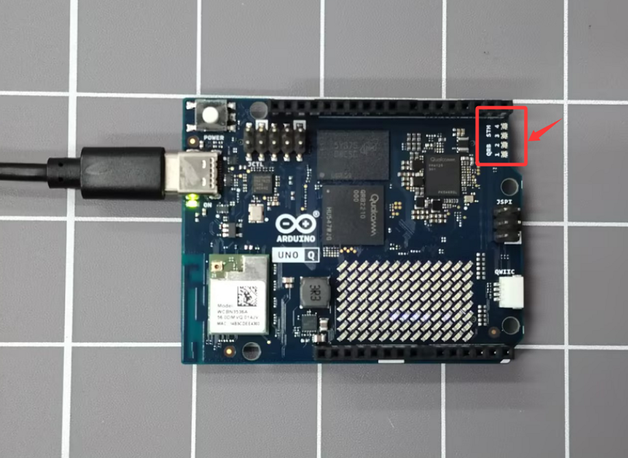

### 2.3.2 Program Download

Digital output: Find the [**2. Software & Programs\02 Source Code\2. Arduino UNO Q Hardware Basics\2.3 digital_out_rgb.zip**](https://drive.google.com/drive/folders/1S7CEFenebQMZ755vOiYnDN7UNDqkiGMA?usp=sharing) source package in the same directory as this document and import it. Refer to [2.1 Program Download (Must Read)](#p2-1) for the detailed download procedure.

Digital input: Find the [**2. Software & Programs\02 Source Code\2. Arduino UNO Q Hardware Basics\2.4 digital_in_pullup.zip**](https://drive.google.com/drive/folders/1S7CEFenebQMZ755vOiYnDN7UNDqkiGMA?usp=sharing) source package in the same directory as this document and import it. Refer to [2.1 Program Download (Must Read)](#p2-1) for the detailed download procedure.

### 2.3.3 Project Outcome

**Digital output**: The red, green, and blue channels of the on-board RGB LED turn on in sequence. Each color stays on for 1 second, then the sequence repeats.

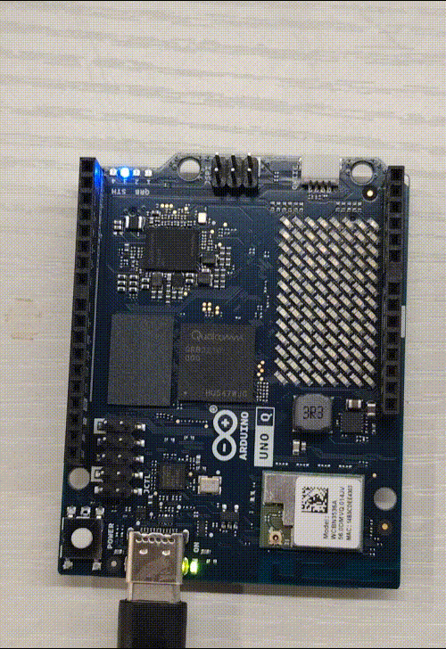

**Digital input**: After opening the **Serial Monitor**, the output is `HIGH` when A1 is not connected to GND. After connecting A1 to GND with a wire, the output changes to `LOW`, simulating a button press.

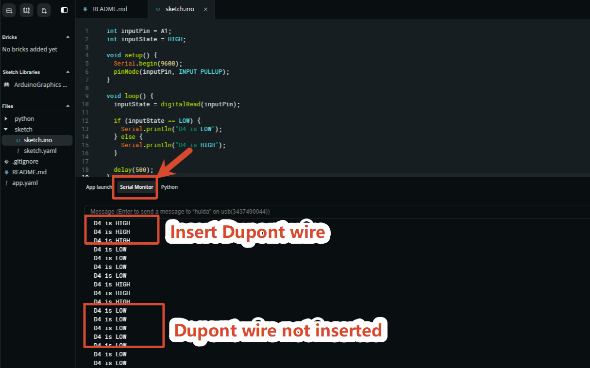

### 2.3.4 Program Analysis

* **Digital output: sketch.ino file**

Configure the three pins as outputs in `setup`, then turn off all three channels:

```cpp
pinMode(LED3_R, OUTPUT);
pinMode(LED3_G, OUTPUT);
pinMode(LED3_B, OUTPUT);
digitalWrite(LED3_R, HIGH);
digitalWrite(LED3_G, HIGH);
digitalWrite(LED3_B, HIGH);
```

In `loop`, set only the target pin to `LOW` and keep the other pins at `HIGH` to turn on a single color:

```cpp
digitalWrite(LED3_R, LOW);   // Red on
digitalWrite(LED3_G, HIGH);  // Green off
digitalWrite(LED3_B, HIGH);  // Blue off
delay(1000);
```

| Code | Function |
|---|---|
| `pinMode(LED3_R, OUTPUT)` | Sets the red LED pin to output mode |
| `digitalWrite(LED3_R, LOW)` | Turns on the red LED. The LED turns on at a low logic level |
| `digitalWrite(LED3_R, HIGH)` | Turns off the red LED |
| `delay(1000)` | Keeps each color on for 1 second |

* **Digital input: sketch.ino file**

Use `INPUT_PULLUP` to enable the internal pull-up resistor:

```cpp
pinMode(inputPin, INPUT_PULLUP);
```

Read the pin level and print it in `loop`:

```cpp
inputState = digitalRead(inputPin);
if (inputState == LOW) {
  Serial.println("A1 is LOW");
} else {
  Serial.println("A1 is HIGH");
}
delay(500);
```

| Code | Function |
|---|---|
| `pinMode(inputPin, INPUT_PULLUP)` | Enables the internal pull-up resistor. When A1 is not connected, it reads `HIGH` by default |
| `digitalRead(inputPin)` | Reads the current logic level of A1 |
| `LOW` | A1 is connected to GND |
| `HIGH` | A1 is not connected to GND |

## 2.4 PWM and Lighting Effects

### 2.4.1 Experiment Overview

`analogWrite()` can output a PWM signal from 0 to 255 and control LED brightness by changing the duty cycle. This experiment uses PWM to create a breathing effect on the on-board RGB LED. The red, green, and blue channels brighten and dim in sequence, then repeat. The program wraps the process from 0 to 255 and then back to 0 into one complete breathing cycle through the `breathe()` function.

### 2.4.2 Program Download

Find the [**2. Software & Programs\02 Source Code\2. Arduino UNO Q Hardware Basics\2.5 pwm_rgb_breathe.zip**](https://drive.google.com/drive/folders/1S7CEFenebQMZ755vOiYnDN7UNDqkiGMA?usp=sharing) source package in the same directory as this document and import it. Refer to [2.1 Program Download (Must Read)](#p2-1) for the detailed download procedure.

### 2.4.3 Project Outcome

The on-board RGB LED breathes in red, green, and blue sequence. Each color completes one full transition from dim to bright and then back to dim within 3 seconds, creating a slow breathing-light effect.

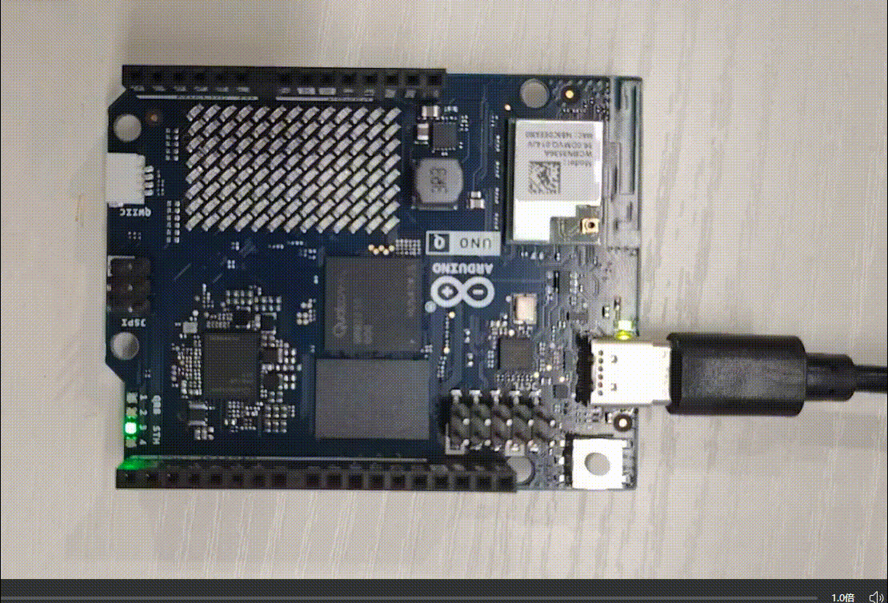

### 2.4.4 Program Analysis

* **sketch.ino file**

Wrap the `breathe()` function. It receives the pin number and total duration as two parameters:

```cpp
void breathe(int pin, int duration_ms) {
  for (int i = 0; i <= 255; i++) {
    analogWrite(pin, i);
    delay(duration_ms / 512);
  }
  for (int i = 255; i >= 0; i--) {
    analogWrite(pin, i);
    delay(duration_ms / 512);
  }
}
```

Call the three color channels in sequence in `loop`:

```cpp
breathe(LED3_R, 3000);
breathe(LED3_G, 3000);
breathe(LED3_B, 3000);
```

| Code | Function |
|---|---|
| `analogWrite(pin, value)` | Outputs a PWM signal to the specified pin. The `value` range is 0 to 255, where 0 is the darkest and 255 is the brightest |
| `breathe(pin, duration_ms)` | Completes one full breathing cycle from brightening to dimming. `duration_ms` controls the total duration |
| `delay(duration_ms / 512)` | Divides the total breathing duration into 512 steps, 256 brightening steps and 256 dimming steps, to control the transition speed |
| `LED3_R / LED3_G / LED3_B` | Red, green, and blue channel pins of the on-board RGB LED |

## 2.5 Serial Monitoring and Control

### 2.5.1 Experiment Overview

`Serial` is the most basic method for debugging MCU programs. This experiment includes two exercises. View runtime logs through the **Serial Monitor**, then send text commands through the serial port to control the on-board RGB LED. The log exercise uses `millis()` for non-blocking reporting once per second. The command exercise uses `Serial.readStringUntil()` to receive commands, then parses and executes them.

### 2.5.2 Program Download

Log viewing: Find the [**2. Software & Programs\02 Source Code\2. Arduino UNO Q Hardware Basics\2.6 serial_log_uptime.zip**](https://drive.google.com/drive/folders/1S7CEFenebQMZ755vOiYnDN7UNDqkiGMA?usp=sharing) source package in the same directory as this document and import it. Refer to [2.1 Program Download (Must Read)](#p2-1) for the detailed download procedure.

Serial control: Find the [**2. Software & Programs\02 Source Code\2. Arduino UNO Q Hardware Basics\2.7 serial_cmd_rgb.zip**](https://drive.google.com/drive/folders/1S7CEFenebQMZ755vOiYnDN7UNDqkiGMA?usp=sharing) source package in the same directory as this document and import it. Refer to [2.1 Program Download (Must Read)](#p2-1) for the detailed download procedure.

### 2.5.3 Project Outcome

**View runtime logs**: After opening the **Serial Monitor** and setting the baud rate to 9600, one status line is output every second, including uptime and loop count.

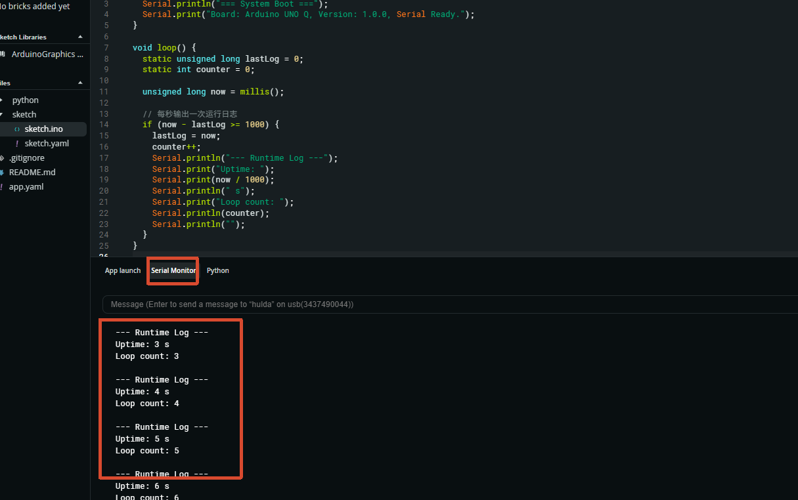

**Send commands**: Enter a command with a newline at the end in the **Serial Monitor** input box and send it to control the RGB LED on or off. Supported commands include `LED3 ON/OFF` and `LED3_R ON/OFF`. Enter `STATUS` to query the current status.

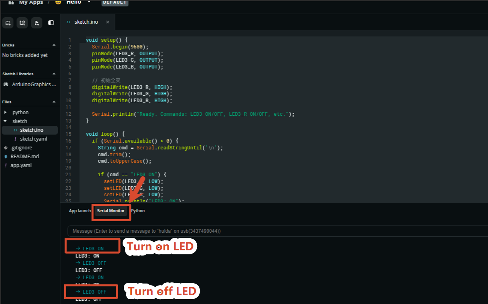

### 2.5.4 Program Analysis

* **View runtime logs: sketch.ino file**

Initialize the serial port and print startup information in `setup`:

```cpp
Serial.begin(9600);
Serial.println("=== System Boot ===");
```

Use `millis()` in `loop` for non-blocking timing and report once per second:

```cpp
if (now - lastLog >= 1000) {
  lastLog = now;
  counter++;
  Serial.print("Uptime: ");
  Serial.print(now / 1000);
  Serial.println(" s");
}
```

| Code | Function |
|---|---|
| `Serial.begin(9600)` | Initializes serial communication with a baud rate of 9600 |
| `Serial.print()` | Outputs content without a line break |
| `Serial.println()` | Outputs content and automatically adds a line break |
| `millis()` | Returns the number of milliseconds since the program started |
| `static` variable | Initializes only on the first call, then keeps the previous value |
| `if (now - lastLog >= 1000)` | Performs non-blocking timing once per second without blocking `loop()` |

* **Send commands: sketch.ino file**

Receive and parse serial commands in `loop`:

```cpp
if (Serial.available() > 0) {
  String cmd = Serial.readStringUntil('\n');
  cmd.trim();
  cmd.toUpperCase();

  if (cmd == "LED3 ON") {
    setLED(LED3_R, LOW);
    setLED(LED3_G, LOW);
    setLED(LED3_B, LOW);
    Serial.println("LED3: ON");
  }
  else if (cmd == "LED3 OFF") { ... }
}
```

| Code | Function |
|---|---|
| `Serial.available()` | Checks whether data is available in the serial receive buffer |
| `Serial.readStringUntil('\n')` | Reads a string until the newline character |
| `cmd.trim()` | Removes extra spaces and carriage return characters at the beginning and end |
| `cmd.toUpperCase()` | Converts the command to uppercase so command matching is not case-sensitive |

**Supported commands**:

| Command | Effect |
|---|---|
| `LED3 ON` | Turns on all RGB channels |
| `LED3 OFF` | Turns off all RGB channels |
| `LED3_R ON` / `LED3_R OFF` | Controls the red LED separately |
| `LED3_G ON` / `LED3_G OFF` | Controls the green LED separately |
| `LED3_B ON` / `LED3_B OFF` | Controls the blue LED separately |
| `STATUS` | Queries the current status of the three LEDs |
