# 3. Linux and Python Development

The QRB2210 main processor on Arduino UNO Q runs the full **Debian Linux 13 (Trixie)** operating system, with a quad-core Cortex-A53 processor at 2.0 GHz. This chapter covers common operations for using the Linux terminal and Python on UNO Q.

<p id="p3-1"></p>

## 3.1 Program Download (Must Read)

1. Connect the **Arduino UNO Q** development board to the PC with a **Type-C** data cable, as shown below:


2. Open **Arduino App Lab**. After the device starts successfully, click the **Arduino UNO Q** development board icon to connect.


3. Click the **My Apps** icon in the upper-left corner to import the project.


4. Use the **mcu_telemetry** project as an example. Drag the corresponding project zip package into the window.


5. After the import success prompt appears, click the corresponding project icon to enter the project.


6. In the project, click the **Run** button in the upper-right corner to run the current project.


7. To run the program automatically after the development board powers on, configure it as shown below.


## 3.2 Open the Terminal and Locate Files

UNO Q provides several ways to open the Linux terminal. This case uses the terminal built into App Lab as an example.

1. Connect the Arduino UNO Q development board and open **Arduino App Lab**.

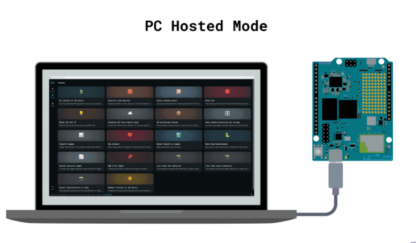

2. After connecting the development board, click the **Command Line** icon, also called the terminal icon, in the lower-left corner.

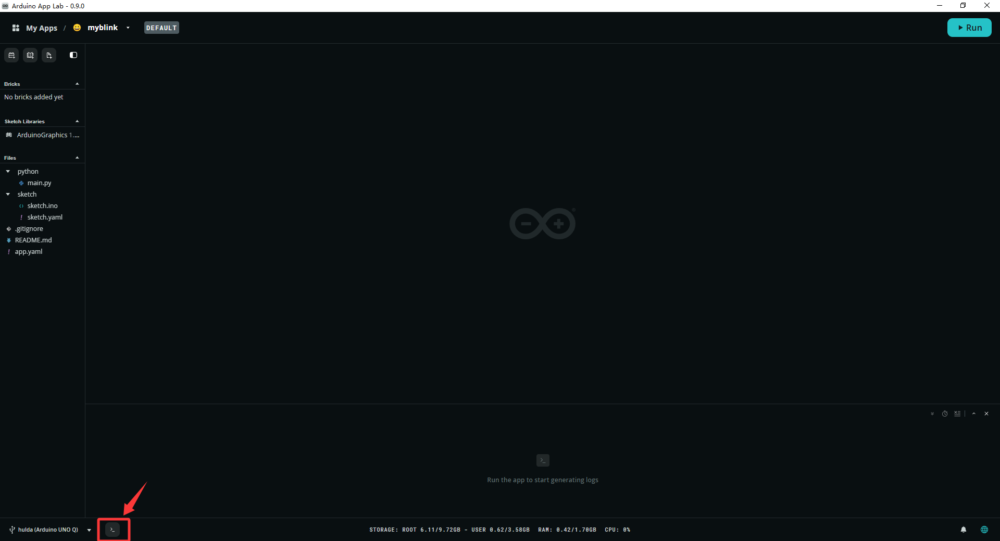

3. The terminal opens at the bottom of App Lab, as shown below:

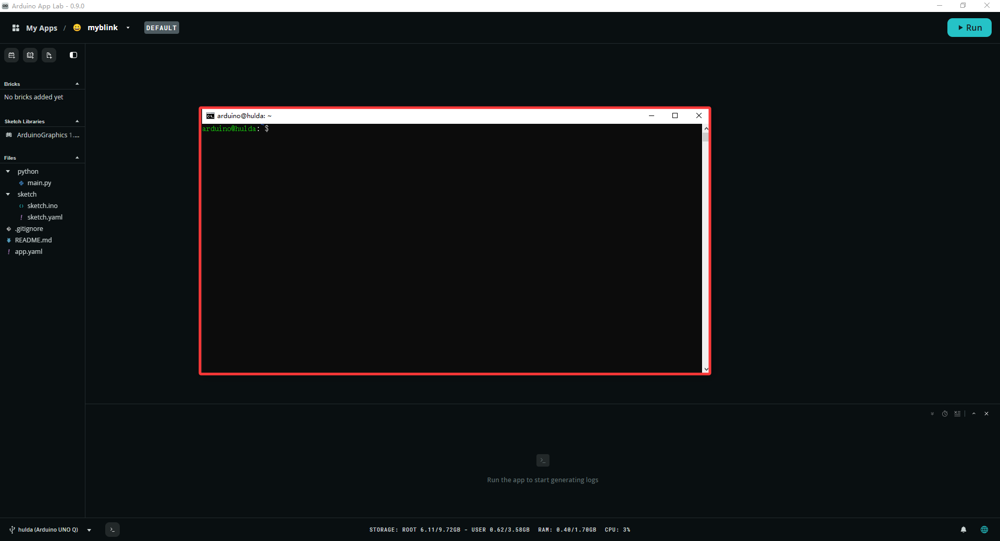

**Basic terminal operations**

After entering the terminal, use the following common file navigation commands:

| Command | Function | Example output |
|---------|----------|----------------|
| `pwd` | Views the current directory | `pwd` -> `/home/arduino` |
| `ls` | Lists files in the current directory | `ls` -> `ArduinoApps  lost+found` |
| `cd <directory>` | Switches to the specified directory | `cd ArduinoApps` |
| `cd ..` | Returns to the parent directory | `cd ..` -> `/home` |
| `mkdir` | Creates a new directory | `mkdir my_project` |
| `cat` | Views file contents | `cat main.py` |
| `nano` | Edits a file | `nano config.json` |

**Common directories**

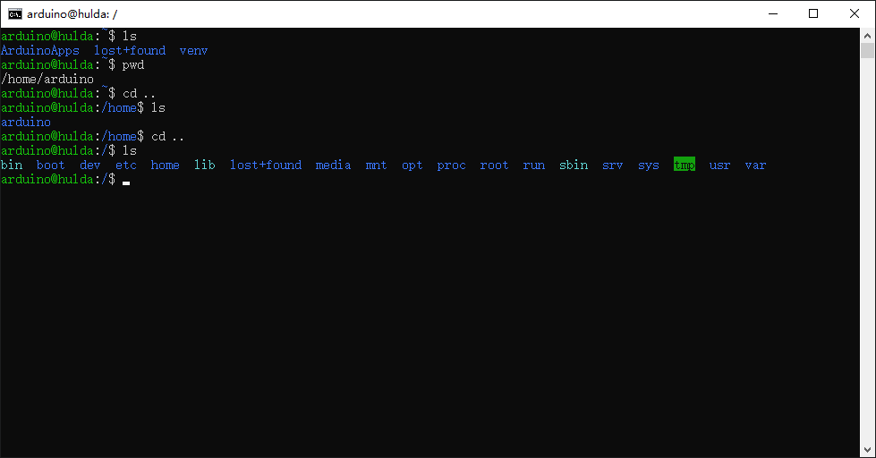

**Key directory descriptions**

| Path | Purpose |
|------|---------|
| `/home/arduino/` | Home directory |
| `/home/arduino/ArduinoApps/` | App Lab project storage location |
| `/var/log/` | System log directory |
| `/etc/` | System configuration file directory |
| `/tmp/` | Temporary file directory. Cleared after restart |

**Quickly locate App Lab project files**

```bash
# Enter the App Lab project directory
cd ~/ArduinoApps

# List all projects
ls -la

# Enter the project. Note that the project name is lowercase
cd myblink

# View project files
ls -la
```

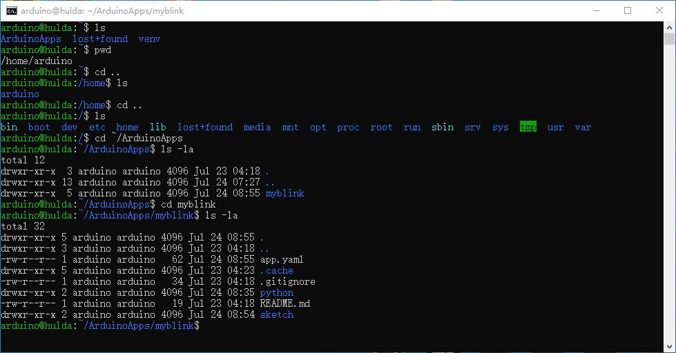

> **Note:** Python code is stored in `python/main.py`, and Arduino code is stored in `sketch/sketch.ino`. They are not placed directly in the project root directory.

---

## 3.3 Run, Stop, and Restart a Python App

This section describes how to run, stop, and restart a Python App on UNO Q through the terminal. Before starting the experiment, download the case code to UNO Q.

Find the [**2. Software & Programs\02 Source Code\3. Linux and Python Development\3.1 minimal_app.zip**](https://drive.google.com/drive/folders/15h4GfGnVvm-IFBB4af5rwSb7nTCkLH_3?usp=sharing) source package in the same directory as this document and import it. Refer to [3.1 Program Download (Must Read)](#p3-1) for the detailed download procedure.

**Manually run a Python script in the terminal**

```bash
# Enter the project Python directory
cd ~/ArduinoApps/myblink/python

# Run the Python script
python3 main.py
```

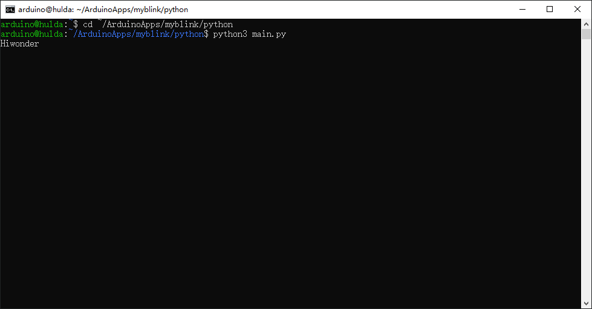

After `Hiwonder` is output, the program continues running. Press **Ctrl+C** to stop it.

**Run a Python script in the background**

To keep the script running after the terminal is closed:

```bash
# Run in the background with nohup and redirect output to a log file
nohup python3 main.py > app.log 2>&1 &

# Description:
# nohup       : Ignores hangup signals so the process does not exit after the terminal closes
# > app.log   : Saves standard output to app.log
# 2>&1        : Merges error output into app.log
# &           : Runs in the background
```

**Stop a Python App**

Method 1: Click **Stop** in App Lab.

Method 2: After the program starts running, open a new command line and stop it with the `kill` command in the terminal:

```bash
# Find the process ID first
ps aux | grep main.py

# Terminate the process. Assume the PID is 1120
kill 1120

# Force termination
kill -9 1120

# One-step method: find and terminate all main.py processes
pkill -f main.py
```

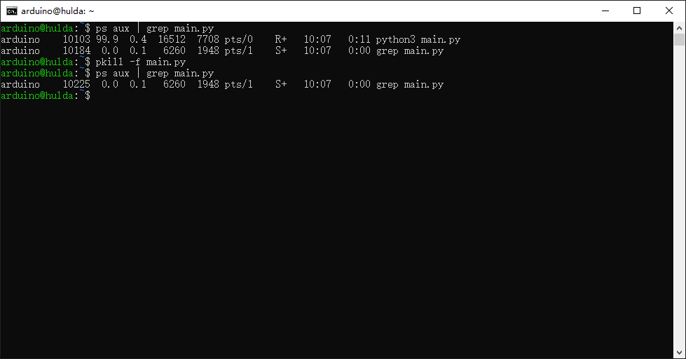

## 3.4 Modify Configuration Parameters

### 3.4.1 Modify Parameters in Python Code

Edit `python/main.py` directly in App Lab. After modifying the parameters, click **Run** to redeploy:

```python
# python/main.py: sample configuration parameters

SAMPLE_INTERVAL = 5      # Sensor sampling interval in seconds
WIFI_TIMEOUT = 30        # WiFi reconnection timeout in seconds
SERVER_URL = "http://192.168.1.50:8080/api/data"
LED_BRIGHTNESS = 128     # LED brightness, 0 to 255
DEBUG = True             # Debug mode switch
```

### 3.4.2 Use a Separate Configuration File

Separate parameters from code. Create `config.json` in the `python/` directory:

```json
{
    "sample_interval": 5,
    "server_url": "http://192.168.1.50:8080/api/data",
    "led_brightness": 128,
    "debug": true
}
```

Read the configuration in `main.py`:

```python
import json

with open("config.json", "r") as f:
    config = json.load(f)

SAMPLE_INTERVAL = config["sample_interval"]
SERVER_URL = config["server_url"]
```

Modify the configuration file directly in the terminal:

```bash
cd ~/ArduinoApps/myblink/python
nano config.json

# Shortcuts: Ctrl+O to save / Ctrl+X to exit / Ctrl+K to cut a line
```

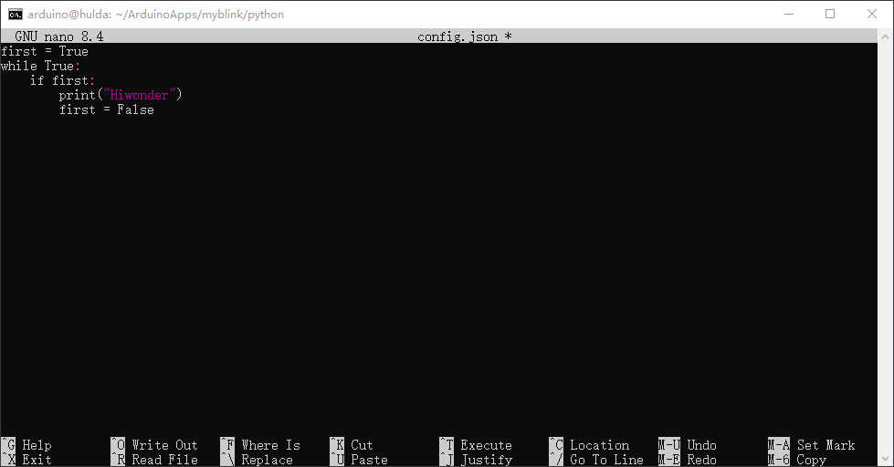

### 3.4.3 Use Environment Variables

This method is suitable for storing sensitive information such as passwords and keys:

```bash
# Temporary setting
export API_KEY="your_secret_key"

# Persistent setting
echo 'export API_KEY="your_secret_key"' >> ~/.bashrc
source ~/.bashrc
```

Read the environment variable in Python:

```python
import os

API_KEY = os.environ.get("API_KEY", "default_key")
```

---

## 3.5 Save Data

During normal use, sensor data such as temperature and humidity exists only in program memory. After the program closes or the device loses power, the data is lost. To view temperature and humidity trends over a period of time later, or compare data from different time periods, save the data persistently. This section introduces file operations in the Python standard library and shows how to write sensor data to text files, JSON files, CSV files, and SQLite databases. These modules are built into Python on UNO Q. Import them directly without installing anything.

### 3.5.1 Write to a Text File

A text file is the simplest way to store data. The program writes data line by line, similar to a log. Start with a blank file and follow the steps below.

**1. Create a directory for logs first:**

After opening the terminal, execute:

```bash
mkdir -p ~/ArduinoApps/myblink/python/logs
```

The function of `mkdir -p` is to create parent directories automatically if they do not exist. This prevents errors when intermediate directories are missing.

**2. Enter the project directory and create a Python script:**

```bash
cd ~/ArduinoApps/myblink/python
nano test_txt.py
```

**3. Enter the following code in the nano editor:**

```python
with open("logs/sensor_log.txt", "a") as f:
    f.write("2026-07-24 10:30:00  Temp: 26.5C  Humidity: 62.1%\n")
    f.write("2026-07-24 10:30:05  Temp: 26.6C  Humidity: 61.9%\n")

print("Write complete!")
```

Press **Ctrl+O** to save, then press **Ctrl+X** to exit nano.

**4. Run the script:**

```bash
python3 test_txt.py
```

The terminal outputs `Write complete!`, which means the write operation succeeded.

**5. Verify the file contents:**

```bash
cat logs/sensor_log.txt
```

The following content appears:

```
2026-07-24 10:30:00  Temp: 26.5C  Humidity: 62.1%
2026-07-24 10:30:05  Temp: 26.6C  Humidity: 61.9%
```

**6. Run it again and check the append effect:**

```bash
python3 test_txt.py
cat logs/sensor_log.txt
```

There are now 4 lines because `"a"` mode appends to the end each time and does not overwrite old data.

**Code explanation:**

- `open("logs/sensor_log.txt", "a")`: Opens the file. Mode `"a"` means append. If the file does not exist, Python creates it automatically.
- `with ... as f:`: The `with` statement automatically closes the file after the code block ends, so `f.close()` is not needed.
- `f.write(...)`: Writes a string to the file. `\n` is the newline character.
- If mode `"w"` is used instead, each file open clears the file and writes from scratch. Logs usually use `"a"`, while configuration files usually use `"w"`.

> [!NOTE]
>
> - **Tip:`f.write()` does not add a line break automatically. Add `\n` manually at the end of the string, or all content will be written on the same line.**


### 3.5.2 Write to a JSON File

JSON is a structured format. It can be understood as a neatly filled information table, where each data item has its own name and corresponding content. A program can quickly find the required information by these names. Python includes the `json` module for direct reading and writing.

**1. Create a new script:**

```bash
nano test_json.py
```

**2. Enter the following code:**

```python
import json
from datetime import datetime

data = {
    "temperature": 26.5,
    "humidity": 62.1,
    "timestamp": datetime.now().isoformat()
}

with open("logs/sensor_data.json", "w") as f:
    json.dump(data, f, indent=2, ensure_ascii=False)

print("JSON write complete!")
```

**3. Run and verify:**

```bash
python3 test_json.py
cat logs/sensor_data.json
```

Output:

```json
{
  "temperature": 26.5,
  "humidity": 62.1,
  "timestamp": "2026-07-24T10:30:00.123456"
}
```

**Code explanation:**

- `json.dump(data, file_object, indent=2, ensure_ascii=False)`: Writes a Python dictionary to a file. `indent=2` formats the output with 2-space indentation for readability. `ensure_ascii=False` keeps non-ASCII characters displayed normally instead of converting them to `\uxxxx`.
- `"w"` mode: Overwrites the file each time. To store multiple records in one JSON file, store them as a list and write the list as a whole.

**Append multiple JSON records, one per line:**

To append one record at a time, write one JSON object per line. This format is JSONL:

```python
import json

record = {"temperature": 26.5, "humidity": 62.1}

with open("logs/sensor_log.jsonl", "a") as f:
    f.write(json.dumps(record) + "\n")
```

When reading later, restore each record with `json.loads(line)` line by line.

### 3.5.3 Write to a CSV File

CSV is a tabular format that can be opened with Excel or WPS. It is well suited for drawing line charts and viewing trends.

**1. Create a script:**

```bash
nano test_csv.py
```

**2. Enter the code:**

```python
import csv

with open("logs/sensor_data.csv", "a", newline="") as f:
    writer = csv.writer(f)
    writer.writerow(["Time", "Temperature(C)", "Humidity(%)"])
    writer.writerow(["2026-07-24 10:30:00", 26.5, 62.1])
    writer.writerow(["2026-07-24 10:30:05", 26.6, 61.9])

print("CSV write complete!")
```

**3. Run and verify:**

```bash
python3 test_csv.py
cat logs/sensor_data.csv
```

Output:

```
Time,Temperature(°C),Humidity(%)
2026-07-24 10:30:00,26.5,62.1
2026-07-24 10:30:05,26.6,61.9
```

**Code explanation:**

- `csv.writer(f)`: Creates a CSV writer.
- `writer.writerow([list])`: Writes one row. Each element in the list corresponds to one cell in the table.
- `newline=""`: When writing CSV files in Python on Windows, omitting this parameter may insert an extra blank line between rows. UNO Q runs Linux, so this usually has little effect, but including it is still standard practice.

> **Tip:** Each run of this script appends two rows of data, including a repeated header. In an actual project, check whether the file is empty first. Write the header only when the file is empty.

### 3.5.4 Use an SQLite Database

The first three methods are suitable for small datasets, from a few hundred to a few thousand records. When the data grows to tens of thousands of records and queries are needed, such as finding the hour with the highest temperature last week, SQLite is much faster than searching through files. Python on UNO Q includes the `sqlite3` module, so it can be used directly.

**1. Create a script:**

```bash
nano test_sqlite.py
```

**2. Enter the code:**

```python
import sqlite3
from datetime import datetime

conn = sqlite3.connect("logs/sensor.db")
cursor = conn.cursor()

cursor.execute("""
    CREATE TABLE IF NOT EXISTS sensor_data (
        id INTEGER PRIMARY KEY AUTOINCREMENT,
        timestamp TEXT NOT NULL,
        temperature REAL,
        humidity REAL
    )
""")

cursor.execute(
    "INSERT INTO sensor_data (timestamp, temperature, humidity) VALUES (?, ?, ?)",
    (datetime.now().isoformat(), 26.5, 62.1)
)
conn.commit()

cursor.execute("SELECT * FROM sensor_data ORDER BY id DESC LIMIT 5")
for row in cursor.fetchall():
    print(row)

conn.close()
print("Database operation complete!")

```

**3. Run it:**

```bash
python3 test_sqlite.py
```

The terminal prints the newly inserted record.

**4. View the database file:**

```bash
ls -lh logs/sensor.db
```

**Code explanation:**

- `sqlite3.connect("logs/sensor.db")`: Connects to the database. If the file does not exist, it is created automatically. All data is stored in this `.db` file.
- `CREATE TABLE IF NOT EXISTS`: Creates a table. `IF NOT EXISTS` prevents errors when the script runs repeatedly.
- `(?, ?, ?)`: Parameterized query. `?` is used as a placeholder to prevent SQL injection and automatically handle quote escaping.
- `conn.commit()`: Commits the transaction. SQLite does not commit automatically by default. If `commit()` is omitted, the data is lost.
- `conn.close()`: Closes the connection and releases resources.

### 3.5.5 Recommended Data Storage Locations

Select a suitable storage path based on the data purpose:

| Data type | Recommended path | Description |
|-----------|------------------|-------------|
| Project configuration | `~/ArduinoApps/<project_name>/python/config.json` | Stored with the code |
| Sensor logs | `~/ArduinoApps/<project_name>/python/logs/` | Project-specific directory |
| Temporary data | `/tmp/` | Automatically cleared after restart |
| Persistent data | `~/data/` | Custom persistent data directory |

### 3.5.6 Disk Space Management

UNO Q has limited eMMC storage. Check it regularly to avoid filling the disk.

```bash
# Check disk usage
df -h
```

```
Filesystem       Size  Used Avail Use% Mounted on
/dev/mmcblk0p68  9.8G  6.1G  3.2G  67% /
```

```bash
# Check the size of each folder in the current directory
du -sh *
```

```bash
# Check the size of the log folder
du -sh ~/ArduinoApps/myblink/python/logs/
```

```bash
# Clean temporary files. sudo may be restricted on UNO Q, so this command may not run
sudo rm -rf /tmp/*
```

> UNO Q 2GB version has 14.6G total eMMC capacity, a 10G root partition, and a 3.7G data partition. Clean caches and logs regularly to reserve space for sensor data.

## 3.6 View Device Status and Logs

### 3.6.1 View System Status

```bash
top -b -n 1 | head -5
```

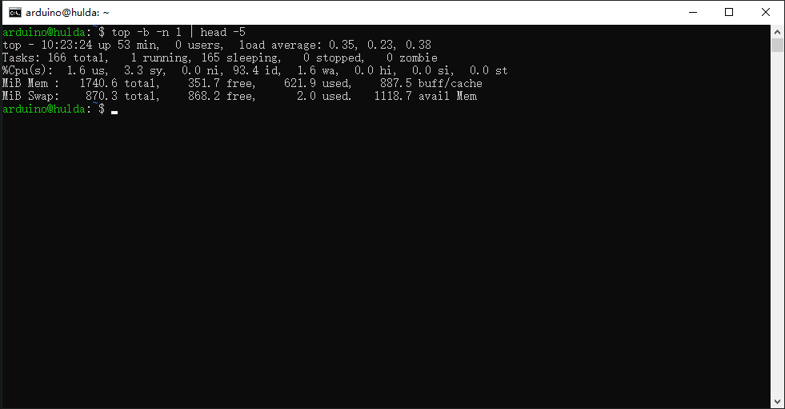

```bash
# Memory usage overview
free -h
```

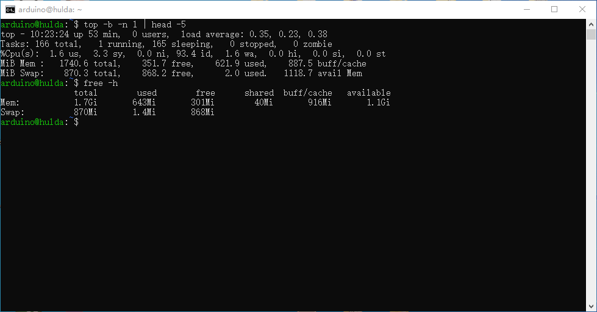

```bash
# View CPU information
lscpu
# Output: Architecture:                aarch64
      # CPU op-mode(s):            32-bit, 64-bit
      # Byte Order:                Little Endian, etc.

# View system uptime
uptime
# Output: 11:27:23 up 21 min, load average: 0.10, 0.13, 0.17

# View kernel version
uname -a
# Output: Linux hulda 6.16.7 ... aarch64 GNU/Linux
```

### 3.6.2 View Network Status

```bash
# View the IP address
ip addr show wlan0 | grep "inet " | awk '{print $2}' | cut -d/ -f1
```

UNO Q has `ifconfig` preinstalled. `iwconfig` is not preinstalled. To view WiFi details, use `ifconfig wlan0`.

```bash
# View network connections
ss -tlnp

# Test network connectivity
ping -c 4 8.8.8.8
```

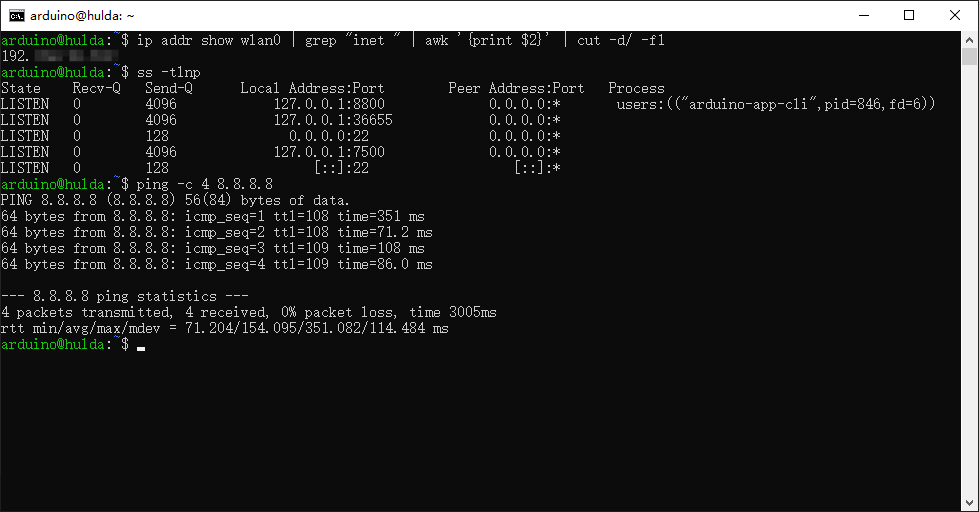

In App Lab, the **Console** panel at the bottom displays program runtime logs and compilation information in real time.

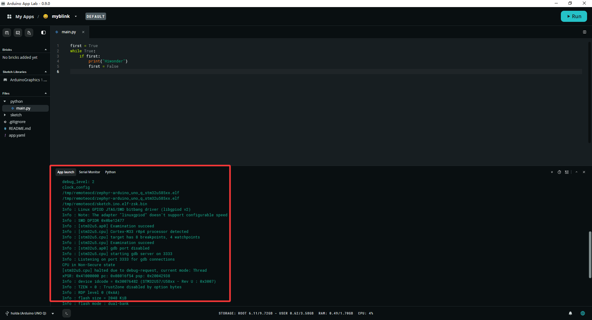

**View logs in the terminal for a Docker container:**

App Lab projects run in Docker containers, and logs are output through Docker. The case program also needs to be running.

```bash
# List running containers
docker ps
```

```bash
# View container logs in real time. Replace <container_name> with the actual name, such as myblink-main-1
docker logs -f myblink-main-1
```

> **Tip:** If the container name is unknown, run `docker ps` first and check the `NAMES` column. If the project is named `myblink`, the container name is usually `myblink-main-1`.

**Search for error messages:**

```bash
# Search error in container logs
docker logs myblink-main-1 2>&1 | grep -i "error"

# View the latest 50 lines
docker logs --tail 50 myblink-main-1
```

**If the program writes log files:**

When the Python code writes logs to a file with `open()`, such as `logs/sensor_log.txt`, use `tail -f` to view it in real time:

```bash
# Confirm that the file exists first
ls ~/ArduinoApps/myblink/python/logs/

# View in real time
tail -f ~/ArduinoApps/myblink/python/logs/sensor_log.txt
```

`tail -f` does not create a file automatically. If the file does not exist, an error is reported directly. Only after the program has written this file can `tail -f` display content.

---

## 3.7 Create a Local Status Page

This section shows how to create a web status monitoring page on UNO Q and view device status in real time through a browser on the LAN.

### 3.7.1 Preparation

- UNO Q is connected to WiFi. Configure it in App Lab in advance.
- The computer and UNO Q are on the same LAN.

---

**Create the status monitoring script**

Open the App Lab terminal tab. Run the following command to create the script. If copying is inconvenient, open [**2. Software & Programs\02 Source Code\3. Linux and Python Development\UNO Q web.py**](https://drive.google.com/drive/folders/15h4GfGnVvm-IFBB4af5rwSb7nTCkLH_3?usp=sharing) in the same directory as this document and copy from it.

```bash
cat > ~/status_server.py << 'EOF'
import os
import time
from http.server import HTTPServer, BaseHTTPRequestHandler

PORT = 8080

def get_cpu_temp():
    try:
        with open("/sys/class/thermal/thermal_zone0/temp", "r") as f:
            return float(f.read().strip()) / 1000.0
    except:
        return "N/A"

def get_system_info():
    load = os.getloadavg()
    mem_total = 0
    mem_avail = 0
    with open("/proc/meminfo", "r") as f:
        for line in f:
            if "MemTotal" in line:
                mem_total = int(line.split()[1]) // 1024
            elif "MemAvailable" in line:
                mem_avail = int(line.split()[1]) // 1024
    stat = os.statvfs("/")
    disk_total = stat.f_frsize * stat.f_blocks // (1024 * 1024)
    disk_free = stat.f_frsize * stat.f_bavail // (1024 * 1024)
    with open("/proc/uptime", "r") as f:
        uptime_s = int(float(f.readline().split()[0]))
    uptime_h = uptime_s // 3600
    uptime_m = (uptime_s % 3600) // 60
    return {
        "cpu_load_1min": round(load[0], 2),
        "cpu_temp": get_cpu_temp(),
        "mem_total_mb": mem_total,
        "mem_avail_mb": mem_avail,
        "disk_total_mb": disk_total,
        "disk_free_mb": disk_free,
        "uptime": f"{uptime_h}h {uptime_m}m",
        "timestamp": time.strftime("%Y-%m-%d %H:%M:%S")
    }

class Handler(BaseHTTPRequestHandler):
    def do_GET(self):
        info = get_system_info()
        mem_pct = round((1 - info["mem_avail_mb"]/info["mem_total_mb"])*100) if info["mem_total_mb"] else 0
        disk_pct = round((1 - info["disk_free_mb"]/info["disk_total_mb"])*100) if info["disk_total_mb"] else 0

        html = f"""<!DOCTYPE html>
<html lang="en">
<head>
<meta charset="UTF-8">
<meta name="viewport" content="width=device-width, initial-scale=1.0">
<title>UNO Q Status</title>
<meta http-equiv="refresh" content="5">
<style>
* {{ margin:0; padding:0; box-sizing:border-box; }}
body {{ font-family:sans-serif; background:#1a1a2e; color:#e0e0e0; padding:20px; }}
.container {{ max-width:600px; margin:0 auto; }}
h1 {{ text-align:center; color:#00d4aa; margin-bottom:20px; }}
.card {{ background:#16213e; border-radius:12px; padding:16px; margin-bottom:12px; }}
.card h2 {{ font-size:16px; color:#00d4aa; margin-bottom:10px; border-bottom:1px solid #0f3460; padding-bottom:6px; }}
.row {{ display:flex; justify-content:space-between; padding:5px 0; font-size:14px; }}
.label {{ color:#a0a0a0; }}
.value {{ font-weight:bold; color:#fff; }}
.bar {{ height:8px; background:#0f3460; border-radius:4px; margin-top:4px; overflow:hidden; }}
.fill {{ height:100%; background:#00d4aa; border-radius:4px; }}
.footer {{ text-align:center; font-size:12px; color:#606060; margin-top:16px; }}
</style>
</head>
<body>
<div class="container">
<h1>UNO Q Device Status</h1>
<div class="card"><h2>CPU</h2>
<div class="row"><span class="label">Load (1min)</span><span class="value">{info["cpu_load_1min"]}</span></div>
<div class="row"><span class="label">Temperature</span><span class="value">{info["cpu_temp"]} C</span></div>
</div>
<div class="card"><h2>Memory</h2>
<div class="row"><span class="label">Avail / Total</span><span class="value">{info["mem_avail_mb"]} MB / {info["mem_total_mb"]} MB</span></div>
<div class="bar"><div class="fill" style="width:{mem_pct}%"></div></div>
</div>
<div class="card"><h2>Disk</h2>
<div class="row"><span class="label">Free / Total</span><span class="value">{info["disk_free_mb"]} MB / {info["disk_total_mb"]} MB</span></div>
<div class="bar"><div class="fill" style="width:{disk_pct}%"></div></div>
</div>
<div class="card"><h2>Uptime</h2>
<div class="row"><span class="label">Running</span><span class="value">{info["uptime"]}</span></div>
</div>
<div class="footer">Arduino UNO Q &middot; {info["timestamp"]}</div>
</div>
</body>
</html>"""

        self.send_response(200)
        self.send_header("Content-Type", "text/html; charset=utf-8")
        self.end_headers()
        self.wfile.write(html.encode("utf-8"))

    def log_message(self, format, *args):
        pass

if __name__ == "__main__":
    print(f"Status page started on port {PORT}")
    HTTPServer(("0.0.0.0", PORT), Handler).serve_forever()
EOF
```

> [!NOTE]
>
> - **`<< 'EOF' ... EOF` is heredoc syntax and writes multiple lines directly to a file.**
> - **All modules are Python standard-library modules. No pip3 or Docker is required.**
> - **The HTML is embedded in the Python script, so a single file contains the entire page.**

### 3.7.2 Key Code Sections

| Function | Data source | Description |
|---|---|---|
| `get_cpu_temp()` | `/sys/class/thermal/thermal_zone0/temp` | CPU temperature, converted to °C |
| Load | `os.getloadavg()` | 1-minute average load. 0 to 1 is normal, and greater than 1 is high |
| Memory | `MemTotal` / `MemAvailable` in `/proc/meminfo` | Converted to MB |
| Disk | `os.statvfs("/")` | Root partition usage |
| Uptime | `/proc/uptime` | Converts startup seconds to Xh Ym format |
| Page refresh | `<meta http-equiv="refresh" content="5">` | Browser refreshes automatically every 5 seconds |

---

### 3.7.3 Start the Service

Enter the home directory, then use `nohup` to run in the background and redirect output to a log file:

```bash
cd ~
nohup python3 status_server.py > status.log 2>&1 &
```

The terminal outputs information such as `[1] 2132`. The number is the process PID.

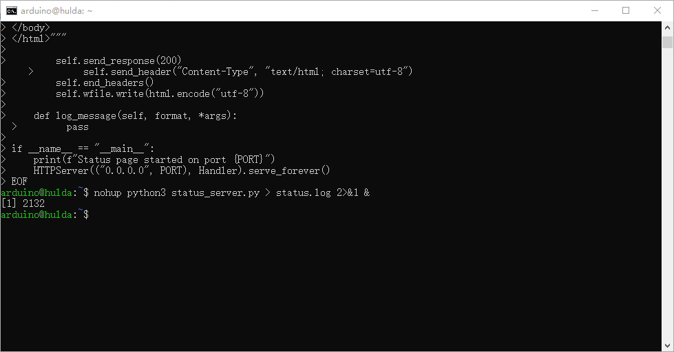

| Command component | Function |
|---|---|
| `nohup` | Keeps the process running after the terminal closes |
| `> status.log` | Writes standard output to `status.log` |
| `2>&1` | Merges error output into `status.log` |
| `&` | Runs in the background |

### 3.7.4 Verify the Service

Run the following command in the UNO Q terminal:

```bash
curl http://localhost:8080 | head -5
```

If `<!DOCTYPE html>` appears, the web service is running normally.

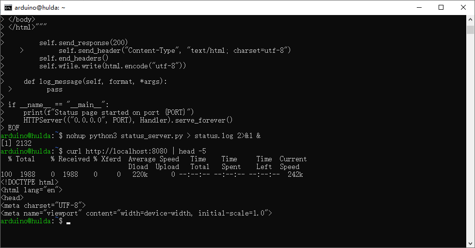

---

### 3.7.5 View the UNO Q IP Address

```bash
ip addr show wlan0 | grep "inet "
```

Example output:

```
    inet 192.168.36.50/24 brd 192.168.36.255 scope global dynamic noprefixroute wlan0
```

Each IP address is different. Use the actual output.

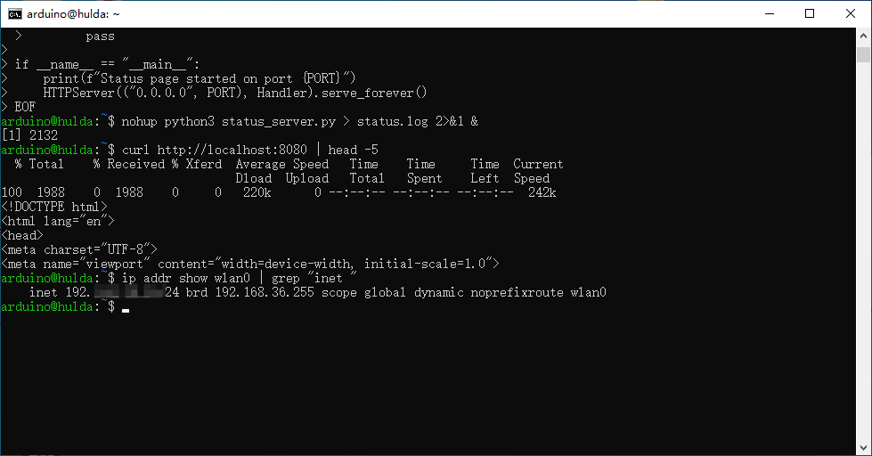

---

### 3.7.6 Browser Access

Enter the following address in the computer browser address bar:

```
http://<UNO-Q-IP>:8080
```

Example:

```
http://192.168.36.50:8080
```

Page effect: A dark dashboard displays CPU load and temperature, memory and disk usage progress bars, and uptime. It refreshes automatically every 5 seconds.

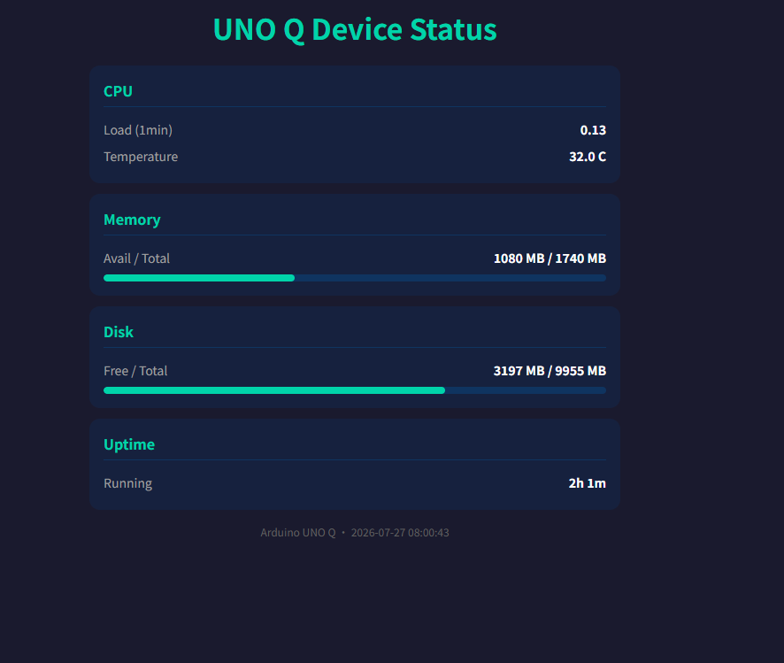

> [!NOTE]
>
> **The computer and UNO Q must be on the same LAN and connected to the same WiFi router. Otherwise, the page cannot be accessed.**

---
