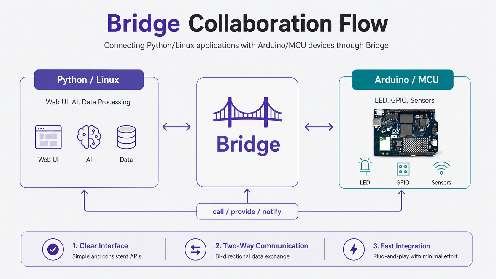
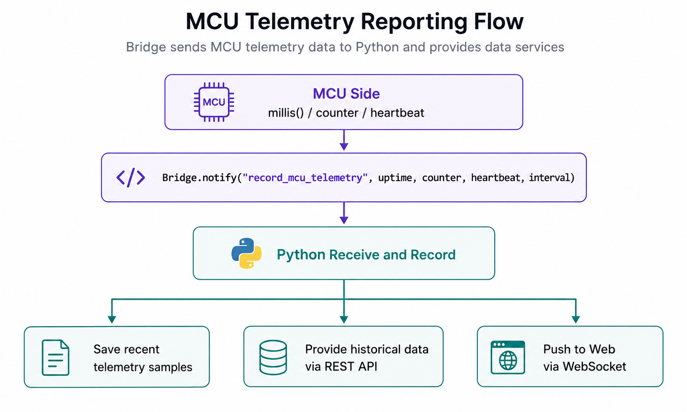
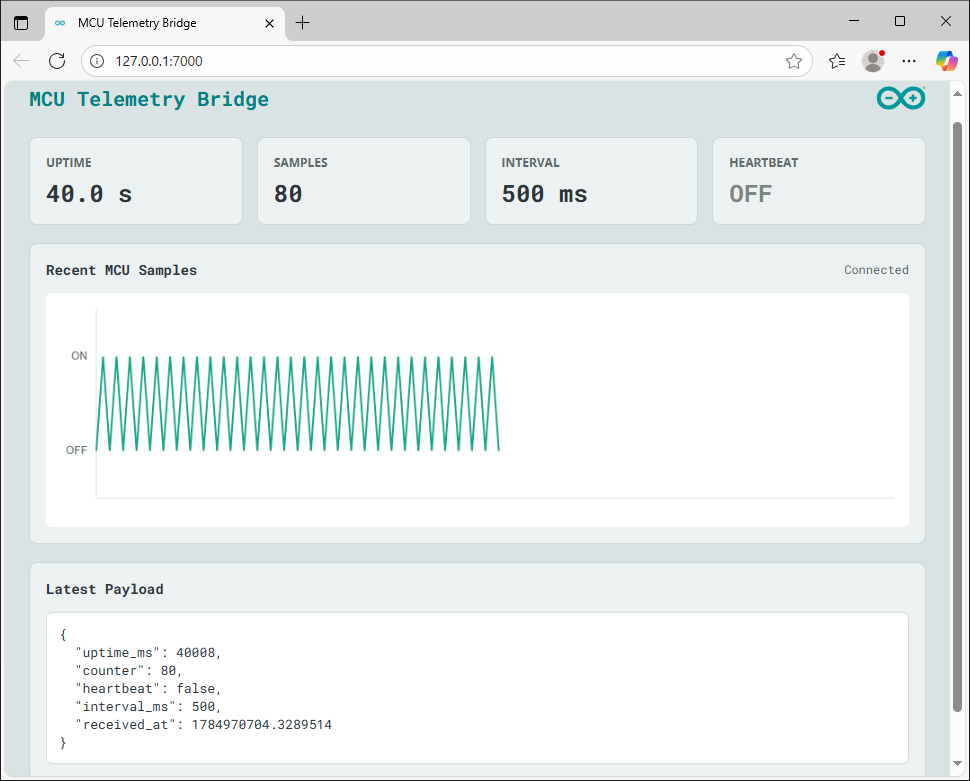
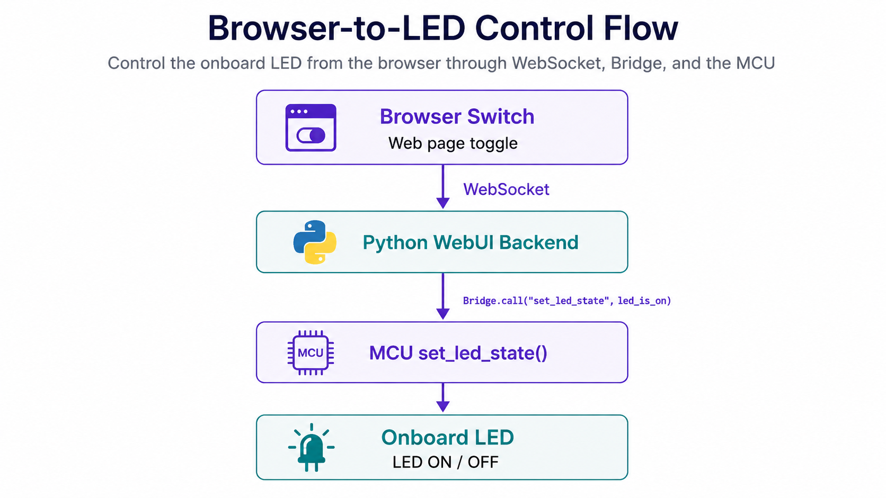
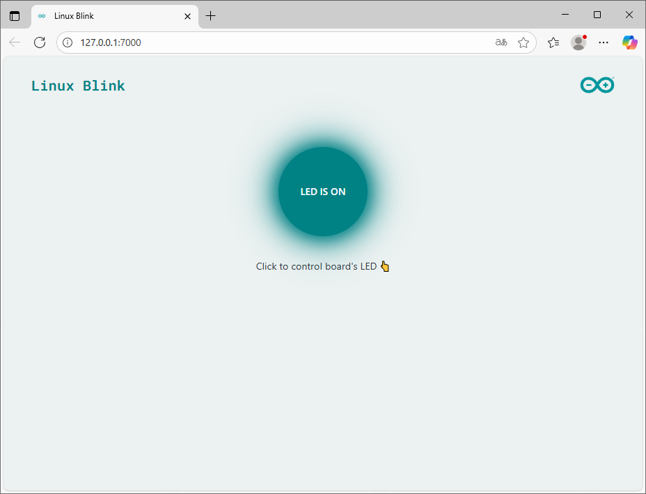
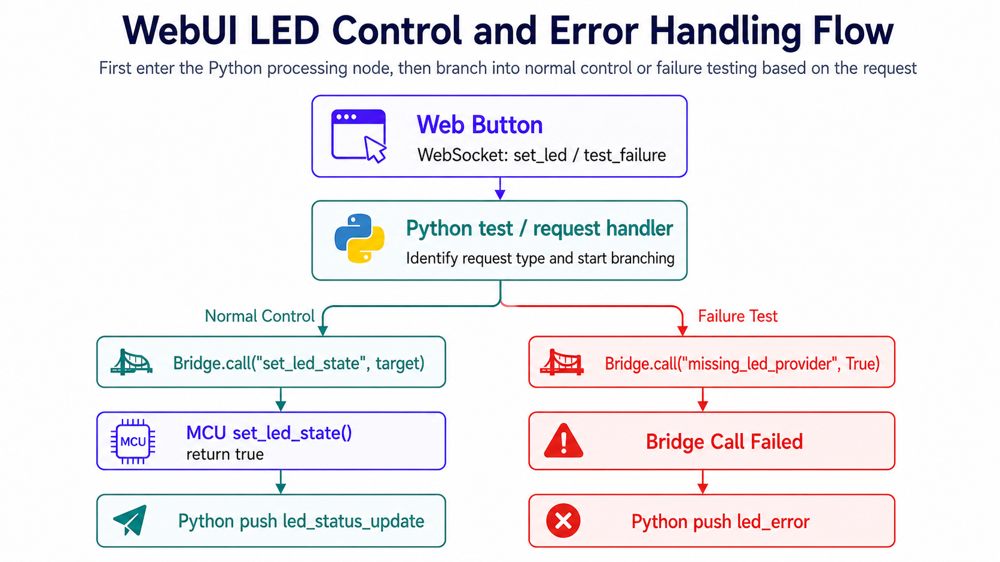
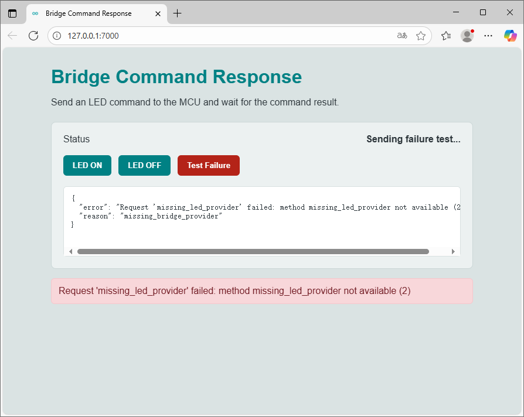
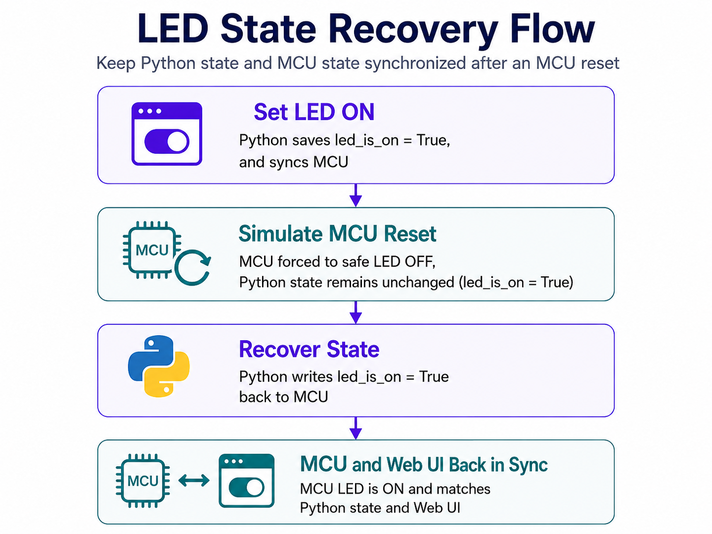
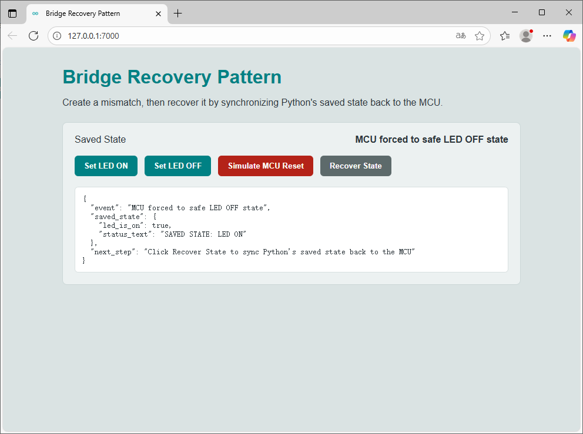

# 4. Bridge-Based Dual-Side Collaboration

This chapter covers **Bridge-based dual-side collaboration** on Arduino UNO Q. UNO Q uses a dual-processor architecture. The Linux side handles networking, interfaces, AI, and complex data processing. The MCU side handles real-time control, peripheral access, and LED matrix display. Router Bridge transfers data, calls functions, and synchronizes state between the two sides.

<p id="p4-1"></p>

## 4.1 Program Download (Must Read)

1. Connect the **Arduino UNO Q** development board to the PC with a **Type-C** data cable, as shown below:


2. Open **Arduino App Lab**. After the device starts successfully, click the **Arduino UNO Q** development board icon to connect.


3. Click the **My Apps** icon in the upper-left corner to import the project.


4. Use the **mcu_telemetry** project as an example. Drag the corresponding project zip package into the window.


5. After the import success prompt appears, click the corresponding project icon to enter the project.


6. In the project, click the **Run** button in the upper-right corner to run the current project.


7. To run the program automatically after the development board powers on, configure it as shown below.


## 4.2 Bridge Overview

### 4.2.1 How Bridge Works

Bridge is the communication layer in UNO Q that connects the Linux side and the MCU side. It lets Python programs and Arduino Sketches call functions across the two sides almost like local functions. This section first clarifies what Linux, MCU, and Bridge each handle on UNO Q, making it easier to place later program logic on the appropriate side.

Start with the dual-side architecture diagram, then review several common APIs. Focus on three questions: which side exposes the function, which side calls it, and which direction the data flows. Bridge is essentially a remote call channel running inside an App Lab project. The called side registers a function first. The calling side then starts a call by using the function name and arguments. Bridge serializes the arguments, forwards them, and sends the result back to the calling side.

The two sides divide work as follows:

| Side | Runs | Main responsibilities |
|---|---|---|
| Linux side | `python/main.py` | Web UI, file read and write, network requests, AI inference, data processing |
| MCU side | `sketch/sketch.ino` | GPIO, LEDs, sensors, PWM, real-time control |
| Router Bridge | App Lab communication layer | Function registration, remote calls, argument passing, event notifications |



### 4.2.2 Common Bridge APIs

#### Bridge.begin()

```cpp
Bridge.begin();
```

| Item | Description |
|---|---|
| Used in | MCU-side `setup()` |
| Arguments | None |
| Return value | None |
| Function | Starts MCU-side Bridge communication, so the Sketch can register providers or call functions on the other side |
| Common location | After hardware initialization such as `matrix.begin()` and `pinMode()` |
| Notes | Usually called only once. Without this call, `Bridge.provide()`, `Bridge.call()`, and `Bridge.notify()` cannot work properly |

#### Bridge.provide()

```text
Bridge.provide(name, function)
```

| Argument | Type | Description |
|---|---|---|
| `name` | String | Function name registered for the other side to call. The calling side must use exactly the same name |
| `function` | Function object | Function executed on this side. Its parameter count and types must match the data sent by the calling side |

| Item | Description |
|---|---|
| Return value | Usually no direct return value. The registered function itself can return a value |
| Use case | Expose an LED control function on the MCU side, or expose a data-processing function on the Python side |
| Naming suggestion | Use lowercase letters with underscores, such as `set_led_state` and `record_mcu_telemetry` |
| Notes | `name` is the agreed interface name for both sides. A spelling error causes the call to fail. Do not register two providers with the same name |

#### Bridge.call()

```text
Bridge.call(name, ...args)
```

| Argument | Type | Description |
|---|---|---|
| `name` | String | Name of the remote function to call |
| `...args` | Variable arguments | Arguments passed to the remote function, such as Boolean values, numbers, strings, and simple arrays |

| Item | Description |
|---|---|
| Return value | The Python side usually receives the result directly. On the Arduino side, `.result(variable)` is often used to read the result and check whether the call succeeded |
| Use case | Execute one explicit action, or call a function that needs to return a result |
| Typical example | Python calls the MCU-side `set_led_state` function to control an LED. MCU calls a Python networking function to obtain a string result |
| Notes | The remote function should not run for too long. For time-consuming tasks such as network requests and model inference, handle timeouts and errors on the Python side |

#### Bridge.notify()

```text
Bridge.notify(name, ...args)
```

| Argument | Type | Description |
|---|---|---|
| `name` | String | Name of the remote handler to notify |
| `...args` | Variable arguments | Data fields sent with the event |

| Item | Description |
|---|---|
| Return value | No return result is required |
| Use case | Upload sensor data frequently, send log events, or notify state changes |
| Typical example | MCU uploads runtime status once every 500 ms |
| Notes | Suitable for data streams that can be sent without confirmation. If every data item must confirm successful processing, use `call` or design a confirmation mechanism |

#### App.run()

```text
App.run(user_loop=None)
```

| Argument | Type | Description |
|---|---|---|
| `user_loop` | Function object, optional | Custom function that needs to run repeatedly while the App is running, such as a periodic sampling task |

| Item | Description |
|---|---|
| Used in | End of Python-side `main.py` |
| Return value | Does not return during normal operation |
| Function | Starts the App Lab runtime, Bricks, Web service, and Bridge communication |
| Notes | Usually placed after all Brick initialization, interface registration, and message registration. Do not place application code that must run immediately after `App.run()` |

When designing a Bridge program, first identify the data direction:

| Scenario | Recommended direction |
|---|---|
| MCU collects sensor data, and Python records and displays it | MCU -> Python |
| Web page buttons control an LED or motor | Python -> MCU |
| MCU requests weather, AI, or file results | MCU -> Python, then wait for a result |
| Frequent real-time data upload | Prefer `notify` |
| Explicit action execution with confirmation | Prefer `call` |

### 4.2.3 Program Directory Description

App Lab dual-side projects usually contain the following structure:

```text
Project directory
├── app.yaml
├── python
│   └── main.py
├── sketch
│   ├── sketch.ino
│   └── sketch.yaml
└── assets
    ├── index.html
    ├── app.js
    └── style.css
```

| File | Function |
|---|---|
| `app.yaml` | Declares the App name, description, and Bricks used |
| `python/main.py` | Linux-side program entry point |
| `sketch/sketch.ino` | MCU-side program entry point |
| `sketch/sketch.yaml` | Arduino-side dependency library configuration |
| `assets/` | Web page files and static resources |

<p id="p4-2"></p>

## 4.3 Send Data from MCU to Python

### 4.3.1 Experiment Overview

This section builds a data upload program that does not require external modules. The MCU side generates runtime status data every 500 ms, including uptime, send count, heartbeat state, and reporting interval. It then sends the data to Python through `Bridge.notify()`. The Python side registers `record_mcu_telemetry()` to receive the data, stores recent samples, and pushes them to the web page for display.

This experiment focuses on the program structure for active MCU data reporting, not on the sensor itself. The MCU side generates data at a fixed interval. The Python side stores, forwards, and displays the data. Since the MCU does not need to wait for a Python return value, `notify` is more suitable. The data is sent, then the next loop continues on schedule.



### 4.3.2 Program Download

Find the [**2. Software & Programs\02 Source Code\4. Bridge-Based Dual-Side Collaboration\4.3_mcu_telemetry.zip**](https://drive.google.com/drive/folders/1WXLpT7eqZ0WSrG0s0cbUwJQ8yPHuOS1g?usp=sharing) source package and import it. Refer to [4.1 Program Download (Must Read)](#p4-1) for the detailed download procedure.

### 4.3.3 Project Outcome

> [!NOTE]
>
> **After the App runs, open the page in a browser based on the connection method.**
>
> **For USB wired connection with a local browser, open `http://127.0.0.1:7000`.**
>
> **For LAN access, use `http://<UNO-Q-IP-ADDRESS>:7000`.**

After the web page connects, it displays the uptime, send count, send interval, and heartbeat state uploaded by the MCU side in real time. The built-in LED toggles on and off with the `heartbeat` field, and the heartbeat curve on the web page changes at the same time.



### 4.3.4 Program Analysis

* **app.yaml file**

This program uses only the `web_ui` Brick:

```yaml
bricks:
  - arduino:web_ui
```

`web_ui` starts the local page, WebSocket message channel, and REST API. This experiment does not perform AI inference or connect external sensors, so no other Bricks are required.

* **sketch/sketch.ino file**

The MCU side consists of three main parts:

1. Initialize Bridge.
2. Initialize the built-in LED.
3. Generate and upload runtime status at a fixed interval.

Initialization section:

```cpp
void setup() {
  pinMode(LED_BUILTIN, OUTPUT);
  digitalWrite(LED_BUILTIN, HIGH);

  Bridge.begin();
}
```

`Bridge.begin()` starts MCU-side Bridge communication. `LED_BUILTIN` displays the heartbeat state, so MCU-side periodic operation can be observed directly even when the web page is not open.

Periodic reporting section:

```cpp
if (currentMillis - previousMillis >= interval) {
  previousMillis = currentMillis;
  sampleCounter++;
  heartbeat = !heartbeat;

  digitalWrite(LED_BUILTIN, heartbeat ? LOW : HIGH);

  Bridge.notify(
    "record_mcu_telemetry",
    currentMillis,
    sampleCounter,
    heartbeat,
    interval
  );
}
```

This program uses `millis()` for non-blocking timing. It updates and sends data only when the difference between the current time and the previous send time reaches `interval`. This approach is better for later expansion than using `delay(500)` directly, because the MCU side does not stay inside the delay function for a long time.

Uploaded fields are as follows:

| Field | Meaning |
|---|---|
| `currentMillis` | Milliseconds elapsed from MCU startup to the current time |
| `sampleCounter` | Sequence number of the data packet already sent |
| `heartbeat` | Heartbeat state that alternates between `true` and `false` |
| `interval` | Data reporting interval set in this program, in ms |

`Bridge.notify()` fits this continuous status upload scenario. The MCU does not need a return value from Python. It only needs to keep a stable rhythm and send the current state to the Linux side.

* **python/main.py file**

The Python side registers a handler with the same name through `Bridge.provide()`:

```python
Bridge.provide("record_mcu_telemetry", record_mcu_telemetry)
```

When the MCU calls `Bridge.notify("record_mcu_telemetry", ...)`, `record_mcu_telemetry()` on the Python side receives four fields:

```python
def record_mcu_telemetry(uptime_ms: int, counter: int, heartbeat: bool, interval_ms: int):
    sample = {
        "uptime_ms": int(uptime_ms),
        "counter": int(counter),
        "heartbeat": bool(heartbeat),
        "interval_ms": int(interval_ms),
        "received_at": time.time(),
    }
```

Python-side processing includes four parts:

| Part | Function |
|---|---|
| Type normalization | Converts Bridge fields to clear Python types |
| Data cache | Uses `deque` to store recent telemetry samples |
| Page push | Uses `web_ui.send_message()` to send the latest sample to the web page |
| API query | Uses the `/telemetry` REST API to return the latest data and historical samples |

The program also exposes a local API:

```python
web_ui.expose_api("GET", "/telemetry", _get_telemetry)
```

In this way, the browser can receive real-time data through WebSocket and read recently cached samples through the REST API. When the page opens, it first requests `/telemetry` to obtain existing data. It then receives new data through `telemetry` messages.

This type of program commonly fails around data timing. If the MCU sends too quickly, page refresh and log output may fall behind. If it sends too slowly, page feedback becomes less intuitive. This experiment uses 500 ms as the reporting interval. The page changes are clear, and Python and the browser are not placed under noticeable load.

Another detail is state ownership. Uptime, counter, and heartbeat are all generated by the MCU side. The Python side only records and displays them, and does not write changes back to those fields. This keeps the data direction clear: MCU is the data source, and Python is the receiver and display side. When runtime status is later replaced with temperature, buttons, analog values, or other sensor data, the Bridge structure can stay the same. Only the MCU-side code that generates the fields needs to change.

<p id="p4-3"></p>

## 4.4 Control the MCU from Python

### 4.4.1 Experiment Overview

This section uses a web switch to control the built-in LED on UNO Q. The browser page sends click events to Python. After Python changes the `led_is_on` state, it calls `Bridge.call("set_led_state", led_is_on)`. The MCU-side `set_led_state()` receives the Boolean value and writes it to the LED pin.

The Python side is suitable for web interaction and state synchronization. The MCU side is suitable for direct pin control. Bridge converts web page operations into MCU function calls. This experiment focuses on the responsibility boundaries among the web page, Python, and MCU, not on the LED itself.



### 4.4.2 Program Download

Find the [**2. Software & Programs\02 Source Code\4. Bridge-Based Dual-Side Collaboration\4.4_mcu_blink_with_ui.zip**](https://drive.google.com/drive/folders/1WXLpT7eqZ0WSrG0s0cbUwJQ8yPHuOS1g?usp=sharing) source package and import it. Refer to [4.1 Program Download (Must Read)](#p4-1) for the detailed download procedure.

### 4.4.3 Project Outcome

> [!NOTE]
>
> **After the App runs, open the page in a browser based on the connection method.**
>
> **For USB wired connection with a local browser, open `http://127.0.0.1:7000`.**
>
> **For LAN access, use `http://<UNO-Q-IP-ADDRESS>:7000`.**

The web page displays an LED switch button. After the switch is clicked:

- Python toggles the `led_is_on` state.
- Python calls the MCU-side `set_led_state` function through Bridge.
- MCU changes the pin level of the built-in LED.
- Python pushes the latest state back to the web page.



### 4.4.4 Program Analysis

* **python/main.py file**

The Python side stores the LED state:

```python
led_is_on = False
```

When the browser sends a `toggle_led` message, the Python side calls the handler:

```python
ui.on_message('toggle_led', toggle_led_state)
```

The handler completes three tasks:

```python
def toggle_led_state(client, data):
    global led_is_on
    led_is_on = not led_is_on
    Bridge.call("set_led_state", led_is_on)
    ui.send_message('led_status_update', get_led_status())
```

| Step | Description |
|---|---|
| Toggle state | Modifies `led_is_on` stored on the Python side |
| Send command | Calls the MCU-side `set_led_state` function |
| Sync page | Pushes the latest state to the web page |

Here, `Bridge.call()` fits a scenario where one explicit hardware action needs to be executed.

* **sketch/sketch.ino file**

The MCU side registers the function in `setup()`:

```cpp
void setup() {
  pinMode(LED_BUILTIN, OUTPUT);
  digitalWrite(LED_BUILTIN, HIGH);

  Bridge.begin();
  Bridge.provide("set_led_state", set_led_state);
}
```

`set_led_state()` controls the LED according to the Boolean value passed in from Python:

```cpp
void set_led_state(bool state) {
  digitalWrite(LED_BUILTIN, state ? LOW : HIGH);
}
```

In this program, the built-in LED is active-low, so writing `LOW` turns it on when `state` is `true`.

* **assets/app.js file**

The frontend mainly handles messages in two directions:

| Message direction | Message name | Function |
|---|---|---|
| Browser -> Python | `toggle_led` | Switch click |
| Browser -> Python | `get_initial_state` | Requests the initial state when the page loads |
| Python -> Browser | `led_status_update` | Refreshes the button state and text |

The frontend does not access hardware directly. Hardware control always goes through Python and Bridge.

This example is useful for explaining where state is stored. The web page is only the operation entry point. The real `led_is_on` state is stored on the Python side. MCU does not store application state. It only writes the pin according to the Boolean value it receives. This keeps state ownership clear when the page refreshes, multiple browsers are open, or repeated clicks occur. If state is scattered across the web page, Python, and MCU, troubleshooting cases such as the page showing ON while the LED stays off becomes difficult.

The empty MCU-side `loop()` is intentional. This example is event-driven. MCU changes the LED only when Python calls `set_led_state()` through Bridge. For low-frequency actions such as buttons, switches, and web controls, this structure is cleaner than repeatedly checking state in `loop()`.

<p id="p4-4"></p>

## 4.5 Commands, Responses, and Timeouts

### 4.5.1 Experiment Overview

This section builds on the LED control experiment and further handles command responses and failure cases. The page provides three buttons: **LED ON**, **LED OFF**, and **Test Failure**. The first two buttons send normal LED control commands. The third button deliberately triggers a failure path to verify error capture and page feedback.

Bridge calls cross two runtime environments, Python and MCU. Whenever cross-side communication exists, several questions must be considered. Are the function names consistent? Can the arguments be serialized? Is the other side online? Did the requested action complete successfully? Organizing one call into command, arguments, response, and error handling makes the program more reliable than handling only the ideal path.



### 4.5.2 Program Download

Find the [**2. Software & Programs\02 Source Code\4. Bridge-Based Dual-Side Collaboration\4.5_command_response_timeout.zip**](https://drive.google.com/drive/folders/1WXLpT7eqZ0WSrG0s0cbUwJQ8yPHuOS1g?usp=sharing) source package and import it. Refer to [4.1 Program Download (Must Read)](#p4-1) for the detailed download procedure.

### 4.5.3 Project Outcome

> [!NOTE]
>
> **After the App runs, open the page in a browser based on the connection method.**
>
> **For USB wired connection with a local browser, open `http://127.0.0.1:7000`.**
>
> **For LAN access, use `http://<UNO-Q-IP-ADDRESS>:7000`.**

After the web page is opened, it displays the LED command response test page:

| Button | Function |
|---|---|
| **LED ON** | Sends `true` and requests MCU to turn on the built-in LED |
| **LED OFF** | Sends `false` and requests MCU to turn off the built-in LED |
| **Test Failure** | Deliberately calls an unregistered Bridge provider to trigger a failure response |

After **LED ON** or **LED OFF** is clicked, the page displays the state data returned after command execution. After **Test Failure** is clicked, the page displays an error message, indicating that the failure path has been captured by Python and returned to the frontend.



### 4.5.4 Program Analysis

* **app.yaml file**

This program uses the `web_ui` Brick:

```yaml
bricks:
  - arduino:web_ui
```

`web_ui` hosts the page and provides the WebSocket message channel between the browser and Python.

* **sketch/sketch.ino file**

The MCU side registers the `set_led_state` function:

```cpp
Bridge.provide("set_led_state", set_led_state);
```

This function receives a Boolean value, writes it to the LED pin, and returns `true` to indicate that the command has completed:

```cpp
bool set_led_state(bool state) {
  digitalWrite(LED_BUILTIN, state ? LOW : HIGH);
  return true;
}
```

The return value is the response observed in this section. The Python side updates its saved LED state only after it receives a successful response.

* **python/main.py file**

When the page sends a `set_led` message, the Python side runs `set_led_from_ui()`:

```python
try:
    ok = Bridge.call("set_led_state", target)
    if ok is False:
        ui.send_message("led_error", {"error": "MCU rejected the command"}, client)
        return

    led_is_on = target
    ui.send_message("led_status_update", get_led_status())
except Exception as e:
    ui.send_message("led_error", {"error": str(e)}, client)
```

This code has three key points:

| Part | Function |
|---|---|
| `Bridge.call()` | Sends the command to MCU and waits for a response |
| `ok is False` | Handles a case where MCU actively rejects the command |
| `except Exception` | Handles communication failures, function name errors, and other exceptions |

When the page sends a `test_failure` message, Python deliberately calls a provider that does not exist:

```python
Bridge.call("missing_led_provider", True)
```

Because the MCU side does not register `missing_led_provider`, this call enters the exception handling branch and sends the error information back to the page through `led_error`.

* **assets/app.js file**

The frontend mainly sends two types of messages:

| Message direction | Message name | Function |
|---|---|---|
| Browser -> Python | `set_led` | Sends a normal LED command |
| Browser -> Python | `test_failure` | Triggers the failure path |

The frontend mainly listens for two types of returned messages:

| Message name | Meaning |
|---|---|
| `led_status_update` | Command executed successfully, and the page refreshes the LED state |
| `led_error` | Command failed, and the page displays the error information |

Command programs should keep clear failure feedback. Common failure cases are as follows:

| Type | Example | Handling method |
|---|---|---|
| Provider name error | Python calls `missing_led_provider` | Catch the exception and send `led_error` |
| MCU rejects the command | Provider returns `false` | Display the rejection reason |
| Business task takes too long | Network request, file processing, or model inference takes too long | Set a timeout and return an error state |
| Argument format error | Unsupported data type is passed in | Check the type and range before calling |

<p id="p4-5"></p>

## 4.6 Disconnection, Restart, and Error Recovery

### 4.6.1 Experiment Overview

This section demonstrates how to recover after state becomes inconsistent. The Python side stores the expected LED state, and the MCU side controls the real hardware output. The page first sets a saved state. Then **Simulate MCU Reset** forces MCU back to the safe default state, creating a mismatch between the state saved by Python and the actual MCU output. Finally, **Recover State** synchronizes the saved Python state back to MCU.



The key to recovery design is not to replay every old action. Instead, first put the hardware into a safe state, then resynchronize it according to the saved application state. In this way, even if one side starts before the other side, the system can return to an expected state.

### 4.6.2 Program Download

Find the [**2. Software & Programs\02 Source Code\4. Bridge-Based Dual-Side Collaboration\4.6_recovery_pattern.zip**](https://drive.google.com/drive/folders/1WXLpT7eqZ0WSrG0s0cbUwJQ8yPHuOS1g?usp=sharing) source package and import it. Refer to [4.1 Program Download (Must Read)](#p4-1) for the detailed download procedure.

### 4.6.3 Project Outcome

> [!NOTE]
>
> **After the App runs, open the page in a browser based on the connection method.**
>
> **For USB wired connection with a local browser, open `http://127.0.0.1:7000`.**
>
> **For LAN access, use `http://<UNO-Q-IP-ADDRESS>:7000`.**

After the web page is opened, it provides four buttons:

| Button | Function |
|---|---|
| **Set LED ON** | Sets the Python saved state to ON and synchronizes it to MCU |
| **Set LED OFF** | Sets the Python saved state to OFF and synchronizes it to MCU |
| **Simulate MCU Reset** | Forces MCU back to the safe LED-off state without changing the Python saved state |
| **Recover State** | Synchronizes the Python saved state back to the page and MCU |

Observe the process in the following order:

1. Click **Set LED ON**. The page shows that the saved state is ON, and the built-in LED turns on.
2. Click **Simulate MCU Reset**. The MCU LED returns to the off state, but the page still shows the Python saved state.
3. Click **Recover State**. Python writes the saved ON state back to MCU, and the LED turns on again.

This process shows the design idea of putting hardware into a safe state first, then restoring it from the application state.



### 4.6.4 Program Analysis

* **app.yaml file**

This program uses the `web_ui` Brick:

```yaml
bricks:
  - arduino:web_ui
```

`web_ui` hosts the recovery test page and provides a real-time message channel between the browser and Python.

* **sketch/sketch.ino file**

The MCU side first sets a safe default state in `setup()`:

```cpp
pinMode(LED_BUILTIN, OUTPUT);
digitalWrite(LED_BUILTIN, HIGH);
```

It then registers two providers:

```cpp
Bridge.provide("set_led_state", set_led_state);
Bridge.provide("force_safe_state", force_safe_state);
```

`set_led_state()` applies the state saved by Python:

```cpp
bool set_led_state(bool state) {
  digitalWrite(LED_BUILTIN, state ? LOW : HIGH);
  return true;
}
```

`force_safe_state()` creates a controlled inconsistent state:

```cpp
bool force_safe_state() {
  digitalWrite(LED_BUILTIN, HIGH);
  return true;
}
```

The two functions have different responsibilities. `set_led_state()` restores the application state. `force_safe_state()` puts the hardware into the safe state.

* **python/main.py file**

| Layer | Handling method |
|---|---|
| Python state | Uses `led_is_on` to store the expected LED state |
| Synchronization function | Uses `sync_board_state()` to write the saved state back to MCU and the page |
| Safe state | Uses `on_force_safe_state()` to put MCU back into safe output |

The Python side stores the application state:

```python
led_is_on = False
```

When **Set LED ON** or **Set LED OFF** is clicked on the page, Python first updates the saved state, then synchronizes it to MCU:

```python
def on_set_led(client, data):
    global led_is_on
    led_is_on = bool(data.get("state", False))
    sync_board_state(client)
```

When **Simulate MCU Reset** is clicked, Python only puts MCU into the safe state and does not change `led_is_on`:

```python
Bridge.call("force_safe_state")
```

When **Recover State** is clicked, or after the page refreshes and reconnects, the page sends `get_initial_state`. Python then calls `sync_board_state()`:

```python
def on_get_initial_state(client, data):
    sync_board_state(client)
```

* **assets/app.js file**

The frontend sends the following messages:

| Message direction | Message name | Function |
|---|---|---|
| Browser -> Python | `set_led` | Sets and saves the LED state |
| Browser -> Python | `force_safe_state` | Forces MCU back into the safe state |
| Browser -> Python | `get_initial_state` | Requests recovery of the saved state |

The frontend listens for the following messages:

| Message name | Function |
|---|---|
| `led_status_update` | Displays the recovered state |
| `recovery_event` | Shows that MCU has been forced back into the safe state |
| `led_error` | Shows errors during synchronization |

In this experiment, the responsibility boundary between MCU and Python is clear. MCU is responsible for safe output. Python is responsible for storing the expected application-layer state. During recovery, the program does not rely on page memory. Instead, Python writes the saved state back to MCU.
