# 5. Networking and AI Applications

This chapter covers **networking and AI applications** on Arduino UNO Q. The Linux side of UNO Q can connect to Wi-Fi, run Web services, call Bricks, perform image classification, and run object detection. When needed, results can be sent to the MCU side through Bridge to control hardware.

<p id="p5-1"></p>

## 5.1 Program Download (Must Read)

1. Connect the **Arduino UNO Q** development board to the PC with a **Type-C** data cable, as shown below:

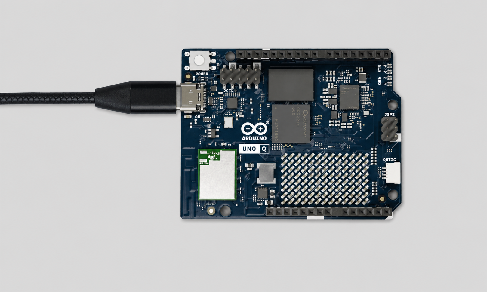

2. Open **Arduino App Lab**. After the device starts successfully, click the **Arduino UNO Q** development board icon to connect.


3. Click the **My Apps** icon in the upper-left corner to import the project.

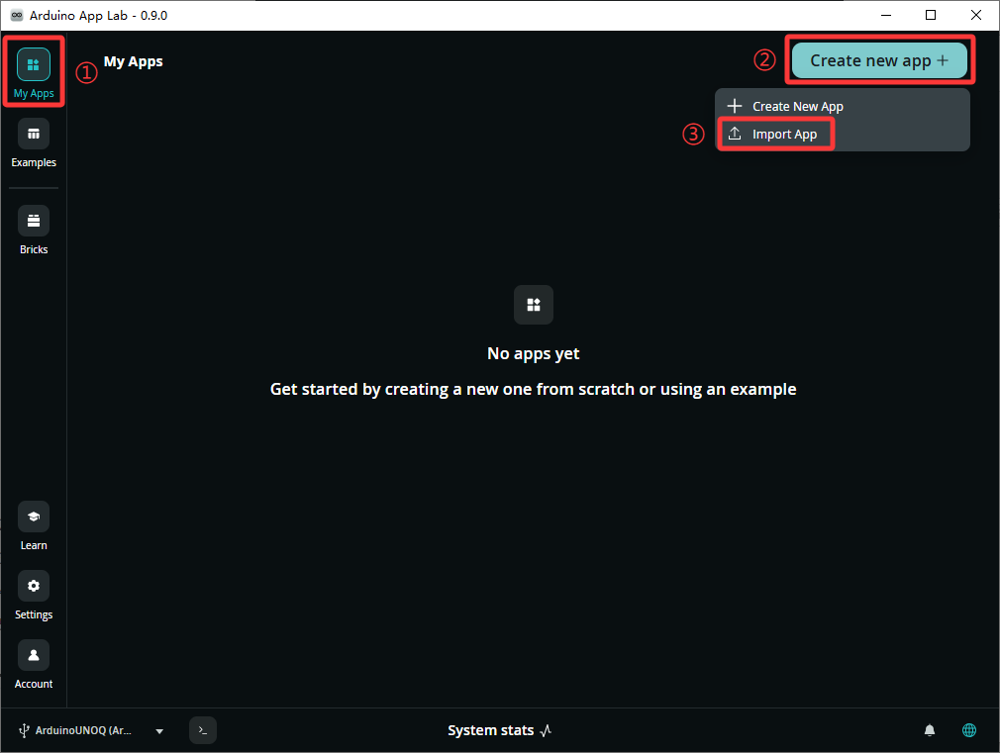

4. Use the **system_resources_logger** project as an example. Drag the corresponding project zip package into the window.


5. After the import success prompt appears, click the corresponding project icon to enter the project.


6. In the project, click the **Run** button in the upper-right corner to run the current project.


7. To run the program automatically after the development board powers on, configure it as shown below.


<p id="p5-2"></p>

## 5.2 Connect to Wi-Fi

The networking capability of UNO Q is mainly provided by the Linux side. When using Arduino App Lab, first make sure the development board has completed initial setup and is connected to an accessible network. After network configuration is complete, UNO Q should be reachable from a computer on the same LAN.

If the program needs to run automatically after the development board powers on, configure it as shown below.

1. After connecting the development board, click the settings button in the lower-left corner.

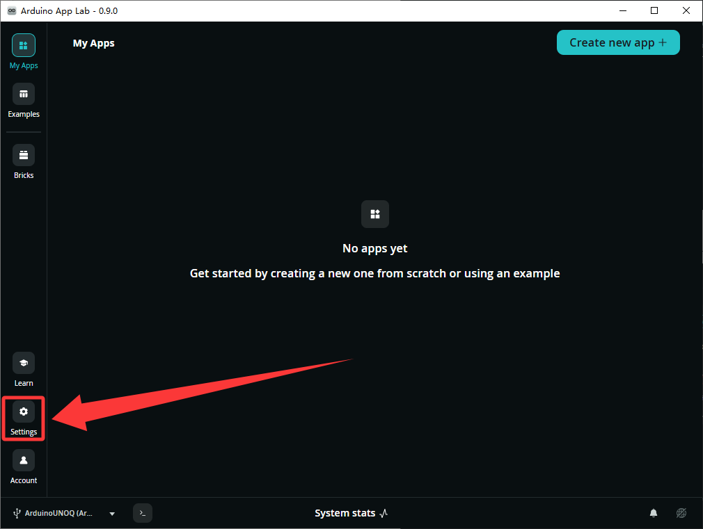

2. At the bottom, find the network connection section, then click the button to search for nearby networks.

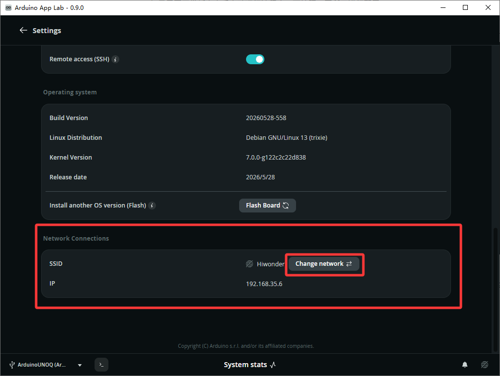

3. In the scanned Wi-Fi list, find the target Wi-Fi network and click it to connect.

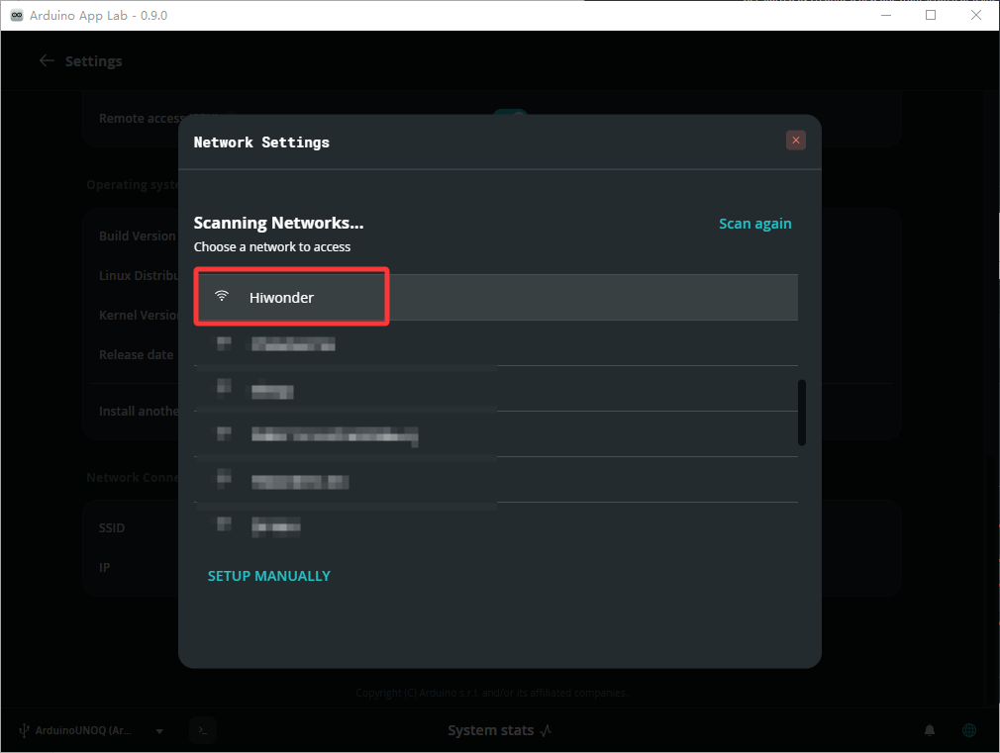

4. Enter the password in the pop-up window, then click **Connect**.

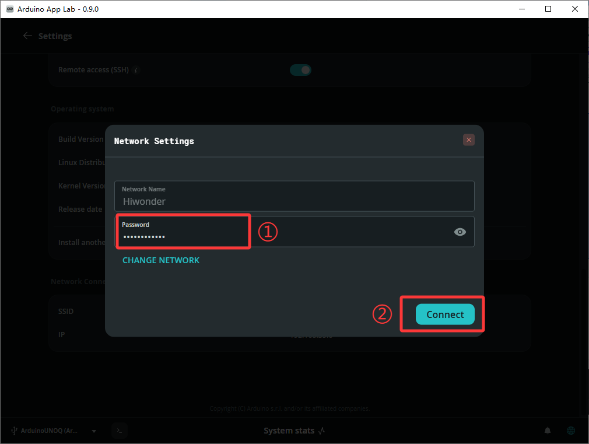

5. After the connection succeeds, the network icon in the lower-right corner shows the connected state.

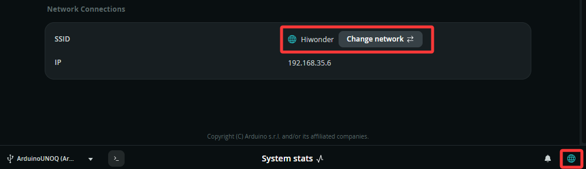

<p id="p5-3"></p>

## 5.3 Local REST and Status API

### 5.3.1 Experiment Overview

This section builds a local status page for viewing the current CPU usage, memory usage, and historical trends of UNO Q in a browser. The program collects CPU and memory usage on the Linux side of UNO Q, writes the data to a time-series database, and displays real-time status and historical curves on a local web page.

Python periodically samples system resources and writes the data to `TimeSeriesStore`. Real-time data is pushed to the page through WebSocket, while historical data is queried through a REST API. WebSocket is suitable for live display, and REST is suitable for querying historical data on demand. Used together, the page can display the latest status and read historical samples from the database by time range.

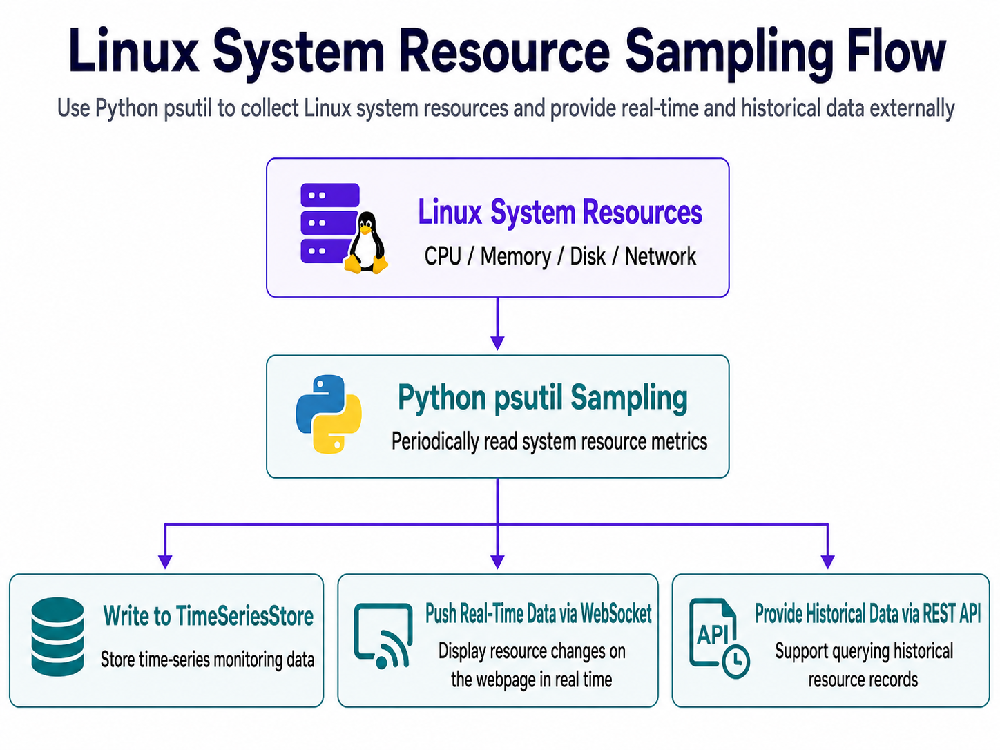

The overall process is as follows:

```text
Linux system resources
   |
   v
Python psutil sampling
   |
   |-> Write to TimeSeriesStore
   |-> Push real-time data through WebSocket
   |-> Provide historical data through REST API
```

### 5.3.2 Program Download

Find the [**2. Software & Programs\02 Source Code\5. Networking and AI Applications\5.3_system_resources_logger.zip**](https://drive.google.com/drive/folders/1l7Egyx6d9QafFFmkMMQ4Pn_qcRFXslCs?usp=sharing) source package and import it. Refer to [5.1 Program Download (Must Read)](#p5-1) for the detailed download procedure.

### 5.3.3 Project Outcome

> [!NOTE]
>
> **After the App runs, open the page in a browser based on the connection method.**
>
> **For USB wired connection with a local browser, open `http://127.0.0.1:7000`.**
>
> **For LAN access, use `http://<UNO-Q-IP-ADDRESS>:7000`.**

The page displays the current CPU and memory usage of UNO Q and provides views such as **Live**, **1h**, and **1D**:

| Page area | Function |
|---|---|
| **Live** | Displays the latest system resources in real time |
| **1h** | Queries historical data from the last 1 hour |
| **1D** | Queries historical data from the last 1 day |
| **Status indicator** | Refreshes the indicator when new data arrives |

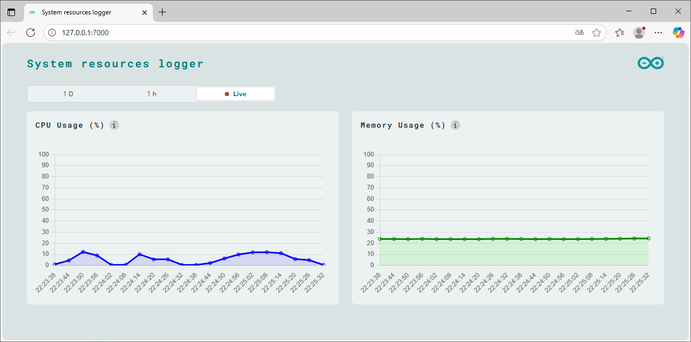

### 5.3.4 Program Analysis

* **app.yaml file**

This program uses:

```yaml
bricks:
  - arduino:dbstorage_tsstore
  - arduino:web_ui
```

`dbstorage_tsstore` is used for time-series storage. `web_ui` is used for the web page, WebSocket, and REST API.

* **python/main.py file**

The program first creates the database and Web UI:

```python
db = TimeSeriesStore()
ui = WebUI()
```

It then exposes the local REST API:

```python
ui.expose_api("GET", "/get_samples/{resource}/{start}/{aggr_window}", on_get_samples)
```

This API contains three path parameters:

| Parameter | Meaning |
|---|---|
| `resource` | Resource to query, such as `cpu` or `mem` |
| `start` | Query start time |
| `aggr_window` | Aggregation window, such as 5 minutes or 1 hour |

The `get_events()` function handles periodic sampling:

```python
cpu_percent = psutil.cpu_percent(interval=1)
db.write_sample('cpu', cpu_percent, ts)
ui.send_message('cpu_usage', {"value": cpu_percent, "ts": ts})

mem_percent = psutil.virtual_memory().percent
db.write_sample('mem', mem_percent, ts)
ui.send_message('memory_usage', {"value": mem_percent, "ts": ts})
```

This section has three parts:

| Part | Function |
|---|---|
| `psutil` | Reads Linux system resources |
| `db.write_sample()` | Writes data to the time-series database |
| `ui.send_message()` | Pushes real-time status to the web page |

Finally, the program uses:

```python
App.run(user_loop=get_events)
```

This allows App Lab to keep running the `get_events()` sampling loop while the Web service is active. Think of `get_events()` as a background sampling task. Each run performs only one sampling cycle: get the timestamp, read CPU usage, write the database, push the page update, read memory usage, write the database, push the page update, then return control to the App runtime. In this structure, the Web service is not blocked by an infinite loop, and REST API requests from the page can still receive normal responses.

<p id="p5-4"></p>

## 5.4 Add and Run a Brick

### 5.4.1 Experiment Overview

A Brick is a functional module provided by App Lab. Once a Brick is added, a Python program can access its capabilities, such as building a web interface, storing data, classifying images, or detecting objects. Understanding how Bricks are connected and configured makes the image classification and object detection sections easier to follow. Rather than simply copying configuration code, you will understand the purpose of each line.

This section uses the simplest `arduino:web_ui` Brick as an example. It declares the Web UI Brick in `app.yaml`, creates a `WebUI()` object in Python, and uses the `/status` API to confirm that the Brick is available to the program.

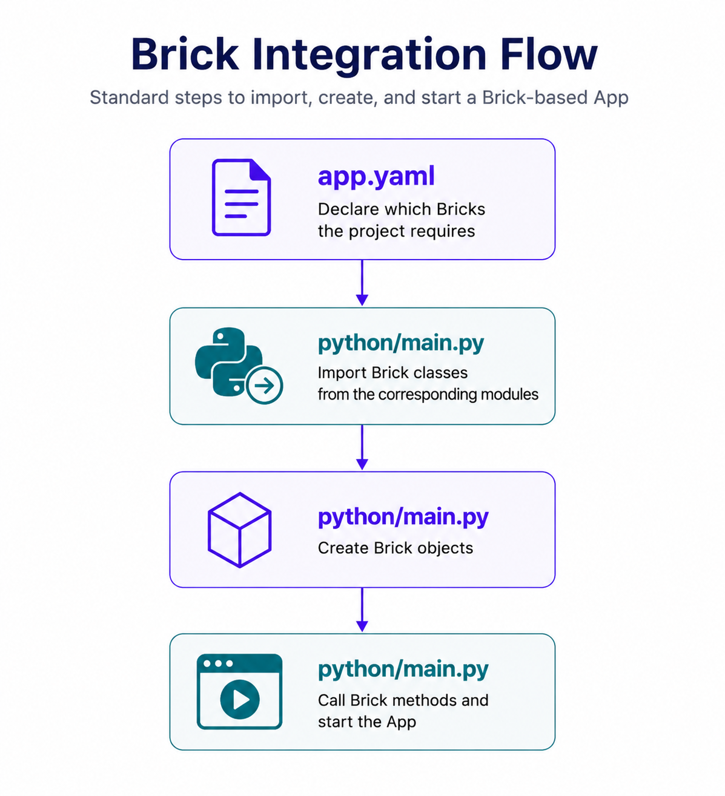

### 5.4.2 Connection Process

* **Step 1: Declare the Brick in app.yaml**

```yaml
bricks:
  - arduino:web_ui
```

The `app.yaml` file declares the `web_ui` Brick as a project dependency, enabling the App Lab runtime to load and initialize the required functionality. Without this declaration, the runtime may not make the `web_ui` functionality available, even if `WebUI()` is referenced in the Python code.

Common Brick declarations are as follows:

| Brick | Function | Later sections |
|---|---|---|
| `arduino:web_ui` | Provides local web pages, REST APIs, and WebSocket capability | 5.4, 5.5, 5.6 |
| `arduino:dbstorage_tsstore` | Stores time-series data | 5.3 |
| `arduino:image_classification` | Performs image classification | 5.5 |
| `arduino:object_detection` | Performs object detection | 5.6 |

* **Step 2: Import the Brick class in Python**

```python
from arduino.app_bricks.web_ui import WebUI
```

The import path usually corresponds to the Brick name. `arduino:web_ui` corresponds to `arduino.app_bricks.web_ui`, and the class name is `WebUI`.

* **Step 3: Create the Brick object**

```python
ui = WebUI()
```

After the object is created, Python can call the methods provided by this Brick. This section only uses `ui.expose_api()` to expose a `/status` API, so the connection process stays clear. Other Web UI features are used in later applications.

* **Step 4: Call the Brick method and start the App**

```python
def get_status():
    return {
        "ok": True,
        "brick": "arduino:web_ui",
        "python_object": "WebUI",
        "status": "ready",
    }

ui.expose_api("GET", "/status", get_status)
App.run()
```

`ui.expose_api()` turns a Python function into a local API that a browser can access. `App.run()` starts the App Lab runtime, and the page and API begin working only after that.

The `ui.expose_api()` arguments are as follows:

| Argument | Type | Description |
|---|---|---|
| `method` | String | HTTP method, such as `"GET"` or `"POST"` |
| `path` | String | API path, such as `"/status"` |
| `handler` | Function object | Python function executed when a browser accesses this path |

| Item | Description |
|---|---|
| Return value | The return value of `handler` is converted into an HTTP response |
| Use case | Read status, query results, or submit configuration from a page |
| Notes | Use return values that are easy to convert to JSON, such as dictionaries, lists, strings, and numbers |

The connection process stays the same when adding AI Bricks in later sections. Only the declared and imported Brick changes:

| Function | app.yaml declaration | Python import and creation |
|---|---|---|
| Image classification | `arduino:image_classification` | `from arduino.app_bricks.image_classification import ImageClassification` |
| Object detection | `arduino:object_detection` | `from arduino.app_bricks.object_detection import ObjectDetection` |

### 5.4.3 Program Download

Find the [**2. Software & Programs\02 Source Code\5. Networking and AI Applications\5.4_brick_template.zip**](https://drive.google.com/drive/folders/1l7Egyx6d9QafFFmkMMQ4Pn_qcRFXslCs?usp=sharing) source package and import it. Refer to [5.1 Program Download (Must Read)](#p5-1) for the detailed download procedure.

### 5.4.4 Project Outcome

> [!NOTE]
>
> **After the App runs, open the page in a browser based on the connection method.**
>
> **For USB wired connection with a local browser, open `http://127.0.0.1:7000`.**
>
> **For LAN access, use `http://<UNO-Q-IP-ADDRESS>:7000`.**

After the minimal template is imported and run, the page provides a simple status API test entry. After **Refresh Status** is clicked, the browser requests the `/status` API exposed by the Python side and displays the returned result.

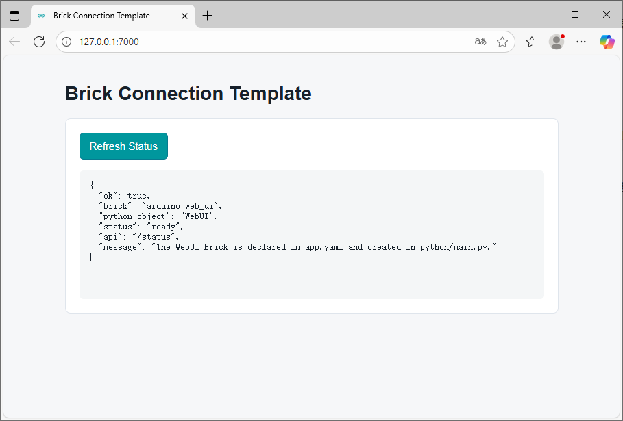

### 5.4.5 Program Analysis

* **app.yaml file**

This project declares only one Brick:

```yaml
bricks:
  - arduino:web_ui
```

This configuration line lets App Lab load Web UI capability when running the project. Image classification and object detection in sections 5.5 and 5.6 also add their corresponding Bricks here.

* **python/main.py file**

The Python side first imports `WebUI`:

```python
from arduino.app_bricks.web_ui import WebUI
```

Then it creates the object:

```python
ui = WebUI()
```

This step means Python has obtained the capability provided by the `web_ui` Brick. Next, define a normal Python function:

```python
def get_status():
    return {
        "ok": True,
        "brick": "arduino:web_ui",
        "python_object": "WebUI",
        "status": "ready",
        "api": "/status",
    }
```

Then attach this function to the Web UI REST API:

```python
ui.expose_api("GET", "/status", get_status)
```

Finally, start the App:

```python
App.run()
```

* **assets/index.html file**

The page contains only one **Refresh Status** button. After the button is clicked, the frontend requests `/status`:

```javascript
const response = await fetch('/status');
const data = await response.json();
statusOutput.textContent = JSON.stringify(data, null, 2);
```

The frontend does not need to know how `WebUI()` is created. It only needs to access the API exposed by Python. This divides the Brick connection process into two clear layers: Python loads and calls the Brick, while the web page displays the call result.

Remember this fixed template in this section:

```text
Declare Brick -> import class -> create object -> call method -> App.run()
```

Later image classification and object detection only replace this template with more specific Bricks. Image classification adds `ImageClassification()` and `classify()`. Object detection adds `ObjectDetection()` and `detect()`. The connection idea is the same.

<p id="p5-5"></p>

## 5.5 Image Classification

### 5.5.1 Experiment Overview

This section builds an image classification page. After an image is uploaded on the web page, the browser converts it to base64 and sends it to Python. Python reconstructs the image object, calls `image_classification.classify()` to obtain classification results, and then sends the results back to the page.

Image classification answers one question: what is the whole image most likely to be? The model does not mark object locations. It returns several classes and their confidence values. The confidence threshold on the page filters low-confidence results.


### 5.5.2 Program Download

Find the [**2. Software & Programs\02 Source Code\5. Networking and AI Applications\5.5_image_classification.zip**](https://drive.google.com/drive/folders/1l7Egyx6d9QafFFmkMMQ4Pn_qcRFXslCs?usp=sharing) source package and import it. Refer to [5.1 Program Download (Must Read)](#p5-1) for the detailed download procedure.

### 5.5.3 Project Outcome

> [!NOTE]
>
> **After the App runs, open the page in a browser based on the connection method.**
>
> **For USB wired connection with a local browser, open `http://127.0.0.1:7000`.**
>
> **For LAN access, use `http://<UNO-Q-IP-ADDRESS>:7000`.**

After the page opens:

1. Upload a JPG or PNG image.
2. Adjust the confidence threshold.
3. Click **Run classification**.
4. View the classification results and processing time.

After inference is complete, the page displays a list of classification results:

| Field | Meaning |
|---|---|
| Class name | Class predicted by the model |
| Confidence | How confident the model is in that class |
| Processing time | Time spent on this inference |

Increasing the confidence threshold filters out low-confidence results and keeps the page cleaner. Lowering the threshold may display more candidate classes, including less reliable ones.

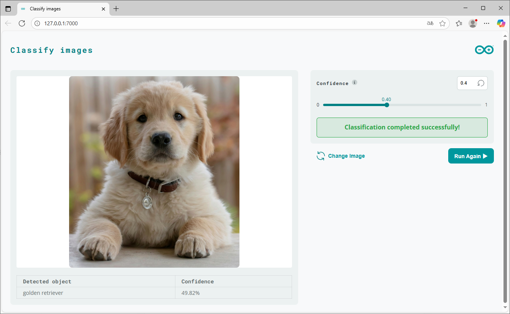

### 5.5.4 Program Analysis

* **app.yaml file**

```yaml
bricks:
  - arduino:web_ui
  - arduino:image_classification
```

`web_ui` handles browser interaction. `image_classification` handles image classification inference.

Common `ImageClassification()` API:

```text
image_classification.classify(pil_image, image_type, confidence)
```

| Argument | Type | Description |
|---|---|---|
| `pil_image` | `PIL.Image` object | Image to classify |
| `image_type` | String | Image format, such as `"jpeg"` or `"png"` |
| `confidence` | Float | Confidence threshold, usually in the range `0.0 ~ 1.0` |

| Item | Description |
|---|---|
| Return value | Classification result dictionary, usually containing a `classification` list |
| Use case | Determine the main class of an entire image |
| Notes | A higher threshold returns fewer results. Uploaded images must be reconstructed from base64 into image objects first |

* **python/main.py file**

The program first imports image processing and Brick modules:

```python
from arduino.app_bricks.web_ui import WebUI
from arduino.app_bricks.image_classification import ImageClassification
from PIL import Image
import io
import base64
```

The core handler is `on_classify_image()`, which includes the following parts:

| Part | Function |
|---|---|
| Read input | Reads the image, image type, and confidence value from the browser message |
| Decode image | Uses `base64.b64decode()` and `PIL.Image.open()` to reconstruct the image |
| Run inference | Calls `image_classification.classify()` |
| Return result | Uses `ui.send_message()` to send classification results or errors |

Key code:

```python
image_bytes = base64.b64decode(image_data)
pil_image = Image.open(io.BytesIO(image_bytes))
results = image_classification.classify(
    pil_image,
    image_type=image_type,
    confidence=confidence
)
```

Web UI message registration:

```python
ui = WebUI()
ui.on_message('classify_image', on_classify_image)
App.run()
```

This means that after the browser sends a `classify_image` message, Python runs image classification.

The core of this code is converting an image from the browser into an image object the model can process. For easier transmission, the browser converts the uploaded image to a base64 string. The Python side first uses `base64.b64decode()` to restore the bytes, then uses `Image.open()` to let PIL parse the image. At this point, the image has changed from web page data into a processable image object in Python.

Do not treat the `confidence` threshold as accuracy. It is only a filter for returned results. A higher threshold keeps the page cleaner, but some results may be filtered out. A lower threshold returns more candidates, but less reliable classifications may appear. Use the same image with `0.2`, `0.5`, and `0.8` to observe how the result count changes.

<p id="p5-6"></p>

## 5.6 Object Detection

### 5.6.1 Experiment Overview

This section builds an object detection page. After an image is uploaded, the program identifies multiple objects in the image and draws detection boxes. Unlike image classification, object detection not only determines what appears in the image, but also returns the position of each object and draws bounding boxes on the image.

After the browser uploads an image, Python calls `object_detection.detect()` to obtain detection results. It then uses `draw_bounding_boxes()` to draw the results back onto the image and returns the processed image to the page. Object detection outputs class, position, and confidence. Position is usually represented by a bounding box, so object detection is more suitable than image classification for counting, localization, alerts, and later hardware control.

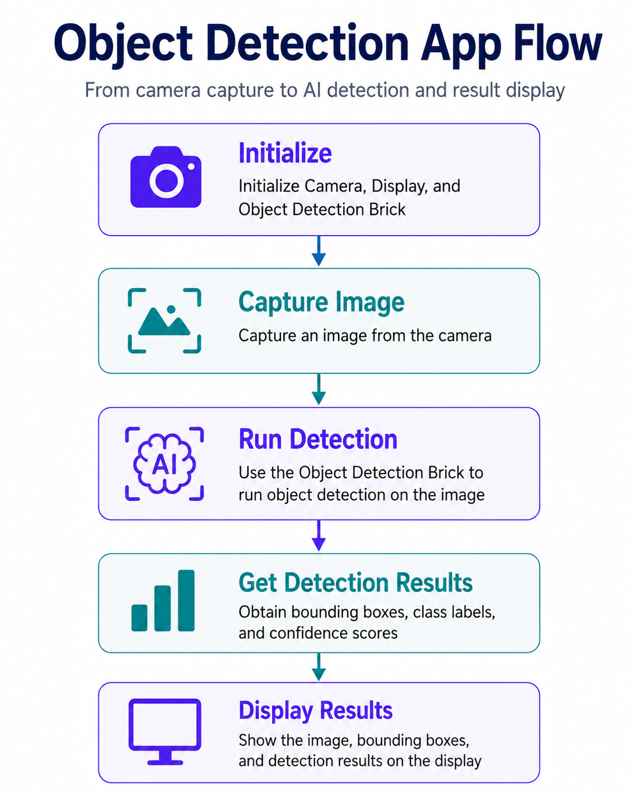

### 5.6.2 Program Download

Find the [**2. Software & Programs\02 Source Code\5. Networking and AI Applications\5.6_object_detection.zip**](https://drive.google.com/drive/folders/1l7Egyx6d9QafFFmkMMQ4Pn_qcRFXslCs?usp=sharing) source package and import it. Refer to [5.1 Program Download (Must Read)](#p5-1) for the detailed download procedure.

### 5.6.3 Project Outcome

> [!NOTE]
>
> **After the App runs, open the page in a browser based on the connection method.**
>
> **For USB wired connection with a local browser, open `http://127.0.0.1:7000`.**
>
> **For LAN access, use `http://<UNO-Q-IP-ADDRESS>:7000`.**

After the page opens:

1. Upload the image to detect.
2. Adjust the confidence threshold.
3. Click **Run detection**.
4. View the result image with bounding boxes.

The program returns the detection result image with detected objects boxed and labeled. The page usually displays:

| Field | Meaning |
|---|---|
| Detection count | Number of objects detected in the image |
| Result image | Image after bounding boxes are drawn |
| Processing time | Time spent on this detection |

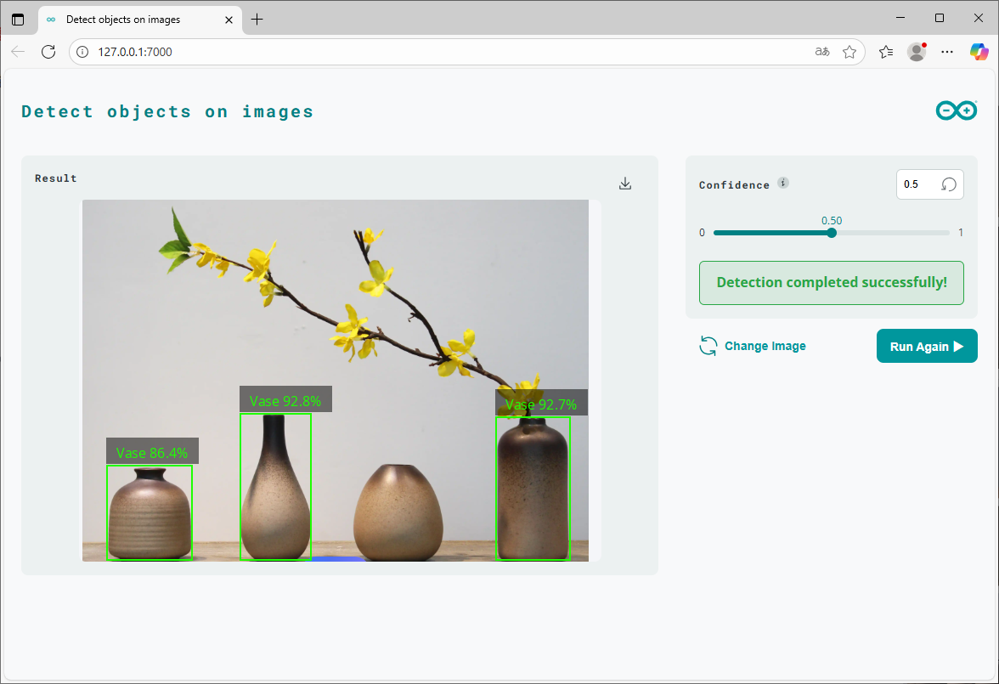

### 5.6.4 Program Analysis

* **app.yaml file**

```yaml
bricks:
  - arduino:web_ui
  - arduino:object_detection
```

The `object_detection` Brick performs object detection, and `web_ui` handles image upload and result display.

Common `ObjectDetection()` API:

```text
object_detection.detect(pil_image, confidence)
```

| Argument | Type | Description |
|---|---|---|
| `pil_image` | `PIL.Image` object | Image to detect |
| `confidence` | Float | Confidence threshold, usually in the range `0.0 ~ 1.0` |

| Item | Description |
|---|---|
| Return value | Detection result dictionary, usually containing object classes, confidence values, and bounding box information |
| Use case | Find which objects are in the image and where they are located |
| Notes | If the image is too dark, the object is too small, or the threshold is too high, no result may be detected |

Bounding box drawing API:

```text
object_detection.draw_bounding_boxes(pil_image, results)
```

| Argument | Type | Description |
|---|---|---|
| `pil_image` | `PIL.Image` object | Original image |
| `results` | Dictionary | Detection result returned by `detect()` |

| Item | Description |
|---|---|
| Return value | Image object with bounding boxes drawn |
| Use case | Converts model detection results into a result image that is easy to understand |
| Notes | The returned image still needs to be encoded as PNG, JPEG, or base64 before being sent to the browser |

* **python/main.py file**

The program creates the detection object:

```python
object_detection = ObjectDetection()
```

The core function `on_detect_objects()` can be divided into five parts:

| Part | Function |
|---|---|
| Read input | Gets the base64 image and confidence value uploaded by the browser |
| Decode image | Converts the data into a PIL image object |
| Model detection | Calls `object_detection.detect()` |
| Draw result | Calls `draw_bounding_boxes()` to generate the boxed image |
| Return to page | Re-encodes the result image as base64 and sends it to the browser |

Key detection code:

```python
results = object_detection.detect(pil_image, confidence=confidence)
img_with_boxes = object_detection.draw_bounding_boxes(pil_image, results)
```

The result image is re-encoded before being returned:

```python
img_buffer = io.BytesIO()
img_with_boxes.save(img_buffer, format="PNG")
b64_result = base64.b64encode(img_buffer.getvalue()).decode("utf-8")
```

Finally, register the Web UI message:

```python
ui = WebUI()
ui.on_message('detect_objects', on_detect_objects)
App.run()
```

Object detection adds one more step than image classification: result visualization. `detect()` returns model results, which may not be easy to understand directly. `draw_bounding_boxes()` draws the results back onto the image, making it clear which objects were recognized. This conversion is a good example of AI application post-processing. Model output is usually not the final product form. It often needs to be converted into pages, charts, control commands, or alert messages.

If the detection result is empty, first check three things: whether the object is clear in the image, whether the confidence threshold is too high, and whether the model supports that object class. Do not assume the program has crashed as soon as the result is empty. In many cases, the threshold or sample selection is not suitable.

The differences between image classification and object detection are as follows:

| Item | Image classification | Object detection |
|---|---|---|
| Input | One image | One image |
| Output | Image class and confidence | Target class, count, and position |
| Draws boxes | No | Yes |
| Suitable scenario | Determines what the overall image is | Finds which objects are in the image |
| Related project | `image-classification` | `object-detection` |
