# 6. Integrated Project Practice

This chapter combines the networking, Bridge, Web UI, and AI Brick features covered earlier to build integrated projects, including RGB light control, weather forecast, air quality monitoring, and remote video object detection. These integrated projects no longer verify a single API only. Instead, they connect data sources, program processing, and page or hardware output into complete workflows.

<p id="p6-1"></p>

## 6.1 Program Download (Must Read)

1. Connect the **Arduino UNO Q** development board to the PC with a **Type-C** data cable, as shown below:


2. Open **Arduino App Lab**. After the device starts successfully, click the **Arduino UNO Q** development board icon to connect.


3. Click the **My Apps** icon in the upper-left corner to import the project.


4. Use the **color_your_leds** project as an example. Drag the corresponding project zip package into the window.


5. After the import success prompt appears, click the corresponding project icon to enter the project.


6. In the project, click the **Run** button in the upper-right corner to run the current project.


7. To run the program automatically after the development board powers on, configure it as shown below.


<p id="p6-2"></p>

## 6.2 RGB Light Control

### 6.2.1 Experiment Overview

This section builds an RGB light control project. UNO Q has four built-in RGB LEDs. LED 1 and LED 2 are controlled directly by the Linux side, while LED 3 and LED 4 are controlled by the MCU side. The web page provides switches and color selection. The Python side receives page messages and dispatches each command to the Linux side or MCU side based on the LED number.

This project is useful for understanding how the two sides of UNO Q divide work inside the same application. Even though each action sets an LED color, the control path is not exactly the same for every LED.

| LED | Control location | Control method |
|---|---|---|
| LED 1 | Linux / MPU | `Leds.set_led1_color()` |
| LED 2 | Linux / MPU | `Leds.set_led2_color()` |
| LED 3 | MCU | `Bridge.call("set_led3_color", r, g, b)` |
| LED 4 | MCU | `Bridge.call("set_led4_color", r_on, g_on, b_on)` |

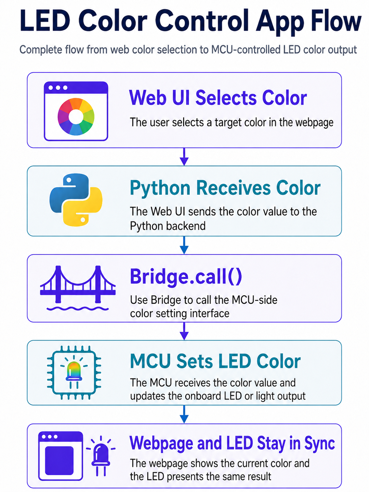

### 6.2.2 Program Download

Find the [**2. Software & Programs\02 Source Code\6. Integrated Project Practice\6.2_color_your_leds.zip**](https://drive.google.com/drive/folders/1hJ-aFXBa9cMP_oOKcXAxOCIsvk7rKrVv?usp=sharing) source package and import it. Refer to [6.1 Program Download (Must Read)](#p6-1) for the detailed download procedure.

### 6.2.3 Project Outcome

> [!NOTE]
>
> **After the App runs, open the page in a browser based on the connection method.**
>
> **For USB wired connection with a local browser, open `http://127.0.0.1:7000`.**
>
> **For LAN access, use `http://<UNO-Q-IP-ADDRESS>:7000`.**

The page displays a diagram of the UNO Q LEDs and four control cards. Each LED can be turned on or off with a switch. LED 1, LED 2, and LED 4 use preset color buttons, while LED 3 supports a more complete color selector.

Observe the project in the following order:

1. Turn on LED 1, select red, green, or blue, then observe the built-in LED.
2. Turn on LED 3, drag the color selector, then observe the PWM color mixing effect.
3. Turn off an LED, then check whether the page state and the physical LED stay synchronized.
4. Refresh the web page, then check whether the current state is synchronized to the hardware after reconnection.

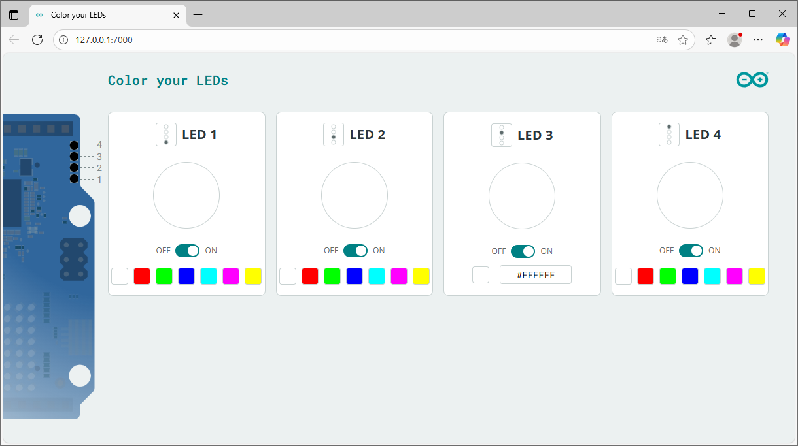

### 6.2.4 Program Analysis

* **app.yaml file**

```yaml
name: Color your LEDs
icon: 🎨
description: Control the color of your LEDs from a web interface.

bricks:
  - arduino:web_ui
```

This project uses the `web_ui` Brick to provide the web page and WebSocket channel. Color operations on the page do not control hardware directly. They are sent to the Python backend first.

* **python/main.py file**

The Python side creates the Web UI and registers the `set_color` message:

```python
ui = WebUI()
ui.on_message("set_color", on_set_color)
```

Each time the browser toggles a switch or selects a color, it sends data similar to the following:

```json
{
  "led": 3,
  "color": {
    "r": 255,
    "g": 128,
    "b": 0
  }
}
```

`on_set_color()` first reads the LED number and RGB data, then checks the format:

```python
ledid = message.get("led")
rgb_color = message.get("color")

if ledid not in (1, 2, 3, 4):
    raise ValueError(f"Unknown led '{ledid}'")

if not rgb_color or not all(k in rgb_color for k in ("r", "g", "b")):
    raise ValueError("Color must be an object with 'r', 'g', 'b' keys")
```

Then it dispatches the command to different control paths based on the LED number:

```python
if ledid == 1:
    Leds.set_led1_color(rgb_color["r"] != 0, rgb_color["g"] != 0, rgb_color["b"] != 0)
elif ledid == 2:
    Leds.set_led2_color(rgb_color["r"] != 0, rgb_color["g"] != 0, rgb_color["b"] != 0)
elif ledid == 3:
    Bridge.call("set_led3_color", rgb_color["r"], rgb_color["g"], rgb_color["b"])
elif ledid == 4:
    Bridge.call("set_led4_color", rgb_color["r"] != 0, rgb_color["g"] != 0, rgb_color["b"] != 0)
```

The key point is routing logic. LED 1 and LED 2 call the `Leds` interface directly on the Linux side. LED 3 and LED 4 send commands to the MCU through Bridge.

* **sketch/sketch.ino file**

The MCU side provides two functions:

```cpp
void set_led3_color(int r, int g, int b) {
  analogWrite(LED3_R, r);
  analogWrite(LED3_G, g);
  analogWrite(LED3_B, b);
}
```

LED 3 uses PWM output. `r`, `g`, and `b` can be values from 0 to 255, so richer mixed colors can be displayed.

```cpp
void set_led4_color(bool r, bool g, bool b) {
  digitalWrite(LED4_R, r ? LOW : HIGH);
  digitalWrite(LED4_G, g ? LOW : HIGH);
  digitalWrite(LED4_B, b ? LOW : HIGH);
}
```

LED 4 uses digital output. Each color channel has only two states, on and off, so it can only combine a limited set of colors. It is active-low, so writing `LOW` when the value is `true` turns the channel on.

Register the Bridge providers in `setup()`:

```cpp
Bridge.begin();
Bridge.provide("set_led3_color", set_led3_color);
Bridge.provide("set_led4_color", set_led4_color);
```

The function names called by Python must exactly match the names registered here.

* **assets/app.js file**

The frontend uses `ledState` to store page state:

```javascript
const ledState = {
  1: { color: '#FFFFFF', isOn: true },
  2: { color: '#FFFFFF', isOn: true },
  3: { color: '#FFFFFF', isOn: true },
  4: { color: '#FFFFFF', isOn: true },
};
```

When the color changes, the frontend converts the hexadecimal color value to RGB and sends it to Python:

```javascript
const rgb = hexToRgb(newColor);
ui.send_message('set_color', { led: ledNumber, color: rgb });
```

When the page reconnects, all LED states are synchronized again so the physical hardware and page display remain consistent.

<p id="p6-3"></p>

## 6.3 Weather Forecast

### 6.3.1 Experiment Overview

This section builds a weather forecast display project. The MCU side stores the city name and passes it to Python through Bridge. Python uses the `weather_forecast` Brick to get the current weather and returns a simplified weather category, such as `sunny`, `cloudy`, `rainy`, `snowy`, or `foggy`. The MCU then plays the corresponding animation on the LED matrix based on the category.

This project is similar to air quality monitoring, but it adds one important point: when the MCU calls the Python function, it passes an argument, which is the city name.

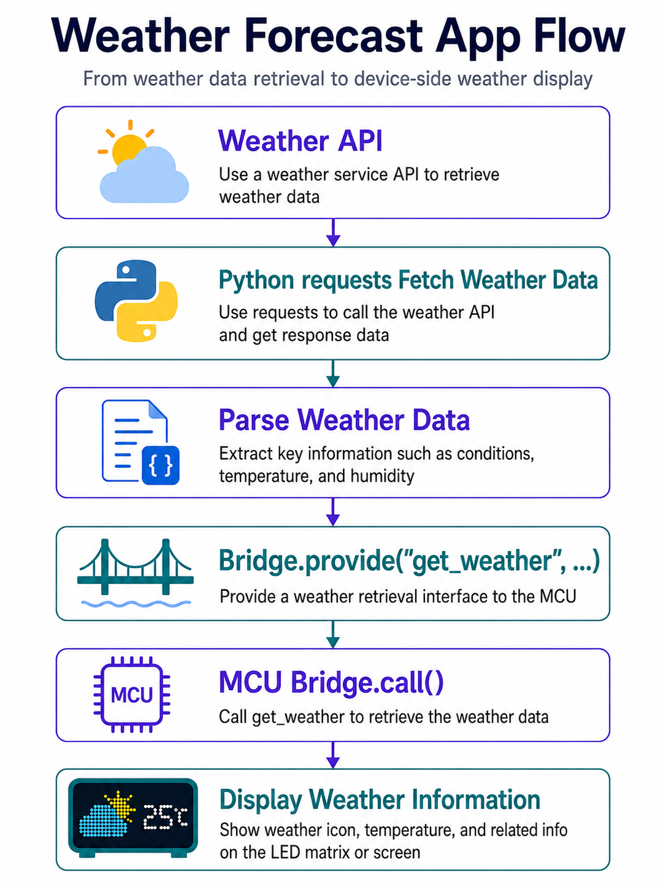

### 6.3.2 City Configuration

Open `sketch/sketch.ino` and find the city configuration:

```cpp
String city = "Shenzhen";
```

Change `Shenzhen` to the city to query, such as `NewYork`. After the program runs, the MCU sends this string as an argument to `get_weather_forecast(city)` on the Python side.

### 6.3.3 Program Download

Find the [**2. Software & Programs\02 Source Code\6. Integrated Project Practice\6.3_weather_forecast.zip**](https://drive.google.com/drive/folders/1hJ-aFXBa9cMP_oOKcXAxOCIsvk7rKrVv?usp=sharing) source package and import it. Refer to [6.1 Program Download (Must Read)](#p6-1) for the detailed download procedure.

### 6.3.4 Project Outcome

After running, UNO Q periodically queries the current weather and plays the corresponding animation on the LED matrix.

The mapping between weather categories and animations is as follows:

| Returned category | Display effect |
|---|---|
| `sunny` | Sunny animation |
| `cloudy` | Cloudy animation |
| `rainy` | Rain animation |
| `snowy` | Snow animation |
| `foggy` | Fog animation |

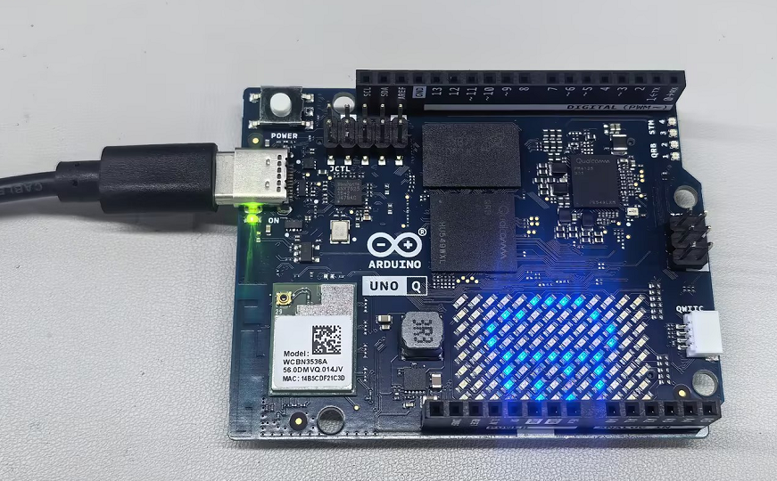

### 6.3.5 Program Analysis

* **app.yaml file**

```yaml
name: Weather forecast on LED matrix
icon: ☀️
description: A weather forecast system that get the current weather and display it on LED matrix.

bricks:
  - arduino:weather_forecast
```

This project uses the `weather_forecast` Brick to obtain weather data. The Brick wraps weather lookup and weather code conversion, so the Python side only needs to call a clear interface.

* **python/main.py file**

The Python side creates a weather query object:

```python
forecaster = WeatherForecast()
```

The core function receives the city name and returns the weather category:

```python
def get_weather_forecast(city: str) -> str:
    forecast = forecaster.get_forecast_by_city(city)
    print(f"Weather forecast for {city}: {forecast.description}")
    return forecast.category
```

This code has three steps:

| Step | Function |
|---|---|
| Receive `city` | Gets the city name from the MCU side |
| `get_forecast_by_city(city)` | Queries the weather for that city |
| Return `forecast.category` | Returns the simplified category for MCU-side judgment |

Finally, expose the function to MCU:

```python
Bridge.provide("get_weather_forecast", get_weather_forecast)
App.run()
```

* **sketch/sketch.ino file**

The MCU side stores the city name:

```cpp
String city = "NewYork";
```

In each loop, MCU passes the city name to Python as an argument:

```cpp
String weather_forecast;
bool ok = Bridge.call("get_weather_forecast", city).result(weather_forecast);
```

This is different from a Bridge call with no argument. `city` is also passed to `get_weather_forecast(city)` on the Python side.

After receiving the weather category, MCU plays the corresponding animation:

```cpp
if (weather_forecast == "sunny") {
  matrix.loadSequence(sunny);
  playRepeat(10);
} else if (weather_forecast == "rainy") {
  matrix.loadSequence(rainy);
  playRepeat(20);
}
```

Animation frames are stored in `weather_frames.h`. Different weather conditions use different repeat counts and animation rhythms. For example, rain animation plays faster, while fog animation plays more slowly.

Playback function:

```cpp
void playRepeat(int repeat_count) {
  for (int i = 0; i < repeat_count; i++) {
    matrix.playSequence();
  }
}
```

This function repeats the animation sequence that has already been loaded into the matrix several times, creating a dynamic weather icon.

<p id="p6-4"></p>

## 6.4 Air Quality Monitoring

### 6.4.1 Experiment Overview

This section builds an air quality monitoring project. The Python side obtains the air quality index AQI for the specified city through the AQICN API, then converts the value into air quality levels such as `Good`, `Moderate`, and `Unhealthy`. The MCU side calls the Python function through Bridge, then displays different expression icons on the UNO Q LED matrix based on the returned level.

This project connects three capabilities:

| Part | Function |
|---|---|
| Linux / Python | Accesses a network API, parses JSON, and converts AQI levels |
| Router Bridge | Allows MCU to call `get_air_quality()` in Python |
| MCU / LED Matrix | Periodically requests the air quality level and displays the corresponding icon |

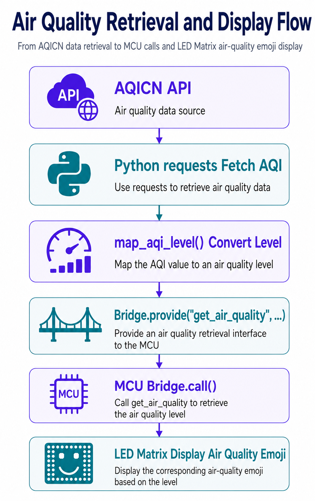

### 6.4.2 API Configuration

Before running the program, configure the AQICN API Token and city name first. Open `python/main.py` and find the following two settings:

```python
API_TOKEN = "demo"
city = "NewYork"
```

Change `API_TOKEN` to an AQICN Token, and change `city` to the city to query. Apply for an AQICN API Token by following the steps below:

1. Open the AQICN Token application page, then enter an email address, name, or organization information.

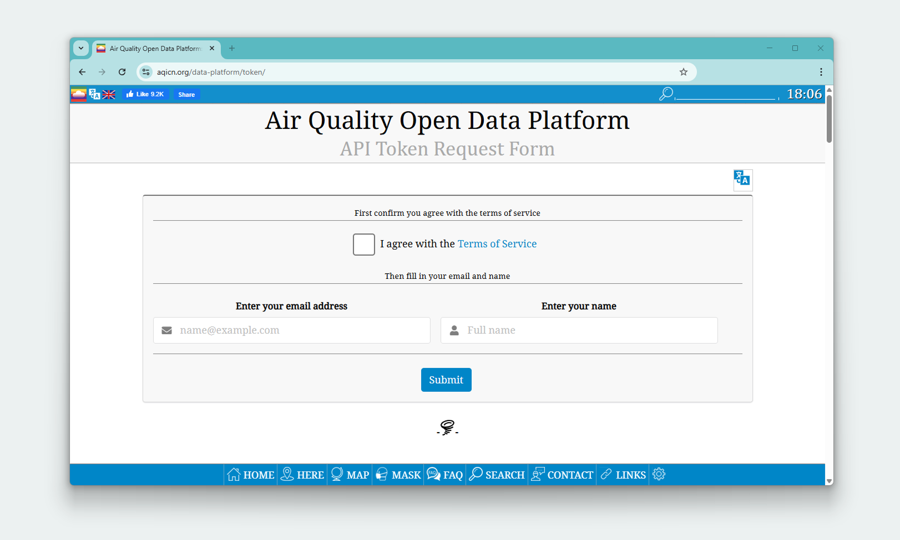

2. Confirm the application information and terms of service.

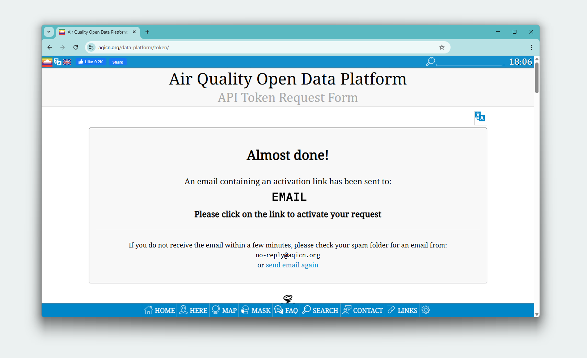

3. Open the confirmation link in the email.

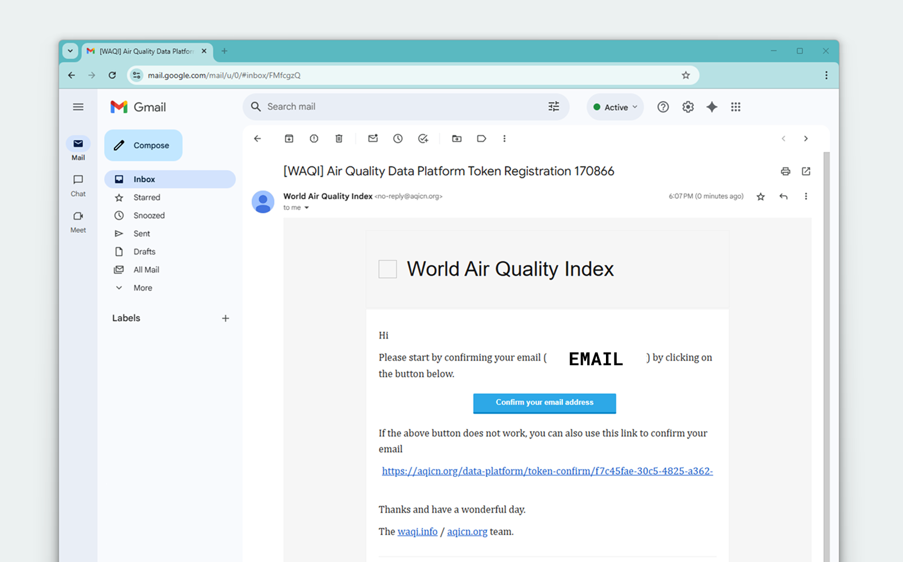

4. After the page displays the Token, copy it to `API_TOKEN`.

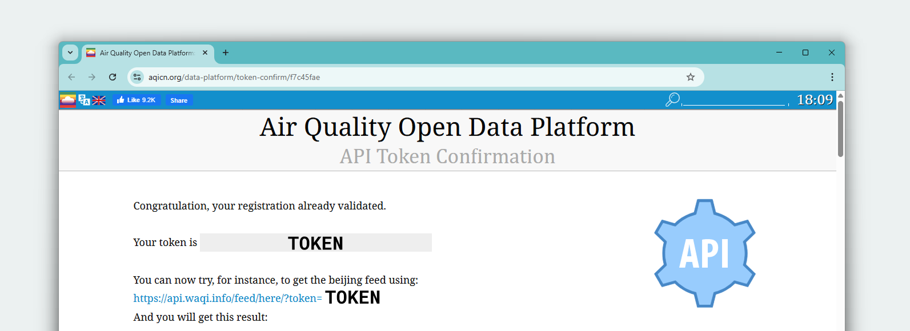

### 6.4.3 Program Download

Find the [**2. Software & Programs\02 Source Code\6. Integrated Project Practice\6.4_air_quality_monitoring.zip**](https://drive.google.com/drive/folders/1hJ-aFXBa9cMP_oOKcXAxOCIsvk7rKrVv?usp=sharing) source package and import it. Refer to [6.1 Program Download (Must Read)](#p6-1) for the detailed download procedure.

### 6.4.4 Project Outcome

When the network is normal and the Token is valid, UNO Q periodically obtains air quality data and displays the corresponding icon on the LED matrix.

The mapping between AQI levels and icons is as follows:

| AQI range | Returned level | Display effect |
|---|---|---|
| 0 - 50 | `Good` | Relaxed expression |
| 51 - 100 | `Moderate` | Neutral expression |
| 101 - 150 | `Unhealthy for Sensitive Groups` | Unhealthy for sensitive groups |
| 151 - 200 | `Unhealthy` | Unhealthy |
| 201 - 300 | `Very Unhealthy` | Very unhealthy |
| 301 - 500 | `Hazardous` | Hazardous |
| Other cases | `N/A` or unknown | Fallback icon |

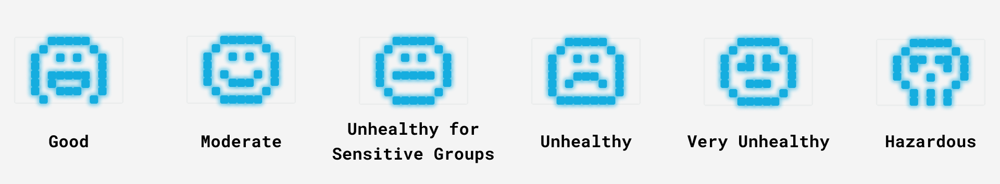

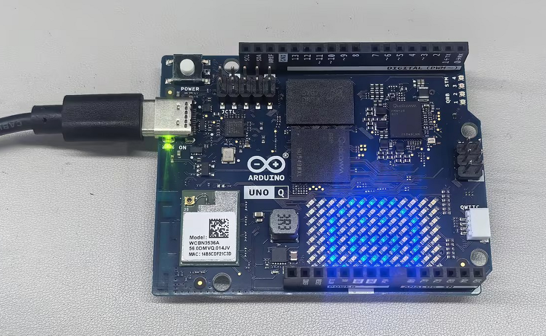

### 6.4.5 Program Analysis

* **app.yaml file**

```yaml
name: Air quality on LED matrix
description: An Air Quality Monitoring System that uses air quality AQI API data to show the air quality state on the LED matrix.
icon: 🍃
bricks:
  - arduino:air_quality_monitoring
```

This project is not a web page project, and the focus is not AI inference. The focus is network API access, Bridge, and LED matrix display. `app.yaml` declares project information and the capabilities that need to be loaded at runtime.

* **python/main.py file**

The Python side first configures the Token, city, and API endpoint:

```python
API_TOKEN = "demo"
city = "Torino"
endpoint = f"https://api.waqi.info/feed/{city}/?token={API_TOKEN}"
```

`API_TOKEN` is used to access the AQICN service, and `city` determines which city to query. `endpoint` is the final request URL, and `requests.get(endpoint)` accesses this URL later.

The air quality level table is stored in `AQI_LEVELS`:

```python
AQI_LEVELS = [
    {"min": 0, "max": 50, "description": "Good"},
    {"min": 51, "max": 100, "description": "Moderate"},
    {"min": 101, "max": 150, "description": "Unhealthy for Sensitive Groups"},
    {"min": 151, "max": 200, "description": "Unhealthy"},
    {"min": 201, "max": 300, "description": "Very Unhealthy"},
    {"min": 301, "max": 500, "description": "Hazardous"},
]
```

This table converts AQI numbers into text levels that are easier to display and evaluate. The conversion function is as follows:

```python
def map_aqi_level(aqi_value: int) -> str:
    for level in AQI_LEVELS:
        if level["min"] <= aqi_value <= level["max"]:
            return level["description"]
    return "N/A"
```

The core function `get_air_quality()` handles the network request, result check, and level conversion:

```python
def get_air_quality():
    response = requests.get(endpoint)
    response_json = response.json()
    status = response_json.get("status", None)
    data = response_json.get("data", None)
    if status != 'ok' or not data:
        print(f"API Error: {response_json}")
        return
    aqi = data.get("aqi", -1)
    aqi_level = map_aqi_level(aqi)
    return aqi_level
```

This code has four steps:

| Step | Function |
|---|---|
| `requests.get(endpoint)` | Requests city air quality data from AQICN |
| `response.json()` | Parses the returned content into a Python dictionary |
| Check `status` and `data` | Determines whether the API returned valid data |
| `map_aqi_level(aqi)` | Converts the AQI number into an air quality level |

Finally, expose the function to MCU through Bridge:

```python
Bridge.provide("get_air_quality", get_air_quality)
App.run()
```

The key here is the name `get_air_quality`. The MCU side must call the same name. Otherwise, Bridge cannot find the corresponding function.

* **sketch/sketch.ino file**

The MCU side first initializes the LED matrix and Bridge:

```cpp
void setup() {
  matrix.begin();
  matrix.clear();

  Bridge.begin();
}
```

In `loop()`, it calls the Python function once per second:

```cpp
String airQuality;
bool ok = Bridge.call("get_air_quality").result(airQuality);
```

`Bridge.call()` requests the Python side to run `get_air_quality()`. `.result(airQuality)` reads the returned string, and `ok` checks whether the call succeeded.

Then MCU selects the matrix icon based on the returned level:

```cpp
if (airQuality == "Good") {
    
  matrix.loadFrame(good);
} else if (airQuality == "Moderate") {
  matrix.loadFrame(moderate);
} else {
  matrix.loadFrame(unknown);
}
```

The actual program also handles levels such as `Unhealthy for Sensitive Groups`, `Unhealthy`, `Very Unhealthy`, and `Hazardous`. All icons are stored in `air_quality_frames.h`.

* **sketch/air_quality_frames.h file**

This file stores LED matrix frame data:

```cpp
const uint32_t good[] = {
    0x0f808209,
    0x484042fa,
    0x14509c82,
    0x08000000,
};
```

Each array represents an 8 × 13 LED matrix icon. The main program does not need to handle individual pixel positions. It only needs to call the corresponding array based on the air quality level.
